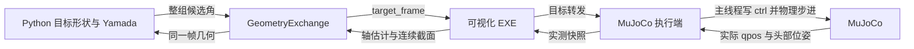

# Adaptive Pole / Snake Robot Gait

本仓库包含原蛇形机器人步态，以及新增的 **Yamada 关节角计算、截面顺应性目标生成、可视化反馈与 MuJoCo 转发执行闭环**。原项目介绍与作者信息保留在文末；其他步态的说明见 [README_zh.md](README_zh.md)。

2026-10-04 新增[三段顺应性协同原型与首轮报告](docs/三段顺应性协同_首轮实现与验证.md)：前/尾分别使用已知管轴执行原截面重建＋Yamada，中段参考角缓慢跟随实测角，按实际转移与持续接触门控边界迁移。独立实验入口 `validation/three_segment_experiment.py`，不改变日常或实机入口。水平搭管存档首轮约 5 秒失去支撑，**运动门槛未通过，未完成完整跨越**；报告含分段着色回放、复现命令与局限。

后续[尾部松开原因定位](docs/三段顺应性_尾部松开原因定位.md)：4 秒短程对照将主要故障定位到尾段绝对重建/接管不保形；固定相位、固定中段仍张开，只固定尾段 ctrl 则保住短程支撑。该轮只定位，未修改控制器。

最新[保形修复与继续验证](docs/三段顺应性_保形修复与继续验证.md)：新增 `three_segment_incremental.py`，以实测空间形状推进 rolling，并施加 A–D/Yamada 的顺应前后差量。实验入口 `validation/three_segment_repair.py` 已通过 4 秒固定相位支撑门槛；12.8 秒 rolling 尾部保持接触，但前部后续脱管，**仍未完成跨越**。旧绝对重建入口保留作对照。

## 目录与职责

```text
codes/
  Adaptive_Pole_Climbing_Mujoco.py  仿真入口：标准螺旋 Yamada、滚动相位与 MuJoCo 调度
  Adaptive_Pole_Climbing_Real.py    实机入口：手动逐节缠绕 → Ctrl+U → 单步顺应性，目标经 EXE 下发舵机
  pole_compliance.py           实测截面 → 目标形状 → 曲率/挠率 → Yamada 目标角
  curved_axis_compliance.py    弯曲轴顺应性（论文扩展）：局部轴、局部截面、螺距角调制；不修改上一行
  Adaptive_Pole_Climbing_CurvedAxis_Mujoco.py  弯曲轴顺应性的 MuJoCo 入口（键位、场景与原入口相同）
  mujoco_visualizer_bridge.py  实测角、头部世界位姿、当前 ctrl 的快照上传
  mujoco_execution_bridge.py   接收 EXE 返回目标，由仿真主线程写入 ctrl
  geometry_debug_view.py       独立进程显示实际收到的曲线/段参数
  adaptive_debug.py            MuJoCo 窗口快捷键、实机全局热键及状态读数
visualizer/
  python_client.py             TCP 客户端、几何反馈与最新目标交换
  windows_app/                 Windows 可视化、几何重建、目标校验与转发源码
  README.md                   可视化构建与模块说明
validation/
  adaptive_pole_stage*.py      各阶段数值/通信/执行验证
  geometry_debug_smoke.py      调试窗口、表格模式及关闭行为验证
  real_flow_mujoco.py          实机版按键流程验证（EXE + MuJoCo 执行端代替舵机）
  baseline_experiment.py       基线实验：两种步态 × 16 个实物参数管道场景 × 5 次，结果在 experiments/
  curved_axis_unit.py          弯曲轴顺应性离线检查（直管退化为原方法、合成弯管形状重建）
  curved_axis_experiment.py    弯曲轴顺应性与基线的对比实验（同场景、同种子）
  fixtures/                   固定反馈、初始显示配置、28 关节模型
  results/                    本地生成的日志和轨迹，不纳入 Git
tools/
  build_variable_pipe_scene.py 生成连续变径管道、初始姿态，并设置本场景 kp 与摩擦
  build_twin_pipe_scene.py     生成论文实验 2 的单管 → 双管场景（复用上面的姿态与参数）
  build_inner_pipe_scene.py    生成论文实验 3 的管内圆管 → 矩形管道场景
  build_tree_scene.py          生成树干近似场景：不规则截面、局部鼓包和收窄
  build_real_pipe_scene.py     按实物参数生成 26 关节机器人与 UPVC 变径管（110 ↔ 160 mm）
  build_pipe_network_scenes.py 同一实物机器人的弯管、组合变径弯管、法兰、偏心异径、三通、倾斜、低摩擦带场景
  matlab/                      蛇形曲线参数可视化（Serpentine_Curve_Params.m）
docs/                         Adaptive Pole 说明、阶段三/四记录、变径实验指南、弯曲轴顺应性方法说明
experiments/                  实验数据与实验说明（基线：baseline_20260930/）
mujoco_model/                 原模型、网格与新增 Variable_Pipe / Twin_Pipe / Inner_Pipe / Tree / o26_Real_Pipe / o26_Pipe_* 场景
交接记录.md                    各轮调试结论、数据位置与待办；接手前先读
```

后续可视化源码统一维护在本仓库 `visualizer/`。原 `Paper Code/two_joint_visualizer` 目录保留为迁移前副本；旧发布目录继续可用。新克隆不再依赖该外部源码目录或特定盘符。

## 数据如何流动



控制器与 MuJoCo 执行端可以在同一个 Python 进程中；两条后台 TCP 连接承担不同职责。主仿真线程读取反馈快照、计算整组目标，并在物理步进前应用已收到的 EXE 目标。网络线程不操作 MuJoCo 数据。最新帧替换旧缓存，不排队执行过时轨迹。

标准螺旋和顺应性目标都通过 Yamada 生成关节角。顺应性模块负责改变目标形状，启动后有效反馈进入它的计算；不再由另一个直接步态写入口覆盖结果。当前 `COMPLIANCE_GAIN` 是几何变形参数，没有接入扭矩阈值触发器或力反馈控制器。

## 启动（Windows PowerShell）

### 20 / 26 关节实物参数模型

20 关节实机保留原舵机 ID 1–20、拆除尾部 21–26。档案为 `visualizer/profiles/20关节实机档案.json`，已复制到 v1.4.3 发布包的 `profiles/`。在 EXE 档案列表选择「20关节实机档案」（如果程序已打开，重启后刷新列表）。该档案继承最新 26 关节档案中前 20 个舵机的独立零位、方向、轴类型与限位，头长/连杆均 64.5 mm，COM9/115200；原 26 关节档案保留。实机入口按档案关节数运行，无需手动修改 Python 的关节数量。此档案对应这台机器的校准值，不是通用零位模板。

两个 MuJoCo 入口均支持 `--joints 20` / `--joints 26`，作用于 `real_s2l`、`real_l2s` 和全部 `pipe_*` 场景。默认仍为 26，保持已有实验命令与基线不变。旧 `pole/variable/twin/inner/tree` 属于历史模型，不随此选项改变。

```powershell
python codes/Adaptive_Pole_Climbing_Mujoco.py --scene real_s2l --joints 20
python codes/Adaptive_Pole_Climbing_CurvedAxis_Mujoco.py --scene pipe_bend90_tight --joints 20
python codes/Adaptive_Pole_Climbing_Mujoco.py --scene real_s2l --joints 26
```

新增 17 个 `Snake_Robot_o20_Real_Pipe_* / Snake_Robot_o20_Pipe_*` XML。20 关节版沿用实机参数：64.5 mm 间距、29 mm 外壳半径、每模块 136 g、kp=127、力矩上限 ±2.355 N·m；保留 K=0.01/0.02、P=220 mm、小/大管目标 R=80/105 mm。模型包含头部及 20 个关节后的连杆，共 21 个质量模块，合计 2.856 kg；这不是新整机的称重结果。摩擦和阻尼仍为原先估计值。初始姿态为 20 关节重新求解，未直接截断 26 关节关键帧。

重新生成（使用与已有基线一致的 MuJoCo 3.3.0）：

```powershell
python tools/build_real_pipe_scene.py --joints 20
python tools/build_pipe_network_scenes.py --joints 20
```

20 关节版只完成静态模型检查，尚未验证攀爬；26 关节实验结果不能视为它的结果。原 26 关节 XML 与历史实验数据保留。

已验证环境为 Windows、Python 3.9、MuJoCo 3.2.7。使用现有 `mujoco` 环境即可；新环境可按下列命令安装本功能所需的依赖。Tkinter 随 Python/Conda 安装，交互 viewer 还需要可用的图形环境。

```powershell
conda create -n snake-adaptive python=3.9 pip
conda activate snake-adaptive
python -m pip install -r requirements-adaptive.txt
.\visualizer\windows_app\build.bat
Start-Process .\visualizer\windows_app\bin\SnakeRobotVisualizer.exe
python .\codes\Adaptive_Pole_Climbing_Mujoco.py
```

构建使用 Windows 自带的 .NET Framework C# 编译器，不需要 Visual Studio。也可先启动已发布的 v1.4.3 EXE（`Paper Code/蛇形机器人可视化程序_v1.4.3/`，v1.4.2 及更早版本保留），再运行本仓库的 Python。默认本机端口为 8765，同一端口只运行一个可视化实例；模拟模式不需要选择串口或使能扭矩。

**管道实验用 `--scene` 选择场景**；不带 `--scene` 时仍打开原 Pole 场景。

**控制台命令 `force`（仅 `Adaptive_Pole_Climbing_Mujoco.py`，纯仿真探限用）**：顺应性遇到“反馈不可用：轴无效或关节离线”时默认跳过本步、保持上一次目标，并在终端打印提示。看到提示后在控制台直接输入 `force`，之后本次运行改为仍强行用当前几何计算并下发目标，可以继续用 Ctrl+U/J/H 调试，用于探测方法在反馈失效时的极限行为；再输入一次 `force` 关闭，恢复默认拒绝执行。只影响这一个仿真入口（`pole_compliance.ComplianceController.ignore_feedback_risk`），不改变默认行为，不改 `curved_axis_compliance.py`（它不检查这个字段，不存在同样问题），**实机入口 `Adaptive_Pole_Climbing_Real.py` 未改动、不支持该命令**。

| 场景 | 命令 | 说明 |
| --- | --- | --- |
| 连续变径 | `--scene variable` | 竖直管外攀爬，外径 180 → 230 mm（z 0.70–1.30 m 过渡），高 1.8 m |
| 单管 → 双管 | `--scene twin` | 论文实验 2（Fig. 14）×0.9：下段外径 180 mm；z 0.70–1.00 m 过渡；上段为外径 90/135 mm 的两根分离圆管 |
| 单管 → 双管（原尺寸） | `--scene twin_full` | 论文实验 2 原尺寸：下段外径 200 mm，上段 100/150 mm 两管，圆心各距原轴 77.5 mm |
| 管内圆 → 矩形 | `--scene inner` | 论文实验 3（Fig. 15）×0.8：内径 272 mm 圆管，z 0.95–1.35 m 过渡到 280×400 mm 矩形管道，高 2.2 m；管壁仿 `Pipe_Crawling` 由 18 根半透明圆棒围成 |
| 管内圆 → 矩形（原尺寸） | `--scene inner_full` | 论文实验 3 原尺寸：内径 340 mm → 350×500 mm |
| 不规则树干 | `--scene tree` | 高 2 m；下段外径 180 mm，z=0.75 m 后转为不规则椭圆，z≈1.25 m 局部鼓包，至 z=1.75 m 收窄；仅完成场景搭建，未做攀爬测试 |
| 实物：小管 → 大管（实验室布置） | `--scene real_s2l` | **26 关节实物参数**；UPVC 外径 110 mm，z=0.95 m 起经 16.6 mm 锥面（斜边 30 mm）变为 160 mm，高 1.9 m |
| 实物：大管 → 小管 | `--scene real_l2s` | 同上，大管在下、小管在上（备用） |

实物场景（`python tools/build_real_pipe_scene.py` 重新生成）按实机测量搭建：26 关节，头长与连杆均 64.5 mm，外壳半径 29 mm（原网格按比例缩放），每节（含头部，头部模块也带舵机）136 g，整机 3.67 kg；位置伺服 kp=127 N·m/rad（悬臂实测），力矩上限 ±2.355 N·m（手册堵转 7.85 N·m × EXE 转矩限制 300/1000），关节阻尼 1.5（保持原模型阻尼比）；摩擦未实测，沿用管外场景。螺距 220 mm；初始姿态与 Ctrl+U 预设挠率相同、半径取不穿透管面的最小值（小管在下 R=96、P=361 mm），Ctrl+U 时只收紧不反拧；Ctrl+U 预设比贴管中心线紧 4 mm（80 / 105 mm）。XML 自带顺应性增益 `experiment_compliance_gain=0.01/0.02`（优先于 `COMPLIANCE_GAIN`）：舵机比原模型硬约 6 倍，沿用 0.04/0.12 会一直顶在力矩上限。

**包胶管道更新（2026-10-03）：** 实验室管外已包一层防滑橡胶，用户报告当前爬行未出现打滑。`real_s2l`、`real_l2s` 和 `pipe_*` 的20/26关节模型统一标记为哑光橡胶表面 `pipe_rubber`。接触仍使用原来的滑动/扭转/滚动摩擦 `2 / 0.005 / 0.002`（后两项单位 m），通过生成器 `PIPE_SLIDING_FRICTION` 集中设置；这些是未实测的暂定参数，本次没有提高摩擦或声称已实现无滑移。材质外观与接触参数分开设置，见 [MuJoCo 接触参数说明](https://mujoco.readthedocs.io/en/stable/modeling.html#contact-parameters)。用户估计单层厚度1–2 mm，仿真取中值1.5 mm（RUBBER_THICKNESS_M），包胶外径为113/163 mm，估计范围为112–114/162–164 mm。采用均匀径向增厚近似，不模拟橡胶压缩、接缝和圆台法向厚度；三通支管由75增至78 mm，法兰相对凸起高度保持原值。34个模型的初始姿态重新求解，Ctrl+U默认中心线半径更新为81.5/106.5 mm，P=220 mm；此前80/105 mm及旧初始姿态属于包胶前配置。场景表中的110/160/75 mm为裸管标称尺寸。`pipe_slip_band` 的蓝色低摩擦区仍为0.3，用作独立扰动实验；管内、树干及旧演示场景不变。历史实验数据保留原条件，本轮未重新验证攀爬或校准摩擦。

**新增实验室急弯场景（2026-10-03）：** 原 bend90/bend90_tight 是圆弧对照，新增直角 L、水平/竖直 T、U 型、大小直管及横向变径，共14类、20/26关节各一套。完整参数表与工况定义见 [实验室急弯与T型场景](docs/实验室急弯与T型场景.md)。新增场景只完成静态验证，尚未做攀爬测试。

**管道网络场景**（`python tools/build_pipe_network_scenes.py [名称…]` 生成，`--scene pipe_<名称>` 加载）：机器人与 `real_s2l` 相同（26 关节实物参数、K=0.01/0.02），下表原有网络场景从裸外径 110 mm 的竖直起始段开始，预缠在 z≈0.5 m；所有特征都在 z≥0.95 m，下表原有弯曲都在 x-z 平面内；新增水平/竖直场景的朝向见上述专门说明。Ctrl+K 的 `RADIUS` 行对这些场景按 XML 中的管中心线（`pipe_centerline`）计算关节到管轴距离、同位置管半径，并给出「沿管进度」（m，从地面起沿中心线计）；弯管上请看沿管进度而不是关节平均高度。

运行时请直接使用下表完整的 `pipe_*` 参数，例如 `--scene pipe_bend90`；`--scene bend90` 不被两个入口接受。场景生成脚本使用不带前缀的名称，例如在仓库根目录运行 `python tools/build_pipe_network_scenes.py bend90 --joints 20`。生成名称与启动参数请勿混用。网络场景默认 26 关节，20 关节实机对应模型需显式加 `--joints 20`。

| `--scene` 参数（原方法与弯曲轴入口通用） | 管道 | 研究用途 |
| --- | --- | --- |
| `pipe_bend90` / `pipe_bend90_tight` / `pipe_bend45` | 90° 弯头（弯曲半径 300 mm / 165 mm=1.5D）、45° 弯头 | 管轴弯曲时轴估计与螺旋跟随；弯曲半径对通过性的影响 |
| `pipe_elbow90_up_horizontal` / `pipe_elbow90_horizontal` | 轴线直接折转90°的 L：竖直上行→水平 / 水平→水平 | 实验室急弯，非圆弧 |
| `pipe_elbow90_horizontal_up` / `pipe_elbow90_horizontal_down` | 水平→竖直向上 / 向下的直角 L | 重力方向与重新缠绕 |
| `pipe_tee_horizontal` | 水平 T，从横杆转入支管 | 水平转管 |
| `pipe_tee_vertical_up` / `pipe_tee_vertical_down` / `pipe_tee_vertical_stem` | 竖直 T：水平转上 / 转下 / 从下方立管转横杆 | 支撑转移，预先指定目标支路 |
| `pipe_u_horizontal` / `pipe_u_horizontal_tight` / `pipe_u_vertical` | 180° U：水平R300 / 水平R165 / 竖直R300 mm | 持续弯曲轴 |
| `pipe_straight_small` / `pipe_straight_large` / `pipe_taper_horizontal` | 包胶113/163 mm直管、水平113→163 mm变径 | 螺距策略对照及横向实机工况 |
| `pipe_offset` | 两个反向 45° 弯头组成的 S 形错位，出口仍竖直 | 连续反向曲率 |
| `pipe_taper_bend` / `pipe_bend_taper` | 先异径（110→160）再 45° 弯 / 先 45° 弯再异径 | 组合特征的顺序影响 |
| `pipe_flange10` / `pipe_flange25` / `pipe_flange40` / `pipe_flange55` | 单个法兰，凸起 10 / 25 / 40 / 55 mm（DN100 PVC 法兰约 55 mm），厚 22 mm | 非连续截面；可越过的凸起高度上限 |
| `pipe_flange_pair` | 两个带 8×M16 螺栓头的法兰（凸起 55 mm），间距 300 mm | 真实法兰接头与短间距连续障碍 |
| `pipe_eccentric` | 偏心异径：−x 侧母线平齐，另一侧单边突变 50 mm | 非对称截面变化（顺应性只在一侧需要放松） |
| `pipe_tee` | 三通：外径 75 mm、伸出 250 mm 的侧向支管 | 侧向分支障碍 |
| `pipe_incline30` | 偏离竖直 30° 的直管 | 重力方向与管轴不一致时的夹紧余量 |
| `pipe_slip_band` | z 0.95–1.25 m 一段滑动摩擦 0.3（其余 2，蓝色显示） | 局部低摩擦（潮湿 / 油污）下顺应性与标准螺旋的打滑差异 |

你若已在 `codes` 目录，可直接运行：

```powershell
python Adaptive_Pole_Climbing_CurvedAxis_Mujoco.py --scene pipe_bend90 --joints 20
python Adaptive_Pole_Climbing_CurvedAxis_Mujoco.py --scene pipe_bend90_tight --joints 20
python Adaptive_Pole_Climbing_CurvedAxis_Mujoco.py --scene pipe_bend45 --joints 20
```

从仓库根目录运行时，在脚本名前加 `codes/`；使用原方法时，将脚本名替换为 `Adaptive_Pole_Climbing_Mujoco.py`，场景参数相同。26 关节模型使用 `--joints 26`。

攀爬结果见上面的基线实验。

树干场景受论文实验 4 启发，尺寸是人为设定，并非论文树木的精确复刻。主轴保持竖直，截面为椭圆叠加小幅三瓣起伏，不包含树枝、分叉或树皮沟槽；统一沿用管外摩擦与 kp。它使用分段凸网格保留鼓包后的收窄，避免整个树干被一个碰撞凸包填平。初始 R=130、P=180 mm，Ctrl+U 预设 R=110、P=180 mm，XML 标记自动选择管外模式。Ctrl+K 可统计树干接触，但不输出圆管专用的同高度管半径。重新生成：`python tools/build_tree_scene.py`。

管道场景共用：20 关节机器人从下段预缠绕姿态开始（R=130 mm、P=180 mm；原尺寸场景为 140 mm），Ctrl+U 默认应用 R=110 mm（原尺寸场景 120 mm）；位置伺服 kp=20（原 Pole 场景为 4），扭转/滚动摩擦按橡胶-管面量级取 0.005/0.002 m。管内场景从贴近管壁的螺旋开始（与管壁留约 2 mm 间隙），Ctrl+U 预设比管壁大（×0.8：R=125、P=243；原尺寸：R=160、P=311，P 按论文 α=0.30 rad 算出），靠向外撑开夹紧；仿真场景 XML 都带 `experiment_inside` 标记（管内 1、管外 0），优先于 `COMPLIANCE_INSIDE`；实机没有该标记，由 `COMPLIANCE_INSIDE` 手动选择。详细步骤见[变径实验与调试指南](docs/Adaptive_Pole_Climbing_变径实验.md)。

```powershell
python .\codes\Adaptive_Pole_Climbing_Mujoco.py --scene variable
python .\codes\Adaptive_Pole_Climbing_Mujoco.py --scene twin
python .\codes\Adaptive_Pole_Climbing_Mujoco.py --scene twin_full
python .\codes\Adaptive_Pole_Climbing_Mujoco.py --scene inner
python .\codes\Adaptive_Pole_Climbing_Mujoco.py --scene inner_full
python .\codes\Adaptive_Pole_Climbing_Mujoco.py --scene tree
python .\codes\Adaptive_Pole_Climbing_Mujoco.py --scene real_s2l
python .\codes\Adaptive_Pole_Climbing_Mujoco.py --scene real_l2s
```

程序启动后保持暂停。**先点击 MuJoCo 窗口**，按 Ctrl+U 应用初始目标，再按 Ctrl+H 或 Ctrl+J 滚动一步。**管外场景（variable / twin，P>0）中 Ctrl+H 向上爬、Ctrl+J 向下；管内场景（inner）相反，Ctrl+J 向上**；螺距符号取反时方向随之反转。按下时生效，忽略长按自动重复；终端、EXE 和调试表格中的按键不会触发运动。加 Ctrl 是为避开 MuJoCo 内置的单字母显示快捷键。

| 操作 | 含义 |
| --- | --- |
| Ctrl+U / 控制台 `apply` | 应用 R/P，沿用当前滚动相位，重新初始化顺应性 |
| Ctrl+J / `step`；Ctrl+H / `back` | 相位 + / − 一步（管外场景为下行 / 上行，管内场景为上行 / 下行） |
| Ctrl+N / `hold` | 保持当前目标角，再推进一段物理时间，相位不变 |
| 空格 / `pause` | 中断动作并暂停；通信和窗口继续刷新 |
| Ctrl+R / `reset` | 恢复初始姿态、清零物理时间并暂停 |
| Ctrl+G / `run` | 连续运行 / 暂停 |
| Ctrl+E / `compliance` | 切换顺应性，下一次滚动生效 |
| Ctrl+K / `status` | 打印相位、反馈、高度、管道接触数、跟踪误差；`RADIUS` 行给出实测截面半径、当前目标截面半径，以及仿真专用的关节到管轴距离、同高度管半径 |
| Ctrl+上 / 下；Ctrl+右 / 左 | R ±5 mm；P ±10 mm，之后 Ctrl+U 应用 |
| Ctrl+- / Ctrl+= | 相位步长减半 / 加倍，快捷键范围 0.01–0.6 rad |
| 控制台 `r=130 p=180` / `delta=0.05` | 修改几何 / 相位步长；几何修改需重新应用 |
| 控制台 `gravity=0` / `gravity=1` | 关闭 / 恢复场景重力；默认开启 |
| 控制台 `help` | 查看操作提示 |

每一步提交一次整组目标，经 EXE 返回后执行 N×10 个物理步；当前 20 关节模型是 0.2 秒模拟时间。等待时物理时间和相位不变，但通信持续刷新。运动中重复运动操作不排队，空格可提前中断。`hold` 用于观察是否继续接近目标、是否滑落，不能保证机器人空间位置不动。

R 是机器人中心线的螺旋半径，P 是每圈轴向位移，均用 mm；R 不是管道表面半径。原 Pole 默认 R=110、P=180；管道场景初始姿态为 130/180，Ctrl+U 默认应用 XML 预设 110/180。顺应性启用时，Ctrl+H/J 使用实测反馈构造局部形状；R/P 用于显式初始化及设计螺距角，不逐帧覆盖顺应性目标。反向一步不是倒放物理状态。

首次取得有效截面前，以标准螺旋推进；顺应性首次接管后，反馈无效则本步不执行。顺应性目标个别关节超出关节范围时，只把该关节裁剪到极限，整步照常执行（整步停住会失去夹紧）。Ctrl+R 是实验重置，保留 R/P、步长、顺应性及重力选项，之后需 Ctrl+U。日常关节目标仍全部经 EXE 转发。旧 a/v、omega、time_step 已退出运行参数。

**当前边界：** 默认顺应性增益 K 首尾 0.04、中部 0.12，目标按关节范围限幅。重力下连续 Ctrl+H 300 步：变径场景（`--scene variable`）从 0.47 m 爬到管顶 1.80 m；论文实验 2 的等比缩小场景（`--scene twin`，单管 → 双管）爬到 1.65 m，已进入双管段约 0.65 m；原尺寸场景（`--scene twin_full`）爬到 1.55 m 且仍在上升，标准螺旋停在约 1.34 m。仿真不模拟舵机过载，但标准螺旋有 23–28% 的时间顶在力矩上限，顺应性只有 4–5%。管内场景（`--scene inner`，Ctrl+J 上爬）420 步：顺应性 0.45→1.40 m（最高 1.42 m），穿过过渡段进入矩形段，与标准螺旋相当（最高 1.42 m）；原尺寸场景顺应性 0.43→1.01 m 仍在上升。初始缠绕半径须贴近管壁，否则 Ctrl+U 时尾部下坠、轴估计偏斜，详见[交接记录](交接记录.md)。各场景均用 kp=20、扭转/滚动摩擦 0.005/0.002 m。原 Pole 场景 kp=4 过软，顺应性模式会下滑。

**基线实验（2026-10-01）：** 现有两种步态在 16 个实物参数管道场景上各做 5 次（`validation/baseline_experiment.py`），数据与[实验说明](experiments/baseline_20260930/实验说明.md)在 `experiments/baseline_20260930/`。顺应性 56/80 成功、顶到力矩上限 43% 的时间；标准螺旋 18/80、72%。顺应性在高法兰（≥40 mm）、三通、短弯头处因轴估计失效而停滞；标准螺旋碰到截面变化即跌落。

**弯曲轴顺应性（论文扩展，2026-10-01）：** 论文第 V 节把“把螺旋轴从直线扩展为曲线”列为未来工作。新方法放在独立文件中，不修改原顺应性代码与可视化程序：`codes/curved_axis_compliance.py`（局部轴、局部截面、螺距角调制）、入口 `codes/Adaptive_Pole_Climbing_CurvedAxis_Mujoco.py`（键位与场景同原入口，例如 `--scene pipe_bend90_tight`）。与基线同条件对比：60/80 成功（原方法 56/80），短弯头和先弯后变径由 3/5 提高到 5/5，0 次跌落；负载比原方法高约 3 个百分点。原理与推导见 [弯曲轴顺应性方法说明](docs/弯曲轴顺应性_方法说明.md)，数据见 `experiments/curved_axis_20261001/`。

## 实机版（`Adaptive_Pole_Climbing_Real.py`）

现场实验现象、读数与待验证问题统一追加到[实机调试实验日志](docs/实机调试实验日志.md)；软件实现和提交进度见[交接记录](交接记录.md)。

实机版不依赖 MuJoCo，关节数和连杆长度取自 EXE 反馈；目标以 `live` 方式交给 EXE，由 EXE 这一唯一串口所有者整组写入舵机。**启动后不下发任何目标**，也不会自动生成螺旋：

1. 启动 EXE，选择实机模式并连接串口；在 EXE 界面**手动解锁并使能扭矩**（Python 无法使能扭矩，急停也用 EXE 的紧急释放）。
2. 设置 `codes/Adaptive_Pole_Climbing_Real.py` 顶部的 `COMPLIANCE_INSIDE`（管外 False、管内 True；实机没有场景标记），运行 `python .\codes\Adaptive_Pole_Climbing_Real.py`。默认 R=105、P=220 mm 对应大管（外径 160 mm）；小管（外径 110 mm）先输入 `r=80`。
3. **缠绕阶段**：Ctrl+J 从头部开始一节一节缠成目标螺旋（R/P），Ctrl+H 退回。每次推进 `WIND_STEP_JOINTS=0.25` 节（一节分四次到位），Ctrl+-/= 减半/加倍；以第一次 Ctrl+J 时的实测姿态为起点，未缠到的关节保持不动。
4. 位置合适后按 **Ctrl+U**：以当前姿态为起点进入单步滚动，本操作不下发目标；默认开顺应性，Ctrl+E 可切换为标准 Yamada。
5. **滚动阶段**：Ctrl+J / Ctrl+H 相位 + / − 一步，与仿真相同（管外、P>0 时 Ctrl+H 上爬）。Ctrl+R 回到缠绕阶段而不移动机器人；Ctrl+N 重发当前目标；Ctrl+K 状态；空格中断等待。

**缠满后调整半径，不要 Ctrl+R：** Ctrl+↑ / ↓ 将 R 增加 / 减少 **1 mm**（`RADIUS_STEP_MM`），Ctrl+→ / ← 将 P 增加 / 减少 10 mm；已开始缠绕时立即下发当前进度下的新目标，缠满后保持所有关节的已缠绕状态。可在控制台输入 `r=104` 设置指定半径。标准螺旋滚动中也可直接调整，保持当前滚动相位；顺应性滚动中须先 Ctrl+E 关闭顺应性。每次只下发一组目标，超出 30° 单步上限或未成功提交时原 R/P 保留，不自动拆成连续动作。R 增大一般使目标更松，R 减小使目标更紧，实际贴合取决于管壁约束。

Ctrl+R 仅用于重新开始缠绕：清零进度、相位及计步，清除旧目标参考；下一次从当前实测角开始，而不是恢复旧螺旋。重复 Ctrl+U 仍不下发角度，但不再清零已有滚动相位。离线回归：`python validation/real_geometry_controls.py`，不访问串口。

热键为系统全局热键，**在任何窗口按下都会响应**，键位与 MuJoCo 窗口一致；控制台命令同样可用（`step`、`back`、`apply`、`hold`、`compliance`、`status`、`reset`、`r=105 p=220`、`delta=0.05`、`wind=0.25`、`quit`）。实机版只支持单步，没有连续运行、重力和仿真读数。

**舵机状态（需 EXE v1.4.2）：** 实机模式下 EXE 每 5 个读取周期改读一次状态块（地址 56–70），在关节表格显示负载（最大输出的百分比，只作相对比较，不能换算成 N·m）和温度，并在几何反馈中给出 `telemetry`。实机版每步完成时打印最大/平均负载、最高温度和最低电压，Ctrl+K 同样显示；运行期间每秒把实测角、目标角、负载、温度、电流、电压写入 `validation/results/real-robot/real_时间.csv`（不入库，`TELEMETRY_LOG=False` 关闭）。若舵机不支持连续读状态块，EXE 在连续 3 次失败后停用该读取，位置反馈不受影响。

**三维视图「轴竖直」：** 实机只有关节角，三维图以头部为原点，滚动时画面绕头部转。勾选 EXE 工具栏「轴竖直」后，按 rolling 轴与二维投影基重画：Z 为 rolling 轴，X/Y 与二维投影相同。只影响显示，轴无效时退回原坐标。

| 配置 | 默认值 | 含义 |
| --- | --- | --- |
| `WIND_STEP_JOINTS` | `0.25` | 缠绕阶段每步推进的关节数 |
| `MAX_JOINT_STEP_DEG` | `30` | 任一关节单步目标变化上限，超过则拒绝本步 |
| `RADIUS_STEP_MM` | `1.0` | 实机 Ctrl+↑/↓ 的半径微调量；MuJoCo 热键仍为 5 mm |
| `STEP_SETTLE_S` | `1.0` | EXE 确认下发后等待舵机运动的时间，之后报告跟踪误差 |
| `COMPLIANCE_INSIDE` | `False` | 手动选择管内 / 管外 |
| `COMPLIANCE_GAIN` | `(0.01, 0.02)` | 按实物刚度仿真得到；实机尚未验证 |
| `HELIX_RADIUS_MM` / `HELIX_PITCH_MM` | `105` / `220` | 缠绕目标，按大管 |
| `TELEMETRY_LOG` / `LOG_PERIOD_S` | `True` / `1.0` | 本地 CSV 遥测记录 |

无硬件时可用 `--execution mujoco` 让 MuJoCo 执行端代替舵机检查流程（见 `validation/real_flow_mujoco.py`），`--execution preview` 只在 EXE 中预览，`--no-hotkeys` 只用控制台。该验证只覆盖按键流程与目标生成，**不代表实机已验证**。

## MuJoCo搭管状态保存

原 `Adaptive_Pole_Climbing_Mujoco.py` 入口支持 **Ctrl+B** 或终端 `save`：在一步完成后保存物理状态、控制相位、顺应参数和force设置，并保持暂停。存档路径会打印在终端，默认位于 `validation/results/manual-captures/`。

恢复：`python codes/Adaptive_Pole_Climbing_Mujoco.py --restore "保存目录"`，使用保存时相同的MuJoCo版本；恢复后等待新鲜反馈，直接单步，不必Ctrl+U/R。详见[搭管状态保存与分段对照](docs/搭管状态保存与分段对照.md)。

## 搭管后动态分段实验

独立批处理入口：`validation/segmented_pole_experiment.py`。使用归档的20关节搭管状态，比较原自动单轴、真实单轴及动态双轴顺应控制；原交互入口不变。

首轮水平开发与竖直冻结复核均未通过完整运动门槛。实现、使用方法、局限及回放见 [阶段报告](docs/搭管后动态分段顺应性_首轮验证.md) 和 [数据索引](experiments/segmented_pole_20261004/README.md)。

进一步的[搭管段牵引与固定相位诊断](docs/搭管段牵引与固定相位诊断.md)区分了目标重构、rolling和边界迁移的影响：前部存在转动及滑动，固定边界仍缺少持续轴向推进；尚未修复跨越控制。

后续[保形接管原型](docs/搭管后保形接管_实现与验证.md)已实现完整三维弯曲场的Yamada映射及独立局部增量试验：固定相位保持通过，8步rolling前后均推进，但3秒保持头部回退仍超10 mm。原入口未替换，边界迁移未开放。

[交替rolling对照](docs/搭管后交替rolling_对照验证.md)已比较等时、等累计相位的同步/前部先行/后部先行三组：交替推进略多，但三组保持均超限，未放行16循环扩展。头部回退包含前段整体转动，暂停相位不等于锚定。

后续[持续rolling对照](docs/搭管后持续rolling_对照验证.md)单独验证“不停下来是否仍能推进”：三组均完成32循环、12.8秒，前部推进约150–162 mm且未触地，接触开始向更靠后的模块转移。新增`--continuous`，保留旧停止保持失败结论；仍为固定边界三维增量原型，尚未完成完整跨越或边界迁移。

[边界迁移长程对照](docs/搭管后边界迁移_长程对照验证.md)现已完成六组固定/迁移实验：迁移实际达到8–9节，但六组均在约17.5–19.3秒失去前部目标管接触，未完成完整跨越。最多8/21模块进入目标区域；部分后续接触了另一支管，不能以未触地判定成功。新增独立迁移原型、长程入口和失败回放；下一步需改进目标管包绕维持与连接区形状控制。

[搭管段螺旋形状维持](docs/搭管段螺旋形状维持_固定边界对照.md)已做四组固定边界对照：加入软螺旋形状反馈后，组合组25.6秒仍保持约半圈角度覆盖及前部接触，净推进202 mm；但后续身体转移与停止保持未通过。仅分离轴转弯项没有改善，尚无精确连接曲线约束；未恢复迁移或替换日常入口。

## 常用开关

仿真版在 `codes/Adaptive_Pole_Climbing_Mujoco.py` 顶部修改（实机版见上一节）：

| 配置 | 默认值 | 含义 |
| --- | --- | --- |
| `CONTROL_VIA_VISUALIZER` | `True` | 目标经 EXE 转发才执行 |
| `COMPLIANCE_ENABLED` | `True` | 使用有效实测截面生成顺应性目标 |
| `COMPLIANCE_GAIN` | `(0.04, 0.12)` | K_i：标量、按关节排序的列表，或（首尾各 4 个关节, 中部）；论文式 (34) 为 0.04/0.08，本模型中部需 0.12 |
| `SINGLE_STEP_MODE` | `True` | 默认等待按键；False 为连续运行 |
| `HELIX_RADIUS_MM` | `110.0` | 原场景初始 R；管道场景取 XML 预设 |
| `HELIX_PITCH_MM` | `180.0` | 初始每圈螺距 P |
| `ROLL_STEP_RAD` | `0.15` | 每一步滚动相位增量 |
| `COMPLIANCE_INSIDE` | `False` | 实机手动选择：False 管外，True 管内。仿真场景 XML 的 `experiment_inside` 标记优先 |
| `DEBUG` | `True` | 显示实际收到的曲线反馈 |
| `DEBUG_DRAW_CURVE` | `True` | False 时仅显示各段参数表 |

`DEBUG=False` 不创建调试进程；`DEBUG_DRAW_CURVE=False` 保留段号、关节、半径、圆心角和段长表。调试窗口只观察反馈，不参与控制。

环境变量 `SNAKE_HELIX_RADIUS_MM` / `SNAKE_HELIX_PITCH_MM` 设置启动几何；`SNAKE_SINGLE_STEP=0` 显式启用连续回归运行（默认 1）；`SNAKE_VISUALIZER_PORT` 设置两端端口；`SNAKE_MUJOCO_MODEL` 指定模型；`SNAKE_MUJOCO_HEADLESS=1` 关闭 MuJoCo viewer/键盘交互（DEBUG 仍是独立开关）；`SNAKE_MUJOCO_MAX_SECONDS` 限定运行时长。`SNAKE_CONTROL_CLIENT_DIR` 可显式指定兼容客户端目录，默认使用本仓库 `visualizer/`。

## 单位、顺序与失效行为

- MuJoCo 使用 rad/m，TCP 关节角使用度，重建长度使用 mm，曲率与挠率使用 1/mm。桥接层统一转换奇偶关节方向，算法外部不要再次翻转。
- 一轮算法共享同一份目标曲线和滚动相位。标准螺旋与顺应性曲线统一使用 `psi=∫tau ds+phase` 的有向 Frenet 挠率，并按模型实际连杆长度积分。详细公式见[阶段三说明](docs/Adaptive_Pole_Climbing_阶段三.md)。
- “计算候选目标”“EXE 接受”“EXE 转发”“写入 ctrl”是不同状态。执行确认不表示真实关节已到位。
- EXE 未启动时不旁路执行；等待回传时不推进物理时间。候选最多等待 2 秒，所用顺应性反馈超过 500 ms 则本步取消，重新按键重算。已开始的一步完成后暂停，空闲期间迟到目标不写入 ctrl。
- 过期、重复、错误运行标识、越界目标被拒绝。重新连接使用新反馈，不重放断线缓存。
- `CONTROL_VIA_VISUALIZER=False`（或 `SNAKE_CONTROL_VIA_VISUALIZER=0`）用于历史直接驱动/预览回归，不能用该模式证明完整转发通路。

## 验证与当前边界

在仓库根目录执行：

```powershell
.\visualizer\windows_app\build.bat
.\visualizer\windows_app\run-tests.bat
python .\validation\adaptive_pole_stage1.py
python .\validation\adaptive_pole_stage3.py
python .\validation\adaptive_pole_stage4.py
python .\validation\geometry_debug_smoke.py
python .\validation\adaptive_pole_single_step.py
python .\validation\variable_pipe_experiment.py
python .\validation\real_flow_mujoco.py
```

测试使用隔离端口与临时程序目录，不接触真实串口。阶段四逐项比对 EXE 回传目标与实际 `d.ctrl`，覆盖 20/28 关节、无 EXE、过期/重复/越界和断开重启。日志与轨迹写入 `validation/results/`，可视化回归日志写入 `visualizer/artifacts/`。

单步专项另核对空闲时 qpos/ctrl/物理时间/相位不变、正反步数、R/P 重新应用、顺应性首次相位增量及 EXE 回传来源，结果写入 `validation/results/adaptive-pole-single-step/`。

变径专项检查碰撞表面、接触探针、原生 viewer 快捷键、保持、重置、暂停及 EXE 返回角来源。重力下的长程爬升（连续 300 步）用于调参，脚本和数据在本地 `validation/results/kp-sweep/`、`twin-pipe/`，结论与数据说明见[交接记录](交接记录.md)。

本次及历史阶段验收状态与限制见[阶段四验收记录](visualizer/STAGE4_RESULTS.md)。短程模拟执行闭环不等同于稳定攀爬、接触力效果或实机已完成。协议见[通信与执行说明](visualizer/COMMUNICATION_V3.md)，操作细节见[阶段四说明](docs/Adaptive_Pole_Climbing_阶段四.md)。

---

## 原项目说明：Snake Robot Gait

### Introduction
Using the MuJoCo open-source physics engine to simulate various gaits of a snake-like robot.

### Features😆
Including MuJoCo model files, references, code files with Chinese annotations, gait explanations, prerequisite knowledge descriptions, as well as corrections and supplements to some papers. 👉[中文版README.md](./README_zh.md)

### Content
👉[中文版README.md](./README_zh.md)

## Contact Me😊
Email: xjxf0923@gmail.com 3332407087@qq.com

WeChat: xjxf0923
