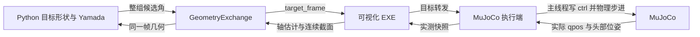

# Adaptive Pole / Snake Robot Gait

本仓库包含原蛇形机器人步态，以及新增的 **Yamada 关节角计算、截面顺应性目标生成、可视化反馈与 MuJoCo 转发执行闭环**。原项目介绍与作者信息保留在文末；其他步态的说明见 [README_zh.md](README_zh.md)。

## 目录与职责

```text
codes/
  Adaptive_Pole_Climbing.py     运行入口、标准螺旋 Yamada、滚动相位与仿真调度
  pole_compliance.py           实测截面 → 目标形状 → 曲率/挠率 → Yamada 目标角
  mujoco_visualizer_bridge.py  实测角、头部世界位姿、当前 ctrl 的快照上传
  mujoco_execution_bridge.py   接收 EXE 返回目标，由仿真主线程写入 ctrl
  geometry_debug_view.py       独立进程显示实际收到的曲线/段参数
  adaptive_debug.py            MuJoCo 窗口快捷键及状态读数
visualizer/
  python_client.py             TCP 客户端、几何反馈与最新目标交换
  windows_app/                 Windows 可视化、几何重建、目标校验与转发源码
  README.md                   可视化构建与模块说明
validation/
  adaptive_pole_stage*.py      各阶段数值/通信/执行验证
  geometry_debug_smoke.py      调试窗口、表格模式及关闭行为验证
  fixtures/                   固定反馈、初始显示配置、28 关节模型
  results/                    本地生成的日志和轨迹，不纳入 Git
tools/build_variable_pipe_scene.py  生成连续变径管道与初始姿态
mujoco_model/                 原模型、网格与新增 Variable_Pipe 场景
```

后续可视化源码统一维护在本仓库 `visualizer/`。原 `Paper Code/two_joint_visualizer` 目录保留为迁移前副本；旧发布目录继续可用。新克隆不再依赖该外部源码目录或特定盘符。

## 数据如何流动



控制器与 MuJoCo 执行端可以在同一个 Python 进程中；两条后台 TCP 连接承担不同职责。主仿真线程读取反馈快照、计算整组目标，并在物理步进前应用已收到的 EXE 目标。网络线程不操作 MuJoCo 数据。最新帧替换旧缓存，不排队执行过时轨迹。

标准螺旋和顺应性目标都通过 Yamada 生成关节角。顺应性模块负责改变目标形状，启动后有效反馈进入它的计算；不再由另一个直接步态写入口覆盖结果。当前 `COMPLIANCE_GAIN` 是几何变形参数，没有接入扭矩阈值触发器或力反馈控制器。

## 启动（Windows PowerShell）

已验证环境为 Windows、Python 3.9、MuJoCo 3.2.7。使用现有 `mujoco` 环境即可；新环境可按下列命令安装本功能所需的依赖。Tkinter 随 Python/Conda 安装，交互 viewer 还需要可用的图形环境。

```powershell
conda create -n snake-adaptive python=3.9 pip
conda activate snake-adaptive
python -m pip install -r requirements-adaptive.txt
.\visualizer\windows_app\build.bat
Start-Process .\visualizer\windows_app\bin\SnakeRobotVisualizer.exe
python .\codes\Adaptive_Pole_Climbing.py
```

构建使用 Windows 自带的 .NET Framework C# 编译器，不需要 Visual Studio。也可先启动已发布的 v1.4.1 EXE，再运行本仓库的 Python。默认本机端口为 8765，同一端口只运行一个可视化实例；模拟模式不需要选择串口或使能扭矩。

**变径实验使用下面的命令**；不带 `--scene` 时仍打开原 Pole 场景。新场景为竖直管外攀爬，管外径 180 → 230 mm，高 1.8 m；20 关节机器人从下段预缠绕姿态开始（R=130 mm、P=180 mm），Ctrl+U 默认应用 R=110 mm；本场景位置伺服 kp=20。详细步骤见[变径实验与调试指南](codes/Adaptive_Pole_Climbing_变径实验.md)。

```powershell
python .\codes\Adaptive_Pole_Climbing.py --scene variable
```

程序启动后保持暂停。**先点击 MuJoCo 窗口**，按 Ctrl+U 应用初始目标，再按 Ctrl+J 正向一步或 Ctrl+H 反向一步。按下时生效，忽略长按自动重复；终端、EXE 和调试表格中的按键不会触发运动。加 Ctrl 是为避开 MuJoCo 内置的单字母显示快捷键。

| 操作 | 含义 |
| --- | --- |
| Ctrl+U / 控制台 `apply` | 应用 R/P，沿用当前滚动相位，重新初始化顺应性 |
| Ctrl+J / `step`；Ctrl+H / `back` | 正向 / 反向一步 |
| Ctrl+N / `hold` | 保持当前目标角，再推进一段物理时间，相位不变 |
| 空格 / `pause` | 中断动作并暂停；通信和窗口继续刷新 |
| Ctrl+R / `reset` | 恢复初始姿态、清零物理时间并暂停 |
| Ctrl+G / `run` | 连续运行 / 暂停 |
| Ctrl+E / `compliance` | 切换顺应性，下一次滚动生效 |
| Ctrl+K / `status` | 打印相位、反馈、高度、管道接触数、跟踪误差 |
| Ctrl+上 / 下；Ctrl+右 / 左 | R ±5 mm；P ±10 mm，之后 Ctrl+U 应用 |
| Ctrl+- / Ctrl+= | 相位步长减半 / 加倍，快捷键范围 0.01–0.6 rad |
| 控制台 `r=130 p=180` / `delta=0.05` | 修改几何 / 相位步长；几何修改需重新应用 |
| 控制台 `gravity=0` / `gravity=1` | 关闭 / 恢复场景重力；默认开启 |
| 控制台 `help` | 查看操作提示 |

每一步提交一次整组目标，经 EXE 返回后执行 N×10 个物理步；当前 20 关节模型是 0.2 秒模拟时间。等待时物理时间和相位不变，但通信持续刷新。运动中重复运动操作不排队，空格可提前中断。`hold` 用于观察是否继续接近目标、是否滑落，不能保证机器人空间位置不动。

R 是机器人中心线的螺旋半径，P 是每圈轴向位移，均用 mm；R 不是管道表面半径。原 Pole 默认 R=110、P=180；变径场景采用 XML 中的 130/180 预设。顺应性启用时，Ctrl+H/J 使用实测反馈构造局部形状；R/P 用于显式初始化及设计螺距角，不逐帧覆盖顺应性目标。反向一步不是倒放物理状态。

首次取得有效截面前，以标准螺旋推进；顺应性首次接管后，反馈无效则本步不执行。Ctrl+R 是实验重置，保留 R/P、步长、顺应性及重力选项，之后需 Ctrl+U。日常关节目标仍全部经 EXE 转发。旧 a/v、omega、time_step 已退出运行参数。

**当前边界：** 变径场景（kp=20）重力下连续 Ctrl+H 260 步，顺应性模式从 0.47 m 爬到 1.10 m，进入变径区；标准螺旋在约 1.0 m 处脱管。尚未验证爬完变径区及上段。原 Pole 场景 kp=4 过软，顺应性模式会下滑。`gravity=0` 仅用于形状、相位和通信调试，不能证明爬升能力；重力实验应恢复 `gravity=1` 并 reset。

## 常用开关

在 `codes/Adaptive_Pole_Climbing.py` 顶部修改：

| 配置 | 默认值 | 含义 |
| --- | --- | --- |
| `CONTROL_VIA_VISUALIZER` | `True` | 目标经 EXE 转发才执行 |
| `COMPLIANCE_ENABLED` | `True` | 使用有效实测截面生成顺应性目标 |
| `COMPLIANCE_GAIN` | `0.04` | 标量或按关节排序的 K_i |
| `SINGLE_STEP_MODE` | `True` | 默认等待按键；False 为连续运行 |
| `HELIX_RADIUS_MM` | `110.0` | 原场景初始 R；变径场景取 XML 的 130 |
| `HELIX_PITCH_MM` | `180.0` | 初始每圈螺距 P |
| `ROLL_STEP_RAD` | `0.15` | 每一步滚动相位增量 |
| `COMPLIANCE_INSIDE` | `False` | 管外模式；True 为管内模式 |
| `DEBUG` | `True` | 显示实际收到的曲线反馈 |
| `DEBUG_DRAW_CURVE` | `True` | False 时仅显示各段参数表 |

`DEBUG=False` 不创建调试进程；`DEBUG_DRAW_CURVE=False` 保留段号、关节、半径、圆心角和段长表。调试窗口只观察反馈，不参与控制。

环境变量 `SNAKE_HELIX_RADIUS_MM` / `SNAKE_HELIX_PITCH_MM` 设置启动几何；`SNAKE_SINGLE_STEP=0` 显式启用连续回归运行（默认 1）；`SNAKE_VISUALIZER_PORT` 设置两端端口；`SNAKE_MUJOCO_MODEL` 指定模型；`SNAKE_MUJOCO_HEADLESS=1` 关闭 MuJoCo viewer/键盘交互（DEBUG 仍是独立开关）；`SNAKE_MUJOCO_MAX_SECONDS` 限定运行时长。`SNAKE_CONTROL_CLIENT_DIR` 可显式指定兼容客户端目录，默认使用本仓库 `visualizer/`。

## 单位、顺序与失效行为

- MuJoCo 使用 rad/m，TCP 关节角使用度，重建长度使用 mm，曲率与挠率使用 1/mm。桥接层统一转换奇偶关节方向，算法外部不要再次翻转。
- 一轮算法共享同一份目标曲线和滚动相位。标准螺旋与顺应性曲线统一使用 `psi=∫tau ds+phase` 的有向 Frenet 挠率，并按模型实际连杆长度积分。详细公式见[阶段三说明](codes/Adaptive_Pole_Climbing_阶段三.md)。
- “计算候选目标”“EXE 接受”“EXE 转发”“写入 ctrl”是不同状态。执行确认不表示真实关节已到位。
- EXE 未启动时不旁路执行；等待回传时不推进物理时间。候选最多等待 2 秒，所用顺应性反馈超过 500 ms 则本步取消，重新按键重算。已开始的一步完成后暂停，空闲期间迟到目标不写入 ctrl。
- 过期、重复、错误运行标识、越界目标被拒绝。重新连接使用新反馈，不重放断线缓存。
- `CONTROL_VIA_VISUALIZER=False`（或 `SNAKE_CONTROL_VIA_VISUALIZER=0`）用于历史直接驱动/预览回归，不能用该模式证明完整转发通路。

## 验证与当前边界

在仓库根目录执行：

```powershell
.\visualizer\windows_app\build.bat
.\visualizer\windows_app\run-tests.bat
python .\validation\adaptive_pole_stage1.py
python .\validation\adaptive_pole_stage3.py
python .\validation\adaptive_pole_stage4.py
python .\validation\geometry_debug_smoke.py
python .\validation\adaptive_pole_single_step.py
python .\validation\variable_pipe_experiment.py
```

测试使用隔离端口与临时程序目录，不接触真实串口。阶段四逐项比对 EXE 回传目标与实际 `d.ctrl`，覆盖 20/28 关节、无 EXE、过期/重复/越界和断开重启。日志与轨迹写入 `validation/results/`，可视化回归日志写入 `visualizer/artifacts/`。

单步专项另核对空闲时 qpos/ctrl/物理时间/相位不变、正反步数、R/P 重新应用、顺应性首次相位增量及 EXE 回传来源，结果写入 `validation/results/adaptive-pole-single-step/`。

变径专项检查碰撞表面、接触探针、原生 viewer 快捷键、保持、重置、暂停及 EXE 返回角来源；另记录有重力下的短程表现。

本次及历史阶段验收状态与限制见[阶段四验收记录](visualizer/STAGE4_RESULTS.md)。短程模拟执行闭环不等同于稳定攀爬、接触力效果或实机已完成。协议见[通信与执行说明](visualizer/COMMUNICATION_V3.md)，操作细节见[阶段四说明](codes/Adaptive_Pole_Climbing_阶段四.md)。

---

## 原项目说明：Snake Robot Gait

### Introduction
Using the MuJoCo open-source physics engine to simulate various gaits of a snake-like robot.

### Features😆
Including MuJoCo model files, references, code files with Chinese annotations, gait explanations, prerequisite knowledge descriptions, as well as corrections and supplements to some papers. 👉[中文版README.md](./README_zh.md)

### Content
👉[中文版README.md](./README_zh.md)

## Contact Me😊
Email: xjxf0923@gmail.com 3332407087@qq.com

WeChat: xjxf0923


做出改动

1. 热键兼容MAC
