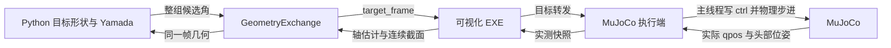

# Adaptive Pole / Snake Robot Gait

本仓库包含原蛇形机器人步态，以及新增的 **Yamada 关节角计算、截面顺应性目标生成、可视化反馈与 MuJoCo 转发执行闭环**。原项目介绍与作者信息保留在文末；其他步态的说明见 [README_zh.md](README_zh.md)。

## 目录与职责

```text
codes/
  Adaptive_Pole_Climbing.py     运行入口、标准螺旋 Yamada、滚动相位与仿真调度
  pole_compliance.py           实测截面 → 目标形状 → 曲率/挠率 → Yamada 目标角
  mujoco_visualizer_bridge.py  实测角、头部世界位姿、当前 ctrl 的快照上传
  mujoco_execution_bridge.py   接收 EXE 返回目标，由仿真主线程写入 ctrl
  geometry_debug_view.py       独立进程显示实际收到的曲线/段参数
visualizer/
  python_client.py             TCP 客户端、几何反馈与最新目标交换
  windows_app/                 Windows 可视化、几何重建、目标校验与转发源码
  README.md                   可视化构建与模块说明
validation/
  adaptive_pole_stage*.py      各阶段数值/通信/执行验证
  geometry_debug_smoke.py      调试窗口、表格模式及关闭行为验证
  fixtures/                   固定反馈、初始显示配置、28 关节模型
  results/                    本地生成的日志和轨迹，不纳入 Git
mujoco_model/                 原 MuJoCo 模型与网格资源
```

后续可视化源码统一维护在本仓库 `visualizer/`。原 `Paper Code/two_joint_visualizer` 目录保留为迁移前副本；旧发布目录继续可用。新克隆不再依赖该外部源码目录或特定盘符。

## 数据如何流动



控制器与 MuJoCo 执行端可以在同一个 Python 进程中；两条后台 TCP 连接承担不同职责。主仿真线程读取反馈快照、计算整组目标，并在物理步进前应用已收到的 EXE 目标。网络线程不操作 MuJoCo 数据。最新帧替换旧缓存，不排队执行过时轨迹。

标准螺旋和顺应性目标都通过 Yamada 生成关节角。顺应性模块负责改变目标形状，启动后有效反馈进入它的计算；不再由另一个直接步态写入口覆盖结果。当前 `COMPLIANCE_GAIN` 是几何变形参数，没有接入扭矩阈值触发器或力反馈控制器。

## 启动（Windows PowerShell）

已验证环境为 Windows、Python 3.9、MuJoCo 3.2.7。使用现有 `mujoco` 环境即可；新环境可按下列命令安装本功能所需的依赖。Tkinter 随 Python/Conda 安装，交互 viewer 还需要可用的图形环境。

```powershell
conda create -n snake-adaptive python=3.9 pip
conda activate snake-adaptive
python -m pip install -r requirements-adaptive.txt
.isualizer\windows_appuild.bat
Start-Process .isualizer\windows_appin\SnakeRobotVisualizer.exe
python .\codes\Adaptive_Pole_Climbing.py
```

构建使用 Windows 自带的 .NET Framework C# 编译器，不需要 Visual Studio。也可先启动已发布的 v1.4.1 EXE，再运行本仓库的 Python。默认本机端口为 8765，同一端口只运行一个可视化实例；模拟模式不需要选择串口或使能扭矩。

入口默认保留原 Pole 的 `a=30, v=0`，即从平面圆弧开始，不代表启动后已经抱管。箭头键调节 a/v；螺旋验证使用过 `SNAKE_MUJOCO_A=-76`、`SNAKE_MUJOCO_V=.05`，这些参数用于短程验收，不是稳定攀爬参数承诺。

## 常用开关

在 `codes/Adaptive_Pole_Climbing.py` 顶部修改：

| 配置 | 默认值 | 含义 |
| --- | --- | --- |
| `CONTROL_VIA_VISUALIZER` | `True` | 目标经 EXE 转发才执行 |
| `COMPLIANCE_ENABLED` | `True` | 使用有效实测截面生成顺应性目标 |
| `COMPLIANCE_GAIN` | `0.04` | 标量或按关节排序的 K_i |
| `COMPLIANCE_PITCH_RAD` | `0.25` | 目标螺距角 α，单位 rad |
| `COMPLIANCE_INSIDE` | `False` | 管外模式；True 为管内模式 |
| `DEBUG` | `True` | 显示实际收到的曲线反馈 |
| `DEBUG_DRAW_CURVE` | `True` | False 时仅显示各段参数表 |

`DEBUG=False` 不创建调试进程；`DEBUG_DRAW_CURVE=False` 保留段号、关节、半径、圆心角和段长表。调试窗口只观察反馈，不参与控制。

环境变量 `SNAKE_VISUALIZER_PORT` 设置两端端口；`SNAKE_MUJOCO_MODEL` 指定模型；`SNAKE_MUJOCO_HEADLESS=1` 关闭 MuJoCo viewer/键盘交互（DEBUG 仍是独立开关）；`SNAKE_MUJOCO_MAX_SECONDS` 限定运行时长。`SNAKE_CONTROL_CLIENT_DIR` 可显式指定兼容客户端目录，默认使用本仓库 `visualizer/`。

## 单位、顺序与失效行为

- MuJoCo 使用 rad/m，TCP 关节角使用度，重建长度使用 mm，曲率与挠率使用 1/mm。桥接层统一转换奇偶关节方向，算法外部不要再次翻转。
- 一轮算法共享同一份目标曲线和滚动相位。挠率在弧长方向累积；标准螺旋保留旧 Pole 符号约定，不能将其中的 τ 直接当作重建曲线的有向 Frenet 挠率。详细公式见[阶段三说明](codes/Adaptive_Pole_Climbing_阶段三.md)。
- “计算候选目标”“EXE 接受”“EXE 转发”“写入 ctrl”是不同状态。执行确认不表示真实关节已到位。
- EXE 未启动时不旁路执行，初始 ctrl 为零；断线后保持最后 ctrl 并继续物理步进，无新执行时冻结下一轮滚动相位。机器人仍受重力与接触作用。
- 过期、重复、错误运行标识、越界目标被拒绝。重新连接使用新反馈，不重放断线缓存。
- `CONTROL_VIA_VISUALIZER=False`（或 `SNAKE_CONTROL_VIA_VISUALIZER=0`）用于历史直接驱动/预览回归，不能用该模式证明完整转发通路。

## 验证与当前边界

在仓库根目录执行：

```powershell
.isualizer\windows_appuild.bat
.isualizer\windows_app
un-tests.bat
python .alidationdaptive_pole_stage1.py
python .alidationdaptive_pole_stage3.py
python .alidationdaptive_pole_stage4.py
python .alidation\geometry_debug_smoke.py
```

测试使用隔离端口与临时程序目录，不接触真实串口。阶段四逐项比对 EXE 回传目标与实际 `d.ctrl`，覆盖 20/28 关节、无 EXE、过期/重复/越界和断开重启。日志与轨迹写入 `validation/results/`，可视化回归日志写入 `visualizer/artifacts/`。

最新验收状态与限制见[阶段四验收记录](visualizer/STAGE4_RESULTS.md)。短程模拟执行闭环不等同于稳定攀爬、接触力效果或实机已完成。协议见[通信与执行说明](visualizer/COMMUNICATION_V3.md)，操作细节见[阶段四说明](codes/Adaptive_Pole_Climbing_阶段四.md)。

---

## 原项目说明：Snake Robot Gait

### Introduction
Using the MuJoCo open-source physics engine to simulate various gaits of a snake-like robot.

### Features😆
Including MuJoCo model files, references, code files with Chinese annotations, gait explanations, prerequisite knowledge descriptions, as well as corrections and supplements to some papers. 👉[中文版README.md](./README_zh.md)

### Content
👉[中文版README.md](./README_zh.md)

## Contact Me😊
Email: xjxf0923@gmail.com 3332407087@qq.com

WeChat: xjxf0923


做出改动

1. 热键兼容MAC
