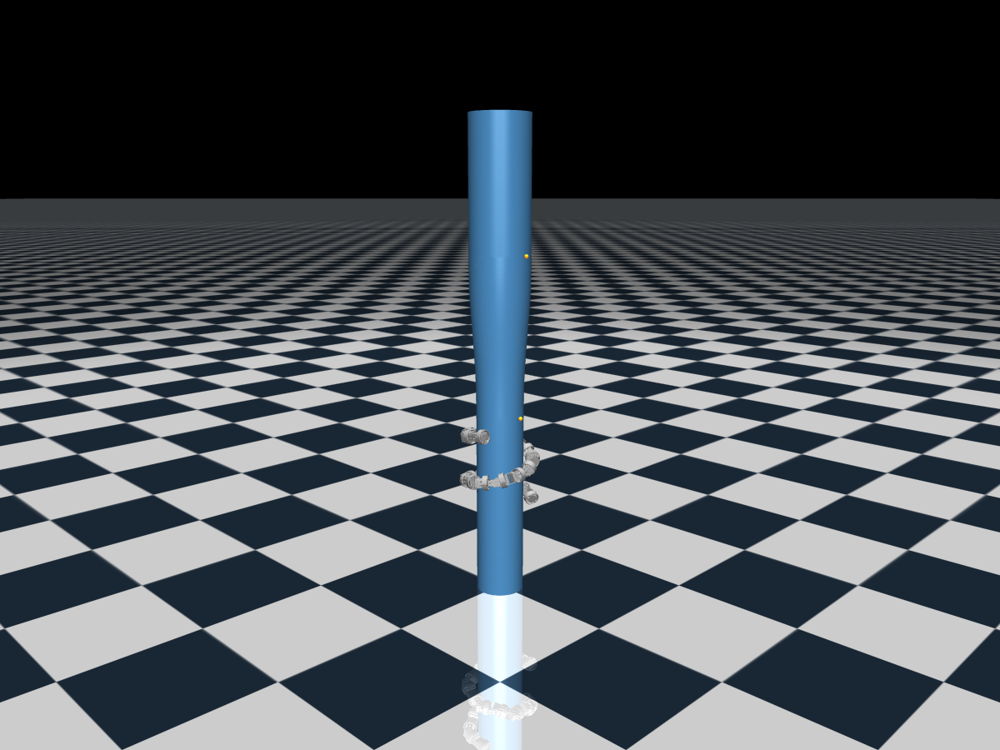

# 单管道连续变径实验与调试

## 启动与场景

先启动 v1.4.1 可视化 EXE，在 `mujoco` 环境、`codes` 目录执行：

```powershell
python Adaptive_Pole_Climbing.py --scene variable
```

无需重编可视化程序。本次新增的是 MuJoCo 场景和 Python 调试操作，EXE 仍承担几何反馈和执行转发。同一端口只启动一个 EXE。

- 竖直管外场景，下段外径 180 mm，上段外径 230 mm，总高 1.8 m。
- z=0.70–1.30 m 为变径区，两处橙色点标出边界；标记没有碰撞。
- 20 关节机器人预缠绕于下段，关节平均高度 0.50 m；初始姿态中心线螺旋 R=130 mm、P=180 mm，Ctrl+U 默认应用 R=110 mm。
- 本场景位置伺服 kp=20（原 Pole 场景仍为 4），力矩上限 ±3 N·m 不变；扭转/滚动摩擦 0.005/0.002 m（原 0.15/0.1），滑动摩擦不变。
- 默认有重力，启动时物理暂停。预缠绕是可重复的初始条件，不等于已经有足够抱紧力；初始没有穿透接触。
- 原等径场景保留，可用 `--scene pole` 打开。



设计半径为 `r(z)=90+25*(10u³-15u⁴+6u⁵)` mm，其中 `u=clip((z-0.70)/0.60,0,1)`，z 用 m。理想轮廓在过渡两端一、二阶导数为零；碰撞表面用 40 个相接凸圆台、每圈 96 边逼近，实际离散表面并非严格光滑曲面。[MuJoCo 对 mesh 使用凸包碰撞](https://mujoco.readthedocs.io/en/3.2.7/computation/#collision-detection)，分圆台可保留变径轮廓，避免整根非凸外形被一个凸包替代。

修改管径、过渡长度或初始高度时，编辑 `tools/build_variable_pipe_scene.py` 顶部常量，在仓库根目录运行 `python tools/build_variable_pipe_scene.py`。初始高度调到变径区时需重新检查碰撞，不能把相同 R 的姿态直接当作已验证配置。正常启动直接加载已生成 XML。

## 第一次调试

快捷键只对 **MuJoCo 窗口**生效，按下触发一次，长按不连发。Ctrl+字母避开内置单字母显示操作。终端命令需要回车。

1. 在终端输入 `gravity=0`，先排除下落对观察的干扰，此项立即生效。
2. 点击 MuJoCo 窗口，按 **Ctrl+U**。初始整组角经过 EXE 返回后执行一次，看到“完成第 1 步”后暂停。
3. 按 **Ctrl+J** 正向一步，phase 增加；按 **Ctrl+H** 反向一步，phase 减少。默认增量 0.15 rad；反向不是撤销物理过程。
4. 按 **Ctrl+N** 保持当前目标，给关节额外时间收敛。它不重新算顺应性目标，也不增加滚动相位。
5. 按 **Ctrl+K** 查看终端状态。等待按键期间模拟时间不增长，反馈序列仍更新属于正常行为。
6. 按 **Ctrl+R** 回到初始姿态并暂停，然后 Ctrl+U 可重新试验。

Ctrl+N 是“关节目标不变、物理继续”，空格是“物理停止”。如果受力不平衡，按 Ctrl+N 仍可能下滑。

## 操作表

| MuJoCo 窗口按键 | 控制台命令 | 作用 |
| --- | --- | --- |
| Ctrl+U | `apply` | 应用 R/P，沿用当前滚动相位、初始化顺应性 |
| Ctrl+J / Ctrl+H | `step` / `back` | 正向 / 反向一步 |
| Ctrl+N | `hold` | 当前整组目标继续执行一段物理时间 |
| 空格 | `pause` | 取消等待目标或剩余物理步，暂停 |
| Ctrl+R | `reset` | 重置位姿、速度、物理时间并暂停 |
| Ctrl+G | `run` | 连续运行 / 暂停 |
| Ctrl+E | `compliance` | 顺应性开关，下一次滚动生效 |
| Ctrl+K | `status` | 打印当前状态 |
| Ctrl+上 / 下 | `r+` / `r-` | 待应用 R ±5 mm |
| Ctrl+右 / 左 | `p+` / `p-` | 待应用 P ±10 mm |
| Ctrl+- / Ctrl+= | `delta-` / `delta+` | 相位步长减半 / 加倍，快捷键范围 0.01–0.6 rad |
| — | `r=130 p=180` | 精确设置待应用形状，再 Ctrl+U |
| — | `delta=0.05` | 设置后续每步相位增量 rad |
| — | `gravity=0` / `gravity=1` | 关闭 / 恢复场景重力，默认开启 |
| — | `help` | 操作提示 |

每次完整操作推进 N×10 个物理步；当前 20 关节模型为 0.2 秒模拟时间。减小 delta 只减小相位增量，不缩短物理时间。运行中的重复运动操作被拒绝，不堆积；空格和重置可中断动作，实际响应在下一调度周期。

Ctrl+R 保留 R/P、delta、顺应性及重力选项；恢复的是 XML 初始姿态，不会根据修改后的 R/P 自动重建初始位姿。之后需 Ctrl+U 应用。原 Pole 场景没有实验关键帧时恢复其直线初始姿态。重置是设置模拟初始条件，日常关节目标仍全部经 EXE 转发。

不要用 MuJoCo 原生 Reset、Load key 或关节/控制滑块做这组对比实验，它们不负责同步 Python 相位和控制器状态。统一用 Ctrl+R 重置。

## 状态读数与有重力实验

- `phase`：滚动相位；`delta`：下一次滚动增量；`sim`：累计物理时间。
- `顺应性=开` 表示允许算法工作；每步完成后的“顺应性”才表示该步用了反馈目标。
- `反馈=有效` 表示收到可用几何，不表示抱紧或爬升成功。
- `关节平均高度`：所有关节锚点平均 z，用于观察上移或下滑。
- `管道接触`：当前接触点数，不是接触关节数或接触力。
- `最大跟踪误差`：实际角与当前目标的最大差，不是管径误差。

做重力实验时输入 `gravity=1`，随后 Ctrl+R、Ctrl+U。先用 Ctrl+N 观察保持时的下滑与跟踪误差，再用 Ctrl+J/H 观察滚动。对比顺应性开/关时，先重置、选择 Ctrl+E 状态，再应用；保持 R/P、delta、重力相同。

**重力下的顺应性攀爬（kp=20，K 首尾 0.04、中部 0.12，目标按关节范围限幅，R=110、P=180，连续 Ctrl+H 300 步）：关节平均高度 0.466→1.799 m，穿过变径区到达管顶。** 论文式 (34) 的中部 0.08 为 1.741 m。摩擦取原值（扭转 0.15、滚动 0.1 m）时会在约 1.08 m 打滑停滞，这是仿真接触参数过大造成的。

论文实验 2（单管 → 双管）场景见 `tools/build_twin_pipe_scene.py`，启动参数 `--scene twin`，操作与本场景相同。

`DEBUG=True` 开启反馈窗口；`DEBUG_DRAW_CURVE=False` 仅显示段参数，降低绘图开销。高度、接触等状态按需打印，不逐帧刷屏。

## 验证

仓库根目录运行 `python validation/variable_pipe_experiment.py`。使用隔离端口与 EXE 副本，加载真实 MuJoCo viewer，向测试进程自己的窗口投递按键，核对长按、步长、R/P、保持、重置、暂停及 EXE 返回角来源，并单独记录重力短测。不操作真实串口。

摘要见 [variable-pipe-2026-09-27.json](../validation/reports/variable-pipe-2026-09-27.json)；原始轨迹在 `validation/results/variable-pipe/`，不纳入 Git。完整框架见[主 README](../README.md)。
