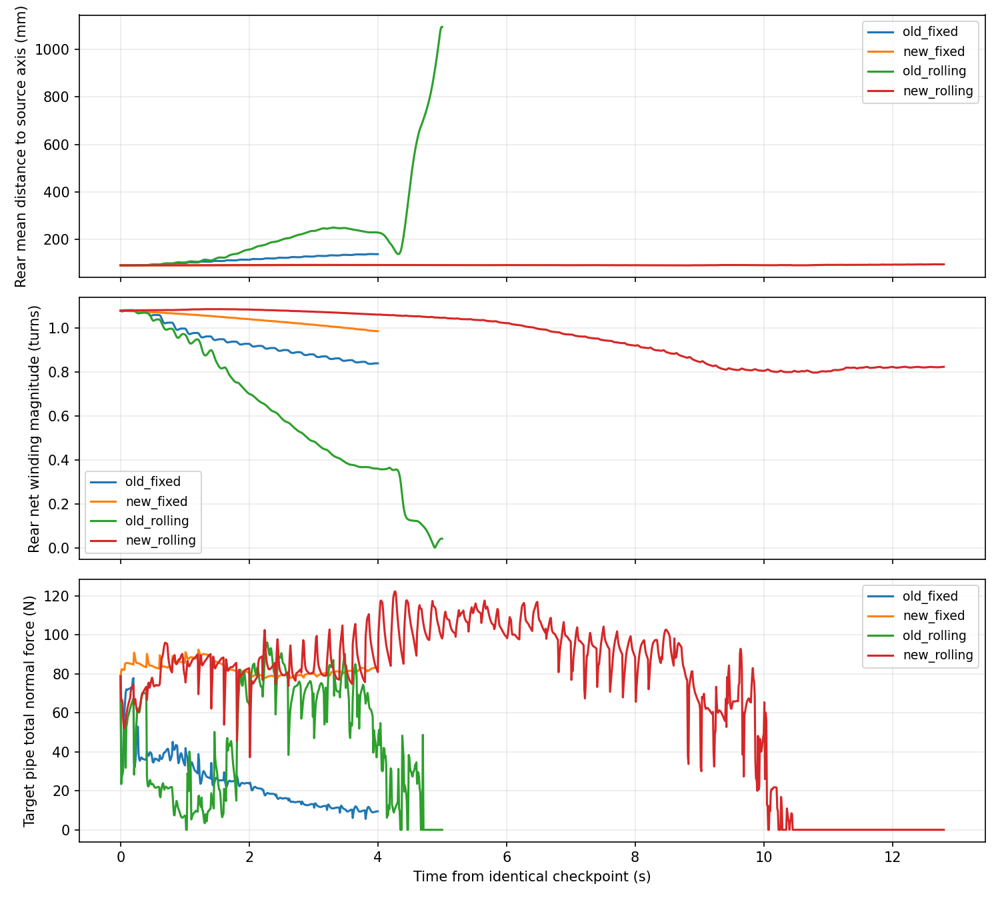

# 三段顺应性：保形修复与继续验证

日期：2026-10-04。

**零增量重建漂移的修复通过了离线和 4 秒固定相位检查。恢复三段 rolling 后，尾部原管接触持续存在，但前部约 10.64 秒持续失去目标管接触，完整跨越仍未完成。**

## 1. 修复了什么

新增 `codes/three_segment_incremental.py` 的 `IncrementalThreeSegmentController`。旧的绝对重建实现及历史数据保留作对照；实机入口、日常仿真入口、模型、摩擦、增益与执行器参数没有改动。

旧实现每帧把截面/固定螺距角近似重建出的整套角度当成新的绝对目标。即使零增益、零相位变化，重建误差也会改变当前姿态；单一相位对齐和短暂残差渐变不能解决这个问题。

新实现将三件事分开处理：

1. **当前空间形状与 rolling。** 复用已有 `SpatialBishopBackbone`，从完整实测关节链获取材料坐标下的弯曲分量，旋转本步相位增量，再按 Yamada 积分生成关节角。不会把真实形状先替换成恒螺距近似形状。
2. **截面顺应性差量。** 前、尾仍分别使用已知双管轴，复用 A–D 截面构造、半径/圆心角变形、曲率挠率及 Yamada。对同一几何、同一子段、同一相位，分别计算实际 K 与 K=0 的结果，只将两者的差加入目标。共同的绝对重建偏差不再直接下发；K=0 时这项严格为零。
3. **初始预紧。** 从存档目标姿态与实测姿态提取两个材料弯曲分量的差，随累计相位旋转。中段转入前段时，按最近实际执行目标重新记录其差值，避免重新施加它进入中段前的旧预紧。

示意（前、尾）：

```text
目标角 = 当前真实空间形状推进本步相位后的角度
       + 随累计相位旋转的预紧分量
       + [截面变形后 Yamada − 同一截面零增益 Yamada]
```

中段仍按 0.6 秒时间常数缓慢跟随实测角；分区权重 0.8 秒渐变、18°/步限速、机械限幅、实际转移/接触/位置门控均沿用原方案。

**方法边界：**这是对现有截面控制的增量适配，不是论文绝对重建控制器的原样运行，也不是上一轮只用 `Kγ` 的局部转角原型。Bishop 表示用于保留三维形状和推进 rolling；顺应性差量仍通过完整 A–D/Yamada 两次计算取得。前尾控制与中段角度控制相结合，并未新增理想螺旋纠正或主动绕障轨迹。

## 2. 分阶段验证

入口 `validation/three_segment_repair.py`，同一水平 step92 存档、20 关节、重力开启，每 0.2 秒推进 −0.075 rad。每条目标实际经隔离 EXE 转发给 MuJoCo。

### 零增量检查

- K=0、相位增量=0 时，前尾输出与捕获 ctrl 最大差 **3.66×10⁻¹⁵ rad**。
- 截面顺应性差量恰为 0。
- 推进 −0.075 rad 后，前尾角度确实变化，最大约 0.108 rad；截面差量的逐帧坐标对齐没有抵消 rolling。
- 三个归属权重之和为 1。

这里检查前尾在捕获状态的零增量接管。中段在存在跟踪误差时主动让位是预定行为；也不意味着机器人受到外力后所有姿态都被冻结。

### 固定相位，4 秒

运行前设定门槛：尾段关节点距原轴平均距离增长不超过 10 mm，净包绕至少保留初始的 90%，前后接触持续存在、不触地。使用原非零增益和中段跟随，保持相位而非冻结全部目标。

| 指标 | 修复前固定相位组 | 修复后 |
|---|---:|---:|
| 初始尾段平均距轴 | 90.78 mm | 90.78 mm |
| 4 秒末尾段平均距轴 | 137.85 mm | 92.35 mm |
| 尾段最小包绕/初始 | 约 77.8% | 91.39% |
| 修复后前后接触 | — | 全程存在 |
| 本轮保形门槛 | — | 通过 |

修复后最大平均距轴增长 1.57 mm，未触地。前部均值后退约 12.2 mm，故这不是全身静止姿态保持成功，也不是攀爬成功；它通过的是所声明的尾部支撑门槛。

### 恢复 rolling，12.8 秒

固定相位通过后才执行。未增加前部形状纠正或调整中段参数。

- 尾部原管接触持续存在，无触地；平均距轴最终 95.13 mm、峰值 95.42 mm。尾段净包绕从 1.080 圈变为约 0.825 圈，不能把仍接触理解成形状完全不变。
- 前段关节数 5→6→7，中段 5→4→3，尾部仍 J11–J20。
- 固定前部模块群沿目标轴一度前进约 **182.8 mm**，但后来后退；结束时相对初始约 **−33.6 mm**。
- 新增持续进入目标区域的模块最多 1 个，最后为 0。
- 前部首次连续 0.2 秒无目标接触的确认时刻约 **10.64 秒**；12.8 秒短程运动门槛未通过，未启动更长运动或竖直场景。
- 关节×采样的执行器饱和比例约 49.5%；最大跟踪误差约 35.85°（初态已有该误差）。修复不等于负载问题或全部运动问题已解决。



- [修复后固定相位回放](../experiments/segmented_pole_20261004/three_segment_repair_v1/fixed_phase/replay.mp4)
- [修复后三段 rolling 回放](../experiments/segmented_pole_20261004/three_segment_repair_v1/rolling/replay.mp4)

## 3. 尾部为什么没有释放

此次不是所有时间都缺少前部接触或接纳：约 **5.8～8.0 秒**，新增前段 J6/J7 的位置满足实际接纳判据，持续目标接触与原管接触也成立。

但待从尾部转入中段的 J11，一直没有靠近设定的交汇区域：

- 门槛为沿原管轴坐标 **大于 −129 mm**（交汇处为 0，两个连杆长度）。
- 该时间窗的实际坐标约 **−160.5～−156.0 mm**，所以尾部释放没有触发。

这是当前门控的真实阻塞条件，不是命令丢失或程序没有执行 rolling。尾段其余身体有向前运动，固定尾部区间平均沿原轴最终前移约 94.1 mm；**不能说整个尾部不前进**。目前是最前面的待转移关节没有进入释放区域，身体未形成连续转移。

J6/J7 的关节点接纳判断与实验中“初始在外、后来持续进入目标区域的模块中心”不是同一指标。两关节短时满足接纳，不等于两个新增模块已成功跨越。

本轮没有放宽位置门槛以改变结果。下一步应检查待转移关节附近的运动方向、约束与中段传力，判断位置判据是否与真实可释放姿态一致，以及前部为何在获得后续身体前失去接触。不能仅凭本轮结果断言应加快释放或加大拉力。

## 4. 复现与归档

```powershell
python validation/three_segment_repair.py --checks --output-root validation/results/three-repair
python validation/three_segment_repair.py --mode fixed_phase --output-root validation/results/three-repair
python validation/three_segment_repair.py --mode rolling --output-root validation/results/three-repair
python validation/three_segment_review.py validation/results/three-repair/rolling --render
```

rolling 入口会检查固定相位门槛；`--mode extended` 会检查 rolling 阶段门槛。本轮不满足 extended 条件。

数据：`experiments/segmented_pole_20261004/three_segment_repair_v1/`，包括运行前计划、控制器运行源码、完整轨迹、命令、检查结果和回放。两组共 **84 条** EXE 命令，存档初始姿态与执行 ctrl 核对通过。运行后仅增加离线比较分析，没有重跑物理实验；无 SHA 校验或参数扫描。
