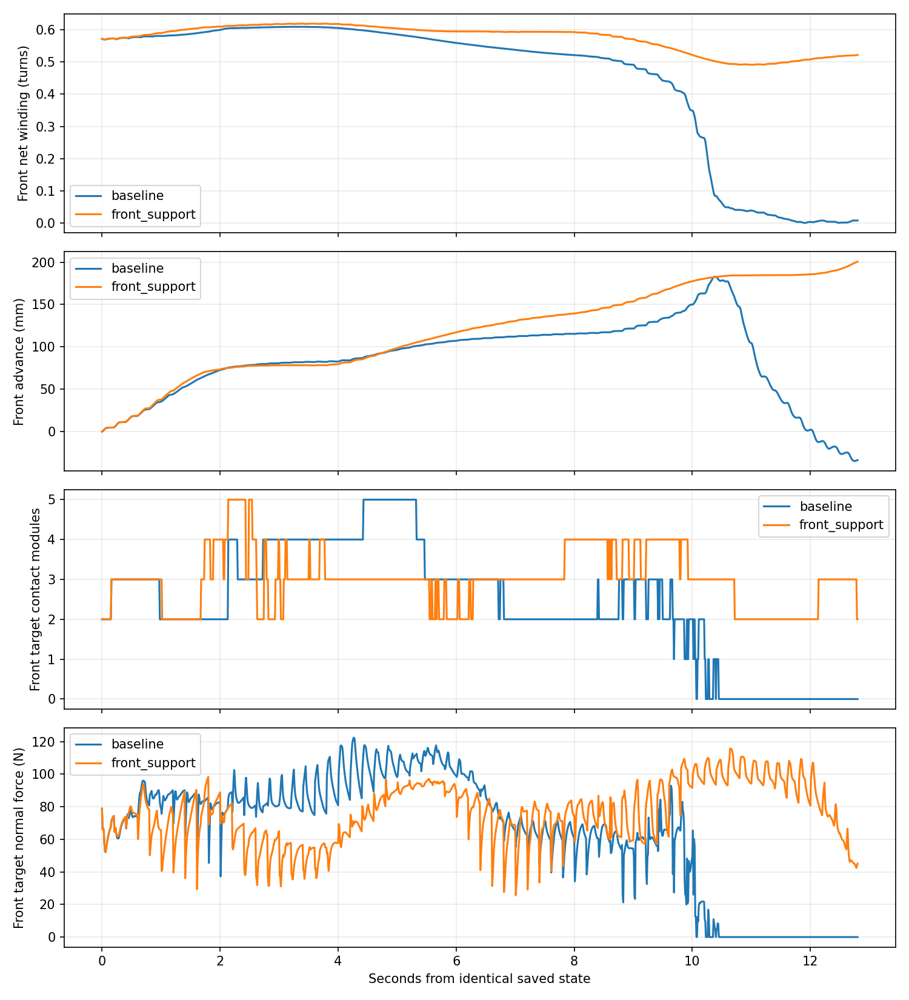

# 三段顺应性：前部包绕维持验证

日期：2026-10-04。**前部包绕维持的短程门槛通过；身体转移门槛未通过，完整跨越仍未完成。** 以下方案在物理运行前保存为数据目录内的 `plan_before_run.md`，未按结果改参数或判据。

## 问题与限定改动

最新保形版本的原前部六个模块在4/8/10/10.44秒的绕轴净角度覆盖约为0.606/0.521/0.349/0.075圈；同一时期仍在前移。10.64秒确认持续失接触。因此“前移”不等于维持包绕后的有效推进。覆盖按固定模块计算，不以归属标签增加改善成绩。

本轮先离线比较已存目标姿态和实测姿态，再只加入前部软螺旋反馈。复用先前 supported_helix 的径向曲率和切向纠正形式，权重0.1、渐入1.6秒、切向松弛长度为两个连杆，P=220 mm。半径取当前前段关节点距目标轴的中位数；不再次按K收紧，原A–D差量继续负责截面顺应性。该形状项不是原2023算法原样运行，也不保证形成精确螺旋或稳定承载。

几何项在材料弯曲分量中合成，经原Yamada积分与rolling相位推进；仅按前段归属权重施加。保持前后预紧、中段0.6秒跟随、0.8秒归属渐变、迁移门槛、相位步长、增益、摩擦、执行器和重力不变。不接实机，不改变日常入口，不冻结机器人，不做参数扫描。

## 对照与预声明判据

- 起点：已保存水平T管step92，完整积分状态相同；前J1–J5、中J6–J10、尾J11–J20。每0.2秒推进−0.075 rad。
- 基线：复用 `three_segment_repair_v1/rolling/` 64步/12.8秒数据，不重复运行已完成的基线。离线核对默认钩子及零形状权重与归档控制实现等价。
- 新组：`three_segment_front_support_v1/rolling/`，先64步/12.8秒，经 Python→隔离EXE→MuJoCo 实际下发。
- 形状/支撑门槛：原前部模块0–5的净包绕覆盖始终不低于初始80%，无连续0.2秒前部目标接触丢失，末0.6秒前部及原尾部均持续接触，前部固定模块0–4均值前进至少64.5 mm，不触地。这些是本轮机制门槛，不是接触力闭合或实机安全证明。
- 身体转移门槛：沿用既有 `three_segment_review.assess`，至少两个相邻、初始不在目标区的新模块持续进入目标区0.6秒，前部推进至少64.5 mm，前后接触维持且不触地；改标签不算转移。
- 两个门槛在64步均通过，才在同一运行中继续至128步/25.6秒；否则停止，不提高增益、不放宽释放条件、不换起点找成功。
- 物理终止：触地或全身管道支撑连续丢失0.2秒，按原控制子步末停止。
- 同时报告实际接触模块、包绕、轴向位移、关节跟踪误差、饱和比例、边界事件与连续转移。包绕恢复但仍不转移，也要明确记为跨越未通过。

## 必要检查

仅检查零权重与原版相同、同反馈下非前段目标不受形状项影响、有限目标与已有角度/速率限制、同一初态和实际EXE命令执行。目标FK分析固定当时浮动基座，仅表示运动学目标形状，不预测实际动力学接触。不做SHA或无关测试。

## 实现与复现

- `codes/three_segment_front_support.py`：新增前段形状反馈子类；原增量控制器只增加默认无作用的 `rolling_observation` 钩子。
- 几何形式沿用旧形状反馈：向管轴的螺旋曲率分量，加上两连杆松弛长度的切向方向纠正；投影到实测材料法平面后进行Yamada积分，再与原实测弯曲积分按前段权重混合，随后推进本步rolling相位。预紧及A–D顺应差量仍走原路径。
- 与旧固定边界形状原型的区别：本轮前段归属5→6→7→8，形状项随原归属渐变接入，非前段目标不直接受此项影响；半径不重复施加K收紧。没有加入旧的轴转弯分离项，也不改变本轮边界门控。
- 入口 `validation/front_support_experiment.py`：离线等价检查、旧轨迹目标诊断、短程物理对照、分开评分和回放。运行后仅将转移诊断纳入离线review，运行源码快照保留，没有重复物理运行。

从仓库根目录，在MuJoCo 3.2.7环境运行；输出目录应使用新的名称：

```powershell
python validation/front_support_experiment.py --checks --output-root validation/results/front-support-repeat
python validation/front_support_experiment.py --run --output-root validation/results/front-support-repeat
python validation/front_support_experiment.py --review --video --output-root validation/results/front-support-repeat
```

本轮数据：[three_segment_front_support_v1](../experiments/segmented_pole_20261004/three_segment_front_support_v1/)。包含运行前方案、完整初态、100 Hz物理轨迹、几何反馈、64条实际EXE命令、控制分量、运行源码和回放。

## 离线诊断与必要核对结果

- 在归档的64个反馈帧上，新默认钩子、形状权重为0的子类与归档原增量控制器输出差均为0；开启形状项后，同一反馈下非前段目标差为0。此处是相同输入下的实现核对，不代表新物理运动中尾段实际姿态或反馈保持不变。
- 旧轨迹8秒时，前部实测/目标FK包绕为0.521/0.515圈；10秒为0.349/0.321圈。后期目标也没有维持住包绕，不能只解释成“理想目标一直抱紧，纯粹摩擦不够”。但目标FK固定当时浮动基座，不足以分离外力牵拉、饱和、重构与接触滑动的贡献，未据此宣称唯一根因。
- 新旧组完整INTEGRATION初态一致，EXE实际执行目标核对通过；本轮最大单步目标变化10.22°，小于原18°上限。未修改模型或执行器。

## 12.8秒对照结果

净包绕观察原前部六个模块0–5（七个端点），前进距离观察原前部模块0–4的中心均值；两个定义与先前诊断、转移验收分别一致。控制中新增前段关节不会增加这些固定群体的成绩。

| 指标 | 保形增量基线 | 增加前部形状反馈 |
|---|---:|---:|
| 初始前部净包绕 | 0.572圈 | 0.572圈 |
| 末尾前部净包绕 | 0.008圈 | **0.522圈** |
| 全程最低包绕/初始 | 约0.02% | **85.91%** |
| 前部目标接触采样占比 | 80.48% | **100%** |
| 首次连续0.2秒失去前部接触 | 10.64秒 | **未发生** |
| 前部末尾净推进 | −33.64 mm | **+200.67 mm** |
| 原尾部接触采样占比 | 100% | 100% |
| 前部支撑机制门槛 | 未通过 | **通过** |
| 新增持续进入目标区模块：最多/最终 | 1 / 0 | 1 / 0 |
| 身体转移门槛 | 未通过 | **未通过** |
| 全关节×采样力矩饱和比例 | 49.46% | **60.61%** |
| 原前5关节力矩饱和比例 | 54.75% | **65.06%** |
| 最大跟踪误差（含初态） | 35.85° | 35.85° |
| 触地 | 无 | 无 |

本轮支持“前部包绕维持确实是需要解决的一环”。相同起点和相同时长内，形状反馈避免了原先的展开脱离。但它尚未证明长期稳定承载、低负载或完整跨越；饱和比例升高是明确代价，不能把仿真饱和比例直接解释为实机电流。



[12.8秒分段着色回放](../experiments/segmented_pole_20261004/three_segment_front_support_v1/rolling/replay.mp4)。绿色/橙色/蓝色表示前/中/尾控制归属，不表示已接触或已完成转移。

## 剩余问题与下一步

前界从5移到8，尾界仍为10，中段从5节减到2节。末尾原前部有模块0、5接触目标管；模块5初始已在目标区域，不能计为新增。模块6、7中心距目标轴分别105.86/113.35 mm，末帧均无目标管接触，尚未满足100.5 mm邻近区域门槛；模块8虽距目标轴100.17 mm，但仍更靠近原管。已加入前段控制并不等于已形成新的有效包绕。

6.6–8.2秒存在实际接纳及两侧接触的窗口，但J11沿原轴约−156.3～−148.9 mm，仍未达到−129 mm释放位置条件；末尾实际接纳条件又不成立。因此不能把这轮失败仅归咎释放阈值，也不能声称“稳住前部就已足够完成跨越”。详见 `transfer_diagnosis.json`。

按预声明条件，没有启动25.6秒扩展、竖直或实机测试，没有提高形状增益。下一步候选是以本轮为前部支撑基线，检查模块6–8为何未建立新的接触，以及J11退出原管包绕是否受到位置门控与连接段几何的共同限制；一次只改变一个环节，并同时比较饱和代价。当前结果不支持直接加大夹紧力或宣布纯被动牵拉已足够。
