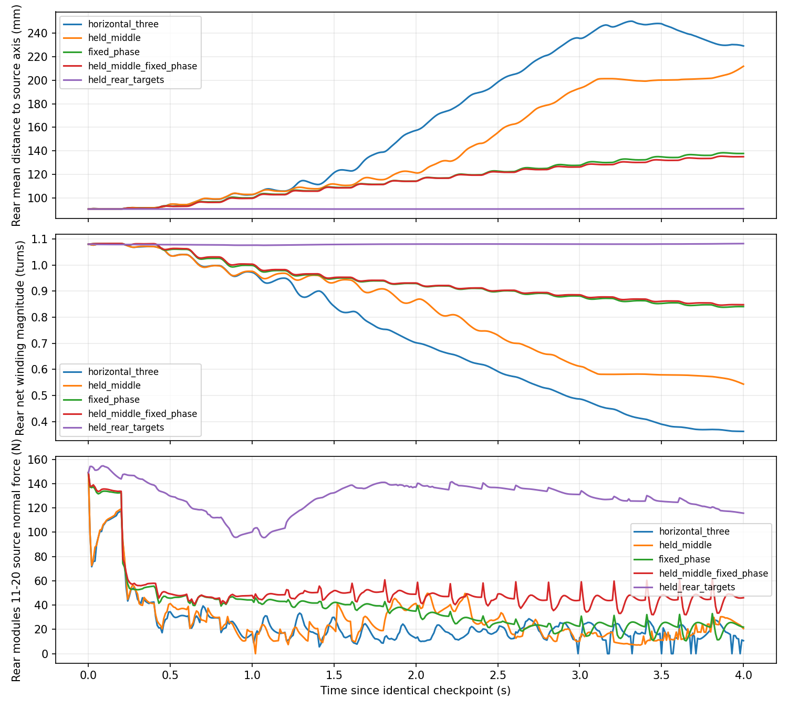

# 三段顺应性：尾部松开原因定位

日期：2026-10-04。

**主要故障已定位到新增尾段控制的目标生成和接管方式：它不能保持捕获时已有的包绕形状，固定相位时也会产生逐步张开的目标。** 中段让位和 rolling 会改变失稳速度，但都不是张开的必要条件。当前证据不支持把失败直接归因于关节数不足、轴估计失败或尾部边界释放过快。

本轮只做诊断，未修改 `codes/three_segment_compliance.py`、原顺应性控制器、实机入口或物理参数。

## 1. 相同存档的短程干预

使用与首轮完全一致的水平 step92 完整积分状态。原三段组直接取既有轨迹前 4 秒；新增四组各 20 条命令、4 秒，每组改变指定控制环节，不改变摩擦、重力、执行器或相位速率。均经隔离 EXE 实际转发。

| 条件 | 4 秒时尾段关节点距原轴平均值 | 尾段相对原轴净包绕绝对值 |
|---|---:|---:|
| 原三段控制 | 228.98 mm | 0.362 圈 |
| 固定当前中段参考，仍 rolling | 211.73 mm | 0.543 圈 |
| 不推进相位，仍实时重建与中段跟随 | 137.85 mm | 0.841 圈 |
| 不推进相位，同时固定中段参考 | 135.15 mm | 0.848 圈 |
| **只保持尾段存档目标；前部 rolling、中段跟随继续** | **91.07 mm** | **1.082 圈** |

共同初始值为 **90.78 mm、1.080 圈**。距离不是截面拟合半径，它同时受形状张开、平移、倾斜影响；包绕也只是绕原管轴的几何角度覆盖，不是接触证明。

“固定当前中段”只改变参考更新，转入前段后的渐变仍执行原控制；“保持尾段目标”只固定 J11–J20 的 ctrl，真实关节仍受物理力作用，未焊接或固定身体。

由此可以判断：

- 禁用中段参考跟随后仍明显松开，不能把它视为唯一原因。
- 固定相位且固定中段时，边界未迁移，仍张开到约 135 mm；因此停止 rolling 或冻结边界不足以消除问题。
- 保留前部运动和中段跟随、仅固定尾部 ctrl，原管支撑在 4 秒内保住，尾部形状基本保持。**尾部持续变化的控制目标是这次失稳的重要直接驱动。**
- 以上是单一姿态的短程诊断，不代表固定尾段能完成跨越。该组新增持续转移模块仍为 0。



## 2. 目标生成中的具体问题

### 2.1 固定相位不代表目标角保持

`LocalSection` 每帧按已知轴投影实际点，构造截面并用捕获时设计螺距角 **23.249°** 重新生成曲率挠率。`align()` 只拟合一个相位，不能消除整段角度幅值和分布的偏差。

在存档原始几何上做离线核对：

- 将顺应性增益设为 0，相位不推进；按实测尾段关节角做现有相位对齐后，重建角度与实测角的最大差仍为 **8.345°**、RMS 约 **4.318°**。
- 用原增益和存档 ctrl 对齐，尾段初始局部目标与存档目标最大相差 **10.441°**，发生在 **J17**：61.541° → 51.100°。这不是实际下发的瞬时跳变，实际经过 0.8 秒残差消退与变化率限制；但渐变完成后仍走向不同的形状。
- 即使把尾段积分前的几何上下文扩展到 J9 或全身，零增益重建的尾段 RMS 偏差仍约 **3.904°**。截断边界会影响误差，但不是唯一来源，简单多读一个邻接关节不能全部解决。

尾段实际连杆相对已知轴的俯仰角分布较宽，约 −6.6°～42.6°。有限关节链本身就有离散误差，不能仅凭角度不一致断言螺距设计错误；这里的直接证据是**按当前截面/固定螺距角重建，再积分回关节角，无法保留该受约束姿态**。

这不是 Yamada 积分数值算错。先前独立积分和奇偶关节轴核对已通过；问题在于送入积分的局部目标曲线及其接入方式不具有所需的保形性质。已知管轴目前只是投影依据，没有自动变成“重建后的离散关节链必须继续沿该管轴包绕”的空间约束。

### 2.2 残差渐变仅缓和切换，不能修正偏差

`ThreeSegmentController.compute()` 用：

```text
局部目标 = 当前截面重建角 + 逐渐消退的接管残差
```

尾部区间一直是 J11–J20，所以接管残差消退以后不会重新生成。当前实现没有持续保存已有包绕/接触预紧的几何基准。只用渐变把一套不保形的目标慢慢替换进去，仍然会改变支撑。

### 2.3 反馈重建使张开继续累积

固定相位组中，J17 的目标如下：

| 时刻 | 目标角 | 实测角 |
|---|---:|---:|
| 存档 | 61.541° | 57.541° |
| 0.2 s | 58.930° | 57.722° |
| 0.8 s | 46.392° | 46.151° |
| 1.0 s | 41.435° | 41.191° |
| 2.0 s | 29.186° | 28.951° |

**没有 rolling 相位推进，目标仍持续变小，实际关节在跟随它。** 这排除了“完全是外力把关节拖开，而目标一直在努力保持原姿态”的解释。

原 rolling 组三段接入后第一条命令把 J17 目标从 61.541° 改为 55.261°；0.01 秒时该关节执行器力矩由存档的 +2.355 N·m 变为 −2.355 N·m。rolling 时单个关节力矩换向本身并不必然错误，关键是与固定相位漂移及固定尾段反事实结果一致：控制目标本身正在改变原支撑形状。

每轮又将已经改变的实测形状当成下一轮重建输入。因此，当前闭环存在“偏差目标改变形状 → 再用新形状重建”的持续漂移。rolling 组还出现尾部轴线明显倾斜，进一步放大偏离；固定相位组则以较小倾斜仍逐渐张开。

## 3. 可以下的结论与尚未分离的因素

**已确认：**尾部未获准释放，真实轴也已提供；仍然失稳。尾段目标更新不保形，且固定该目标后短程支撑恢复。中段持续让位无需因此整体否定。

**合理解释：**将单轴截面方法直接拆成两个独立绝对重建段，缺少对现有空间姿态、连接边界和预紧状态的适配，导致尾部支撑在接管与后续重建中被破坏。

**尚未单独定量分离：**固定螺距角近似、A–D 截面离散化、子段端部截断和局部材料坐标/相位边界各占多少影响。本轮已定位到目标生成环节，不应伪称已经证明只有某一个公式项有错，或已修复完整跨越。

## 4. 后续修复方向

优先修复尾段的**保形接管与反馈更新**，而不是调大摩擦、加快前部、降低中段跟随速度或加快边界迁移：

1. 明确已接触姿态及其预紧基准，避免把重建近似误差直接作为绝对位置目标下发。
2. 在保留基准的表示中施加截面顺应性变化与 rolling 增量，并处理子段起点的材料坐标/邻接几何。先保证零顺应增量、零相位增量时不会持续把尾部算开。
3. 单独确认原管支撑稳定，再恢复已确定的三段协同。不能把诊断中的永久冻结尾部当作正式跨越方案。

这是下一步建议，**本轮未据此替换正式控制器**。

## 5. 文件与复现

- 脚本：`validation/three_segment_diagnosis.py`。
- 数据：`experiments/segmented_pole_20261004/three_segment_diagnosis_v1/`。
- `summary.json`：同一固定尾部区间的几何/接触结果。
- `geometry_attribution.json`：零增益重建误差、几何上下文核对。
- `joint17_evidence.json`：J17 实测、目标和力矩时间点。
- 各组保留运行前计划、运行源码、原始轨迹与全部命令。分析代码在物理运行后补充；未重复物理运行。
- [固定尾段目标回放](../experiments/segmented_pole_20261004/three_segment_diagnosis_v1/held_rear_targets/replay.mp4)
- [固定相位但仍张开的回放](../experiments/segmented_pole_20261004/three_segment_diagnosis_v1/fixed_phase/replay.mp4)

从仓库根目录运行（使用新的输出目录，已有数据不会覆盖）：

```powershell
python validation/three_segment_diagnosis.py --mode held_middle --output-root validation/results/three-diagnosis
python validation/three_segment_diagnosis.py --mode fixed_phase --output-root validation/results/three-diagnosis
python validation/three_segment_diagnosis.py --mode held_middle_fixed_phase --output-root validation/results/three-diagnosis
python validation/three_segment_diagnosis.py --mode held_rear_targets --output-root validation/results/three-diagnosis
python validation/three_segment_diagnosis.py --analyze --output-root validation/results/three-diagnosis
```

四组共 80 条新 EXE 命令；完整初始积分状态与既有基线相同，执行目标核对通过。未做 SHA 校验、参数扫描、长程跨越或实机测试。
