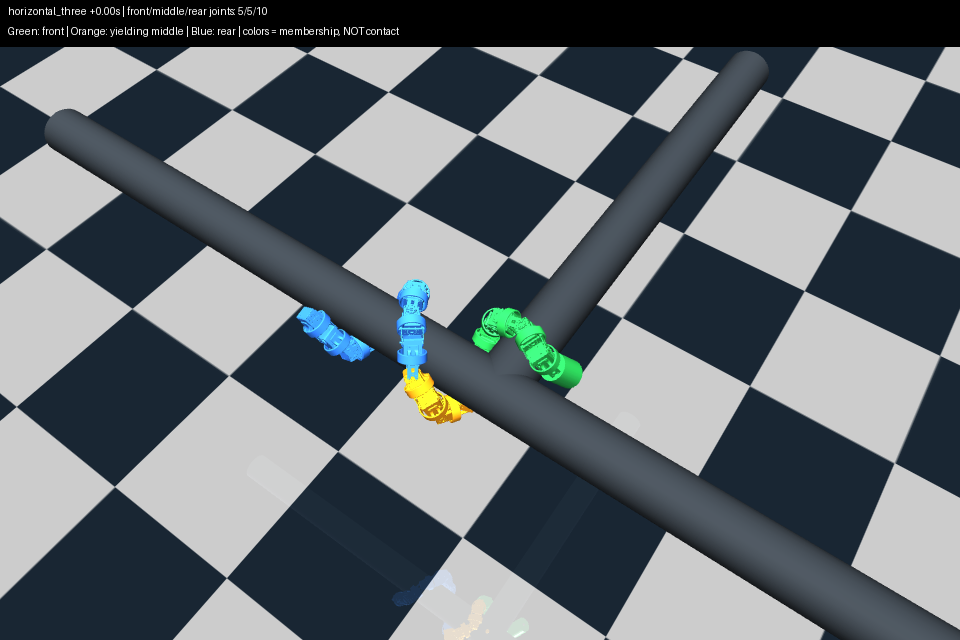
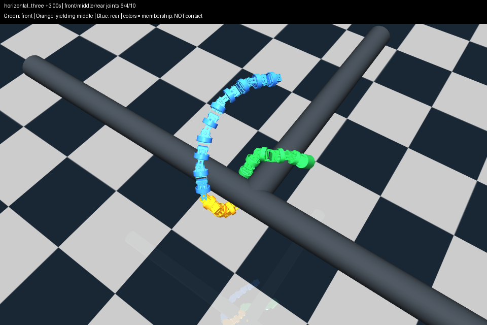
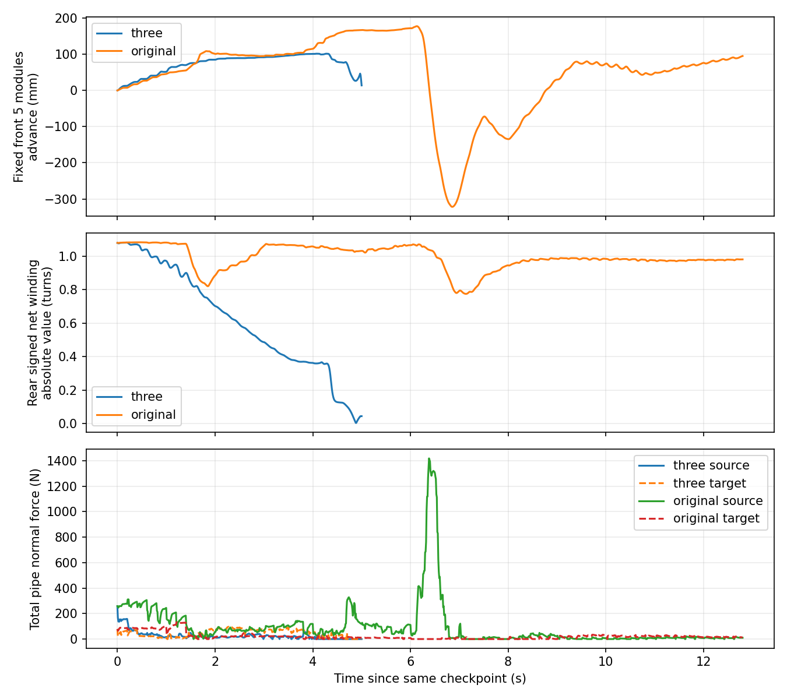

# 三段顺应性协同：首轮实现与验证

日期：2026-10-04。

**实现和通信执行通过，水平搭管后的运动门槛未通过。** 三段组在约 5 秒内失去整体支撑并触地，未获得持续的新增模块转移。不能宣称已实现完整跨越，也不能据此否定全部三段方法。

## 1. 已确认方案与实现

用户通过逐项讨论确认后授权实施：

- 前、尾使用 MuJoCo 已知目标管轴/原管轴，分别执行截面顺应性与 Yamada 积分；rolling 与包绕同时进行，两端相位以相同速率推进。
- 中段不估计轴、不做截面顺应性重建，持续缓慢更新关节参考角，使其跟随实测变形。不用电流触发，不改舵机刚度、阻尼或扭矩上限。
- 中段关节可在接触目标管之前逐渐接入前段控制；尾段关节可在仍有原管接触时开始进入中段。
- 中段长度有上限；前部未发生实际接纳、目标管接触未持续维持时，不继续释放尾段。归属改变不算物理转移。
- 初步机制成立后才延长运动，最终目标仍为完整跨越。

新增 `codes/three_segment_compliance.py`，未改日常仿真入口、实机入口、原控制器或物理模型。

### 前、尾控制

各段按实测关节点独立投影，复用 `curved_axis_compliance.local_sections/joint_segments` 的 A–D 线弧构造，再调用 `pole_compliance.build_backbone` 做目标半径/圆心角变形、长度归一化、曲率挠率与 Yamada 积分。沿用捕获时的螺距角、全身增益分布和管外收紧约定。

两段有各自的相位偏移；只有初次接入或积分区间变化时重新对齐，持续运动中不会逐帧拟合相位而抵消 rolling。尾段可能从 Pitch 关节开始，必须保持**全身关节奇偶轴顺序**，不能把每个子段的第一关节都当作 Yaw。

此实现与上一轮三维增量原型不同：不再用 `SpatialShapeController` 的投影转角增量，也不使用 `supported_helix_field.py` 的额外理想螺旋纠正项。这里只是前、尾各自复用了完整截面计算链；**没有宣称三段形成了一条空间位置和切向均连续的目标曲线**。中间连接由真实关节链与角度控制完成。

### 中段与切换

每 0.2 秒更新：

```text
q_ref ← q_ref + (1 − exp(−dt / 0.6)) × (q_measured − q_ref)
```

初次中段参考取存档 ctrl；尾段进入中段时取最近执行目标，再向实测角靠近。该做法只能减弱对旧角度的恢复作用，不保证前部能拉动中段，也不等同于力矩控制。

- 归属权重用 0.8 秒渐变，三个权重之和保持为 1。
- 新局部积分区间对齐后，切换残差在 0.8 秒内消退；该残差只保证切换过渡，不作为持续形状补偿。
- 目标变化上限 90°/s，即每 0.2 秒最多 18°；沿用原机械角度范围内侧 0.01 rad 限幅。

### 初始分段与迁移

根据存档实际关节位置选择连续前缀，并以距交汇处两个连杆长度初始化尾部：

| 区域 | 初始关节（人类编号） | 初始数量 |
|---|---|---:|
| 前段 | J1–J5 | 5 |
| 中段 | J6–J10 | 5 |
| 尾段 | J11–J20 | 10 |

视频中的模块颜色按相邻关节归属显示；头部也着前段颜色，所以“前部模块数”与“前段受控关节数”不可混用。

- 中段上限初始数量加 2，即 7 个关节；保留至少 6 个尾段关节，除非剩余尾部本身已经进入目标区域并有持续目标接触。
- 前段接入：候选关节距目标轴小于管半径＋29 mm 外壳半径＋半个连杆长度；相比原管轴不明显更远；位于目标分支正向。条件持续 0.6 秒后一次接纳一个关节，无需事先接触。
- 实际接纳：新增前段关节比原管更靠近目标轴至少 10 mm，进入目标管邻近区域，并相对存档沿目标轴前移至少四分之一个连杆长度。新增前段关节必须全部满足，不能重复用一个已接纳关节为后续释放授权。
- 尾部释放：上述实际接纳成立，最近 0.6 秒内每个 100 Hz 样本都有前部目标管接触（法向力 >0.1 N），仍有保留尾段原管接触且满足长度上限/保留数量；候选尾关节接近交汇处并持续 0.6 秒，才释放一个。

接触来自仿真真值，未实现实机接触判别。持续接触只作门控条件，不是承载稳定的证明。末端全部转移分支未被本轮轨迹覆盖。

## 2. 输入、实验边界与复现

输入：`experiments/segmented_pole_20261004/inputs/horizontal/`，用户水平 T 管 step92 的完整存档。20 关节，R81.5 mm、P220 mm，重力开启；MuJoCo 3.2.7。

相同完整物理初态、摩擦、执行器参数、增益、模型：

1. `three`：本轮三段控制。
2. `original`：存档原单轴截面顺应性，使用现有 `AxisReplay` 播种并更新原轴跟踪状态，保留捕获控制器相位。该适配以控制帧率工作，不承诺与 GUI 异步轴估计历史完全一致。

两组均每 0.2 秒推进 −0.075 rad，沿用上一轮同步实验速率（每 0.4 秒 −0.15 rad），**不是手动 Ctrl+H 每次 −0.15 rad 的原节奏**。计划最多 64 个子步/12.8 秒，全程连续 rolling，不插入固定目标保持。全身失去管接触 0.2 秒或触地即结束；停止检查在本次 0.2 秒子步完成后进行。

先验阶段门槛：前部推进一个 64.5 mm 连杆长度，至少两个相邻、初始不在目标区域的模块持续进入目标区域 0.6 秒，前后接触仍在且不触地。所有条件在结束前持续 0.6 秒。通过后才延长三段运动并安排竖直复核。

从仓库根目录、`mujoco` 环境运行。输出目录不得与已有结果重名：

```powershell
python validation/three_segment_checks.py
python validation/three_segment_experiment.py --mode three --output-root validation/results/three-segment-repeat
python validation/three_segment_experiment.py --mode original --output-root validation/results/three-segment-repeat
python validation/three_segment_review.py validation/results/three-segment-repeat/horizontal_three --render
```

实验入口启动隔离端口的隐藏可视化执行程序，实际路径为 Python → EXE → MuJoCo；反馈返回 Python。不需要用户再次手动搭管，也不用打开实机串口。此入口用于存档实验，未接入日常热键。

## 3. 首轮结果

原始结果、计划、运行时源码、命令、100 Hz 轨迹和回放：`experiments/segmented_pole_20261004/three_segment_v1/`。

| 指标 | 三段组 | 原单轴组 |
|---|---:|---:|
| 实际运行时间 | 5.0 s | 12.8 s |
| 结束原因 | 全身失支撑，子步末也已触地 | 达到时限 |
| 最大持续新增目标区域模块数 | 0 | 1 |
| 最终持续新增模块数 | 0 | 0 |
| 首轮运动门槛 | 未通过 | 未通过 |
| 完整跨越 | 未完成 | 未完成 |

两组运行时长不同，不能直接用整段接触率或平均负载宣称某组优于另一组。更不能用原组未触地当作成功跨越。

三段组的具体过程：

- 前段关节数 5→6→7，尾段一直是 J11–J20；**尾部迁移门控从未放行**。日志事件的 `time` 是对应控制区间结束时刻 0.6/4.0 秒，命令实际在 0.4/3.8 秒下发。
- 初始原管有模块 7/10/12/14/15/17/19 接触，目标管有模块 0/4 接触。约 1 秒时原管只剩模块 12 接触，约 3 秒时仅模块 11 接触。
- 固定尾部区间相对原轴的净包绕绝对值从初始约 1.08 圈，降到 1.8 秒的约 0.75 圈、2.8 秒的约 0.53 圈。该区间关节点平均距原轴约 90.8→139.0→221.0 mm。尾部并非因为程序把它改成中段才松开。
- 前部一度前移约 101.7 mm，但没有形成持续的新模块转移。约 4 秒以后原管接触丢失，随后整体掉落。
- 中段原先 J8 目标约 15.8°、实测约 51.6°；参考缓慢跟随后差异逐渐缩小。这说明“角度让位”确实执行了，**不说明它产生了有效牵引或稳定转移**。







- [三段控制回放](../experiments/segmented_pole_20261004/three_segment_v1/horizontal_three/replay.mp4)
- [原单轴控制回放](../experiments/segmented_pole_20261004/three_segment_v1/horizontal_original/replay.mp4)

## 4. 检查范围

- 全身同轴输入与原 `build_backbone` 目标角最大差 0。
- 对包括 Pitch 起始段在内的局部积分，独立数值积分与实现最大差约 4.44×10⁻¹⁶ rad。
- 检查中段无负载触发时的连续跟随、接触前前段接入、无持续目标接触不得释放尾部、中段上限。
- 两组共 89 条目标经 EXE 实际执行，核对存档初始姿态、执行 ctrl 和物理目标区域；无 SHA 校验、无参数扫描。
- 运行后只修正分析/显示细节：初帧分段显示、基线标签、模块材料着色，并把审核门槛明确为相邻新增模块。原始轨迹和运行源码保留，未为此重跑物理实验；这些审核变化不改变 0/1 个新增模块所对应的失败结论。

## 5. 当前判断与下一步建议

**事实：**前后仍在同速推进相位、中段持续让位、尾段没有被主动释放，但尾部包绕先行明显减弱。仅限制归属边界，不能确保实际支撑被保留。

**尚未证实：**当前数据无法单独区分中段让位对支撑的影响、分段截面重建/相位边界的影响，以及尾段相对原管发生整体转动的影响。初次前段局部重建与实测角仍存在偏差，切换平滑只消除了突变，未证明目标几何本身适合搭管姿态。

建议下一步先针对尾段局部目标与原管实际包绕的关系做定位，并把“尾部参考还属于尾段”和“尾部真实保持支撑”分开检查。必要对照应一次只改变中段跟随与否，或只检查局部控制的支撑保持；不要同时修改摩擦、增益、迁移速度。**本轮未擅自开展这些新对照、长程跨越、竖直或实机实验。**
