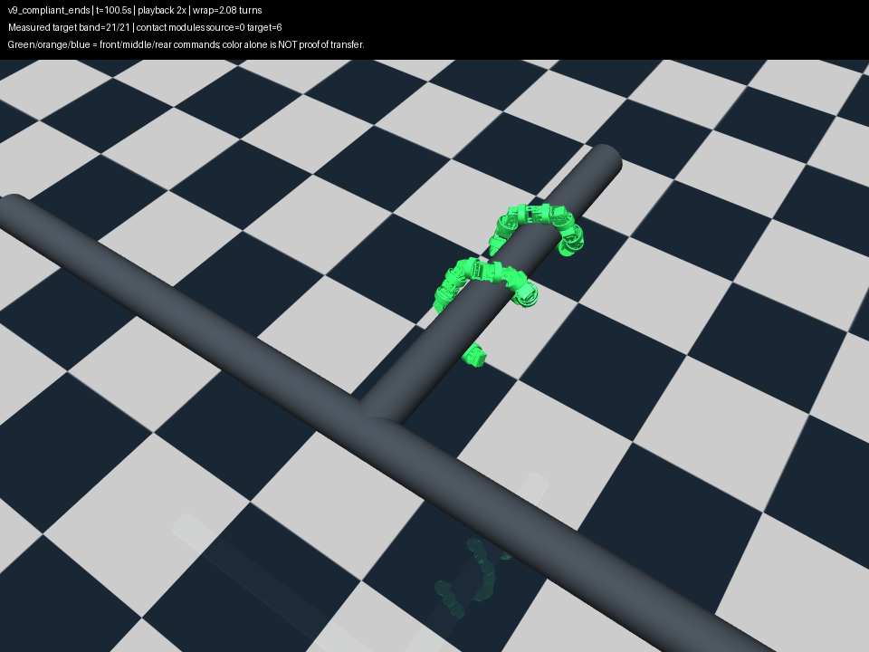
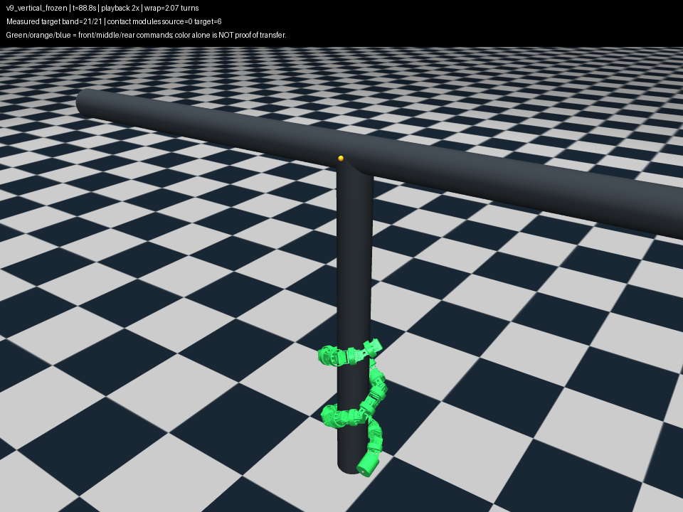
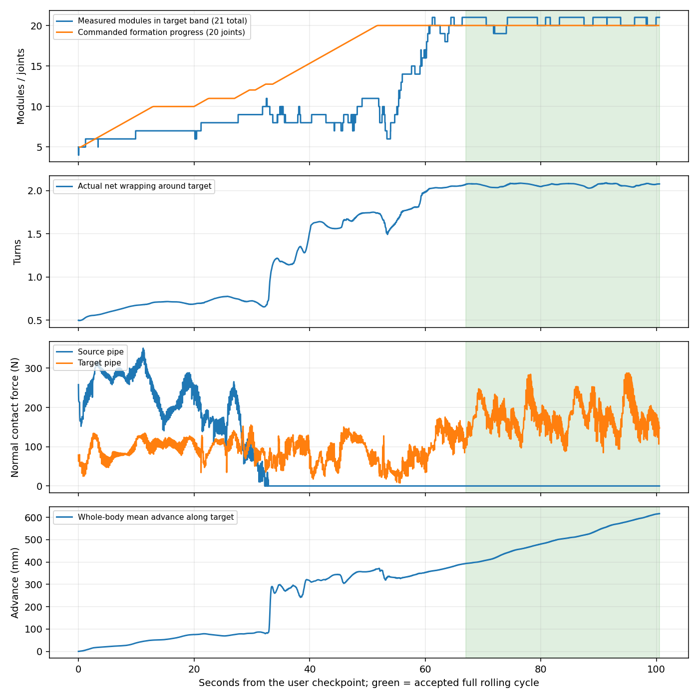
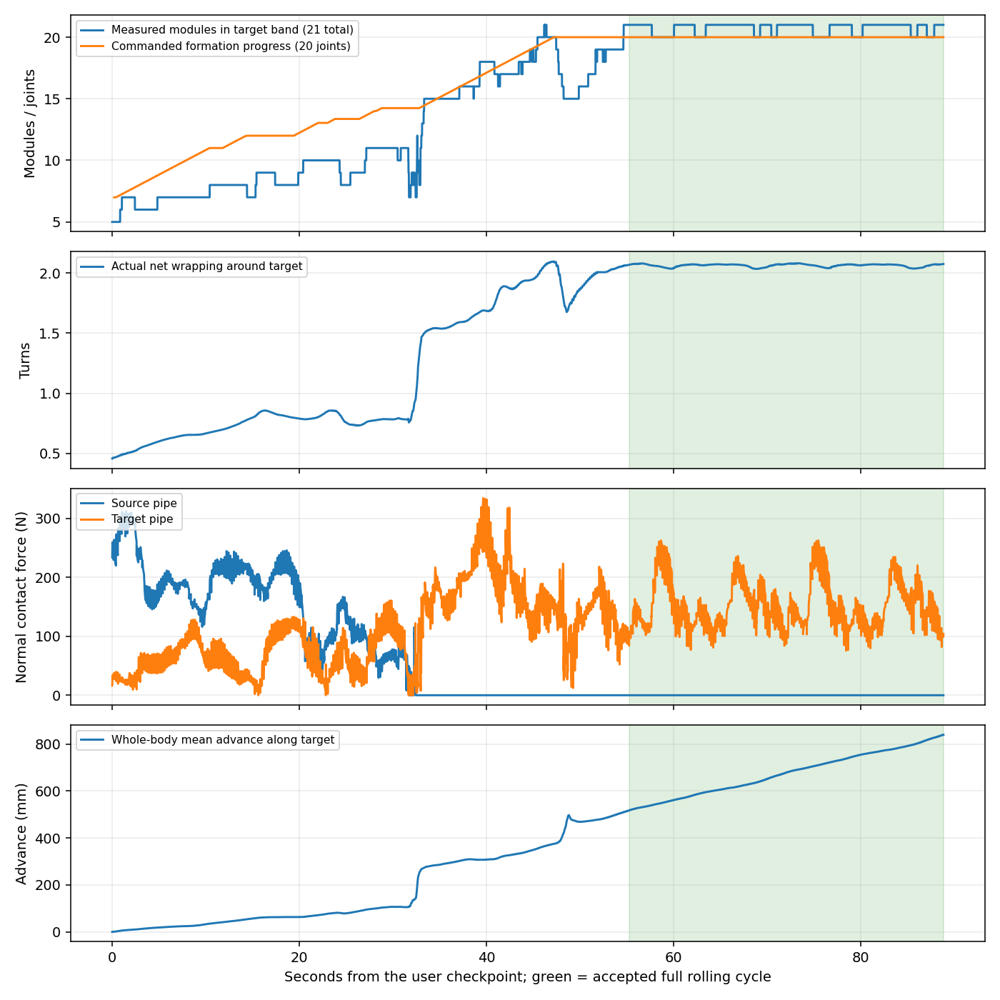

# 三段顺应性同步成形与完整跨越验证

实验于2026年10月4日晚完成，报告归档于10月5日凌晨。使用用户保存的水平 T 型和水平转竖直向下 T 型搭管状态，20关节机器人均完成了原管到目标管的整身转移，并在目标管上继续 rolling 超过一个完整相位周期。两组采用相同控制参数，保留模型的重力、摩擦、执行器刚度和力矩上限，目标均经过 Python → 隔离可视化 EXE → MuJoCo 实际执行。

这是**从已经搭管的存档出发、使用已知双管轴与仿真接触信息的成功候选**。尚未实现从未知环境自主找管、在线双轴估计或实机跨越，也没有证明方法最优或广泛鲁棒。

## 先看回放

- [水平 T 型完整过程，2倍速](../../experiments/segmented_pole_20261004/traveling_winding/reviews/v9_compliant_ends.mp4)
- [转竖直向下 T 型完整过程，2倍速](../../experiments/segmented_pole_20261004/traveling_winding/reviews/v9_vertical_frozen.mp4)

回放从原始搭管状态开始，截止完整验收区间末端。绿色、橙色、蓝色表示控制器的前、中、尾段归属；画面同时显示实际目标区域模块数和两管接触模块数，颜色本身不作为转移证据。





## 实现了什么

用户确认保留顺应性原理，允许扩展控制律；要求已经搭管的前部边 rolling 边保持包绕，后续关节逐渐形成新包绕，再带动更后面的身体。失败后的定位、修正和复测由开发者自主完成。

本轮新增 `snake_control/traveling_compliant_winding.py`。它复用已有实测 Bishop 弯曲场、Yamada 积分和 A–D 截面顺应性，不再使用上一轮的笛卡尔微分 IK 引导。

### 成形进度与滚动相位同时推进

新增连续成形进度，按关节顺序产生从0到1的平滑激活权重。已搭管段继续 rolling；后续关节在接触目标管之前就可以逐渐加入局部螺旋形状。成形进度和实际转移分别记录，接触或位置波动不会让成形进度突然退回。

三段期间，在实测材料弯曲场上加入有限的螺旋形状恢复，再进行 rolling 相位推进，并施加现有 A–D 顺应前后差量。形状恢复使用目标轴的径向、切向关系，半径参考随已搭管前部实测值更新；远离目标管的中段不参与该半径统计。新增关节恢复系数为0.35，已有前部维持系数为0.1，实测变形持续参与每次目标更新。

这是一种**带渐进成形作用的顺应性扩展**，不是2023论文控制律原样运行，也不是固定轨迹加一个无实际作用的顺应性开关。

### 让位与身体释放一起处理

中段仍使用位置接口更新参考角，没有降低物理刚度、阻尼或最大力矩。原0.6秒参考跟随常数在当前高增益位置执行器下会产生明显阻力；改为0.06秒后，对齐前12.8秒、按当时中段归属统计，饱和采样比例由57.8%降至34.0%，平均角误差由2.91°降至0.98°。该修改单独不足以完成跨越。

接触前成形范围允许领先实际连续转移前缀4个关节。前段保有目标接触、尾部仍有剩余支撑时，逐步释放靠近交汇处的尾段；释放位置范围从交汇前2个连杆长度调整为3个连杆长度，并保留接触、空间和支撑条件。

当**整条蛇实际越过原管包络、原管接触连续消失0.6秒、目标接触仍维持**时，进入尾部接管。此后不再要求已经消失的原管支撑作为释放剩余尾段的前提，继续将成形进度推进到最后一个关节。

### 跨过弯头后继续整身顺应性 rolling

成形到达尾部后，以2秒接管残差渐退，转为目标管轴上的整身 A–D 截面顺应性与 Yamada 计算。相位连续，不重置到初始姿态。

仅采用整身 A–D 时，头尾自由段仍会外张。最终保留首尾各4关节的有限成形恢复项：用中部实测半径及对应名义螺旋计算 Yamada 参考，向整身顺应目标加入 `0.25 ×（名义角−实测角）`。它持续依赖实际角度，作用是恢复自由端包绕，不是固定端部或第二个刚性控制器。该项与前述成形作用均属于允许扩展的控制律。

## 固定参数与实现入口

| 项目 | 本轮参数 |
|---|---|
| 模型 | 实机参数20关节模型，21模块，连杆64.5 mm |
| 场景 | 用户水平 step92、竖直向下 step95 存档 |
| 重力与物理参数 | 保留存档值；重力开启，kp=127，力矩上限±2.355 N·m |
| 目标发送周期 | 0.2秒 |
| rolling 相位增量 | 每周期−0.0375 rad，前后同步 |
| 成形速度 | 0.4关节/秒 |
| 接触前成形领先量 | 最多4关节 |
| 中段参考跟随常数 | 0.06秒 |
| 分段目标切换时间 | 沿用0.8秒 |
| 单次目标变化 | 不超过18°，同时保留机械角度限幅 |
| A–D 参数、初始 R/P | 读取各自原始存档，不为两场景分别调参 |

`TravelingCompliantWinding` 负责成形、释放和整身接管；`validation/traveling_winding_experiment.py` 负责恢复存档、实际 EXE 转发、物理步进与记录；`validation/traveling_winding_audit.py` 依据实际位姿和接触验收。默认参数对应成功候选，早期失败变体保存在各轮源码归档中，没有留作默认行为。

## 完整验收标准

验收不依据前段标签达到20，也不以未触地单独判定成功。

1. 验收区间开始和结束前，各有连续0.6秒所有21模块进入原有目标区域：模块中心更靠近目标轴、轴向位置越过弯头、距目标轴小于100.5 mm。
2. 区间内整条曲线越过原管包络，并位于有限目标管的轴向范围内；没有原管、另一支路或地面支撑。
3. 实际净包绕不少于1.5圈；目标管接触位置的轴向跨度不少于一个连杆长度。
4. 前半身、后半身各至少95%的采样时刻存在目标接触，允许 rolling 中各模块交替接触。
5. 继续推进至少2π滚动相位，模块中心平均位置沿目标管前进至少64.5 mm。

旧脚本的 `primary_gate_passed` 要求末尾同时保留两管接触，是早期支撑接替门槛，完整跨越后会自然为假；它仍原样保存。旧 `full_crossing` 半径区域门槛也保留。新增整身验收要求在该门槛基础上继续运动一个周期，并检查有限管长、净包绕和分布支撑。两组最终候选同时通过旧整身门槛与新增继续运动检查。

控制器使用接触真值做支撑调度；验收同样读取物理接触。二者分别计算，但不是独立传感器，不能据此宣称解决了实机接触识别。

## 最终结果

以下时间均从各自用户存档恢复后计时。平均推进指21个模块中心平均位置的轴向变化，不是质量加权质心位移。

| 结果 | 水平 T 型 | 水平转竖直向下 T 型 |
|---|---:|---:|
| 最后一次原管接触 | 32.86 s | 32.42 s |
| 开始尾部接管 | 33.80 s | 33.40 s |
| 开始整身目标管顺应性 | 51.80 s | 47.40 s |
| 完整继续运动验收区间 | 66.99–100.53 s | 55.24–88.81 s |
| 区间滚动相位增量 | 6.30 rad | 6.30 rad |
| 区间平均轴向推进 | 223.76 mm | 320.92 mm |
| 区间最低实际净包绕 | 2.027圈 | 2.033圈 |
| 前后半身目标接触采样占比 | 均100% | 均100% |
| 区间最大关节跟踪误差 | 7.19° | 6.59° |
| 区间最大模块中心半径 | 107.59 mm | 104.68 mm |
| 原管、另一支路及地面支撑 | 无 | 无 |
| 旧整身门槛与完整继续运动验收 | 通过 | 通过 |

区间内全模块同时满足100.5 mm半径带的采样比例为63.5%与72.4%；其余时刻少量自由段随相位外张，不能把结果描述为每个关节始终保持相同半径。进入和结束的连续0.6秒严格门槛均满足。

冻结的原始运行各记录102.4秒。竖直原始运行在验收之后继续下行，最终头部超过1.2 m目标管端约59.6 mm；这段不属于验收区间。交付回放截在88.81秒，新入口在89.6秒检测通过后停止，不把越过管端的后续帧算作稳定在管上的证据。





### 排除单纯依靠重力下滑

另从相同竖直存档运行，在80秒反转 rolling 相位，保持重力和物理参数不变。反转前的物理轨迹与冻结竖直运行完全一致；80–96秒模块中心平均位置沿向下目标轴位移−42.63 mm，即向上回移42.63 mm，目标接触采样占比100%，没有原管或地面支撑。这支持运动方向受控制相位影响，而非单纯自由滑落。它不等同于完成反向跨越弯头。

### 整理后的代码与成功版本一致

对水平与竖直两组各512条反馈/命令记录做只读回放，整理后代码与成功运行目标的最大差为0和6.22×10⁻¹⁵ rad；最大目标单步变化均为18°。回放没有物理步进或SHA校验。新入口的在线停止逻辑也用这些记录核对：水平在512步、竖直在448步满足验收后停止，避免继续走出有限管端。

## 本轮试错与证据

所有运行均保留执行前假设、参数、完整轨迹、反馈、控制目标、实际 EXE 命令和源码快照。运行标签只用于定位对应归档。

| 运行 | 改动或问题 | 结果 |
|---|---|---|
| v1_nominal | 显式成形进度及较早尾部释放，名义角拟合形成新段 | 前段最终脱离，未跨越；另修复成形进度受区域波动影响而倒退的问题 |
| v2_axis | 成形方向依据实际目标轴 | 仍脱离目标管 |
| v3_fast_yield | 中段跟随0.6→0.06秒，同时修复后期误把尾侧接触当作前部支撑的判据 | 中段阻力下降，单独不足以跨越；前12.8秒对照尚未出现该尾侧接触 |
| v4_wider_form | 接触前成形领先量2→4关节 | 新模块开始参与接触，仍未维持整身转移 |
| v5_form_before_outpace | rolling速度减半，成形继续同步推进 | 支撑明显改善，后期原管已脱离而释放逻辑仍等待原管支撑 |
| v6_continuous_helix | 尝试固定连续名义螺旋相位 | 未优于基于实测轴方向的候选，未保留为默认实现 |
| v7_exit_handoff | 物理越过原管后允许尾部接管 | 全部控制归属迁移，实际形成约两圈；整身稳定包绕门槛尚未通过 |
| v8_local_completion | 接回目标管轴上的整身 A–D顺应性 | 中部持续推进，头尾外张；竖直同参数也有相同现象 |
| v9_compliant_ends | 整身阶段保留首尾有限成形恢复 | 水平完整验收通过，冻结参数 |
| v9_vertical_frozen | 同参数独立竖直存档复核 | 完整验收通过 |
| v9_vertical_reverse | 转移后反转相位 | 实际向上回移，维持目标支撑 |

上述是逐轮归因后的设计迭代，不是预先固定方案的统计成功率试验。水平存档用于开发，竖直存档用于同参数复核；不能将两个指定存档通过写成一般场景成功率。

## 如何复现

在仓库根目录、已安装MuJoCo 3.2.7的环境中执行。需要已有可视化 EXE；尚未编译时，先按 `visualizer/README.md` 的本地构建步骤生成。脚本自动使用独立端口和隐藏的可视化执行端，完成后关闭自己的实例，无需手动打开 viewer 或再次调整搭管姿态。

```powershell
python validation/traveling_winding_experiment.py horizontal_verify --scene horizontal --video
python validation/traveling_winding_experiment.py vertical_verify --scene vertical_down --video
```

运行名称对应新的结果目录，不能与已有目录重名。默认最多512步，完整验收通过或失去支撑时提前停止。输出在 `experiments/segmented_pole_20261004/traveling_winding/<运行名>/`。`--video` 生成回放；控制输出仍经过可视化程序实际转发，未绕开通信链路。

归档数据在 [数据索引](../../experiments/segmented_pole_20261004/traveling_winding/README.md)。新克隆若要重算已发表结果，先将相应ZIP解压到 `traveling_winding/`，再运行：

```powershell
python validation/traveling_winding_audit.py v9_compliant_ends
python validation/traveling_winding_audit.py v9_vertical_frozen
python validation/traveling_winding_checks.py
```

本轮没有替换日常 `Adaptive_Pole_Climbing_Mujoco.py` 或实机入口。当前独立入口适合复现这两个搭管存档。

## 仍需解决的问题

转移过程有明显瞬态：水平全程最大跟踪误差约83.53°，竖直约59.05°，远大于稳定继续运动区间的误差；后部退出原管时有快速形变。完整跨越通过不等于转移已经平顺，更不能据此直接驱动实机。

下一步应冻结当前可行候选，优先平滑支撑交接并降低转移负载，然后在不同搭管位置、相位及摩擦扰动下验证。在线分段轴估计、无需仿真接触真值的调度、实机通信频率下的让位效果，应分别验证。局部成形恢复、放慢rolling和尾部接管各自对成功的贡献尚未做完整消融，不夸大某一个因素为唯一原因。
