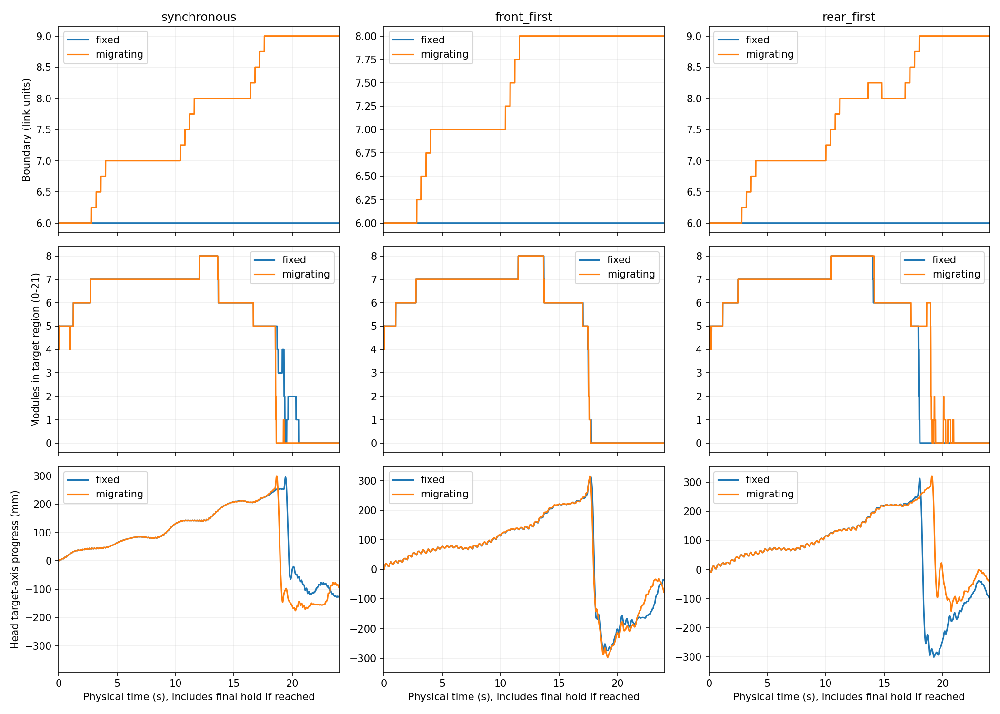
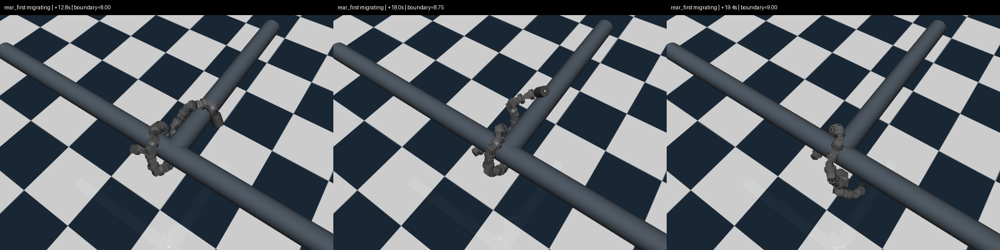
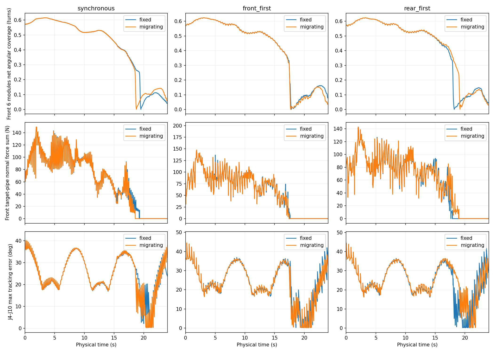

# 搭管后边界迁移：长程对照验证

日期：2026-10-04。

## 结论

**本轮六组均未实现完整跨越。** 边界迁移已实际执行，三组分别由6节迁至最高9/8/9节，但未阻止搭管前部逐渐展开并失去目标管接触。不能把上一轮32循环内的持续推进外推为完整跨越，也不能据此否定所有分段顺应性方法。

本轮检验的是既有三维增量保形原型中增加几何/接触辅助的边界迁移，并非完整2023局部曲线重构，也不是自主障碍识别。更具体的不足是：**移动局部轴分界并未同时建立维持目标管包绕的形状约束。** 这是真实的实现边界；它是否是失败的主要原因，仍需针对性对照。

## 实验条件和预定门槛

- 同一水平T管step92完整存档，20关节、21模块，R=81.5 mm、P=220 mm，重力开启，MuJoCo 3.2.7。K、模型、摩擦、力矩限制、原始物理状态不变。
- 同步、前部先行、后部先行三种顺序，各配固定边界和迁移边界，共六组。相位规则与前轮相同：0.2秒/子步、两子步/循环、每端每循环−0.15 rad。
- 上限192循环、76.8秒。此前32循环只运行12.8秒。本轮中途不停顿、不按中间结果调参数。
- 触地或全身所有管道接触力不超过0.1 N持续0.2秒时停止；在每子步结束时检查。失去前部接触单独记录，不立即结束，用于观察继续运动是否恢复转移。
- 完整转移要求：全21模块连续三个控制终点均属于目标管区域、过去0.6秒无原管接触而目标管接触始终存在、无触地。达到后或运行至时间上限后进行3秒固定目标保持；提前失去全身支撑则不追加保持。
- 保持还要求：全模块始终在目标区域、目标接触持续存在、无原管接触/触地、头部最大回退≤10 mm、基座最大位移≤20 mm。只有完整转移和保持均满足才通过。
- 模块归属使用独立位置判据，不用控制器的边界标签当作跨越结果。

运行前计划保存在[plan.json](../../experiments/segmented_pole_20261004/migration_v1/plan.json)。本轮不做参数搜索、竖直复核或实机控制。

## 迁移实现

新增`snake_control/spatial_boundary_migration.py`。沿头到尾枚举分界，用各模块中心到两根已知管轴的距离形成连续前缀划分，并要求候选附近最近0.6秒有目标管接触。候选连续3个循环得到确认后，每循环最多移动0.25节，可向前或向后修正；过渡宽度保持6节。

仅在前后端相位闭合的循环起点更新分界。局部投影轴和空间相位权重共用该分界，仍然旋转弯曲场后统一Yamada积分，没有拼接两套关节角或重置运动相位。

迁移依赖仿真真实接触与已知管轴，属于运动可行性验证。几何距离与接触并不能证明估计轴或分界最优，尤其在身体解旋、改走另一支管后，连续前缀假设可能不再适用。

为遵守不做额外SHA校验的要求，存档加载器增加可选的`verify_hashes=False`供该实验入口使用；旧入口的默认行为不变。新实验复用既有接触记录方式，不重复已有Jacobian检查。

## 六组结果

“前部”指固定的原前6模块中心平均位置，位移沿指定目标管方向；“失接触”指该前部连续0.2秒无大于0.1 N的目标管接触。模块索引从0开始，不是舵机ID。

| 运动顺序 | 边界方式 | 前部最大推进/mm | 首次前部失接触/s | 边界最大值/节 | 终止情况 |
| --- | --- | ---: | ---: | ---: | --- |
| 同步 | 固定 | 204.53 | 19.31 | 6 | 192循环到时限 |
| 同步 | 迁移 | 202.53 | 18.57 | 9 | 192循环到时限 |
| 前先 | 固定 | 209.00 | 17.61 | 6 | 152.5循环全身失支撑 |
| 前先 | 迁移 | 211.38 | 17.45 | 8 | 183.5循环全身失支撑 |
| 后先 | 固定 | 209.44 | 17.91 | 6 | 192循环到时限 |
| 后先 | 迁移 | 214.98 | 18.99 | 9 | 147.5循环全身失支撑 |

三组迁移均在第8循环起点首次移动分界。六组最多均只有8个模块同时位于目标管区域，最终目标区域模块数均为0。后续没有恢复沿指定分支的完整转移。迁移有时延后、有时提前前部失接触，没有一致的改善趋势。

固定同步、迁移同步、固定后先三组到时限时仍接触T管另一侧支管；不是在指定目标管上完成跨越。其余三组触发全身失支撑停止；停止前没有记录到触地，不应写成“未掉落所以稳定”。

三个到时限组执行了末尾保持，但均已不满足目标区域/目标接触条件，因此均失败；另外三组未执行保持，相关指标标为缺失，不记作零回退通过。全六组运动最大跟踪误差约41.8–48.0°，执行器饱和占关节×采样约49.5%–52.1%，均不构成实机可靠性验证。



## 失败时段的观察与推断

离线检查已保存轨迹，没有新增动力学试跑。以“后部先行＋迁移”为例：

| 时刻 | 分界/节 | 原前6模块对目标轴净角度覆盖/圈 | 前部目标管接触法向力总和/N |
| --- | ---: | ---: | ---: |
| 12.80 s | 8.0 | 0.539 | 73.54 |
| 16.00 s | 8.0 | 0.458 | 54.57 |
| 18.59 s | 9.0 | 0.284 | 11.89 |
| 18.99 s | 9.0 | 0.227 | 0 |
| 19.39 s | 9.0 | 0.019 | 0 |

净角度覆盖是原前6模块围绕目标轴的有符号角度累积后取绝对值，并非全身包绕圈数，也不是充分的稳定性判据。数值来自仿真接触模型，不能直接对应实机夹持力。





**已确认：** 前部先逐渐展开、接触法向力衰减，随后失去目标管支撑并明显回落。分界移动没有带来持续增加的目标管包绕。继续向前运动也没有在本次时限内消除这一失败。

**实现事实：** 当前轴场主要用于局部有符号Δγ=Kγ修正；rolling仍作用于包含连接区形状的整个观测Bishop场及捕获预紧场。同步组中，两端相位相同，改变分界不会改变相位旋转，仅改变局部顺应修正。它没有独立的目标管包绕约束，也没有将过弯形状与螺旋rolling项显式分离。

**合理推测：** 单纯迁移分界不足以阻止包绕形状逐渐展开，当前运动场对连接区形状的处理和前部支撑维持需要改进。该推测与现象一致，但本轮没有独立隔离连接段内力矩、预紧场和形状旋转各自的影响，不能给出唯一原因。也没有证据把失败归咎于20关节长度或轴估计精度：本轮用的是已知管轴。

## 验证范围与版本说明

- 六组初始完整物理状态逐值相同；实际应用的命令分别为384/384/305/367/384/295条，共2119条。核对了记录时序、执行ctrl和0.25节迁移限速、循环内不迁移。
- 三组固定边界前32循环与上一轮qpos逐帧差均为0。代表性迁移指令用更高阶积分复核；闭合相位下只更换分界不产生相位重映射跳变。没有SHA校验或重复全面测试。
- 运行源码保存在各组`sources/`。实验结束后，当前入口对**未触发的末端条件**作了小修正：全身持续进入目标区域时允许过渡区继续移向尾外，不必先等原管接触消失；完整跨越验收门槛不变。本次最多8/21模块进入目标区域，该末端分支从未触发，不影响已保存轨迹。运行前计划和运行源码未被覆盖，末端处理仍未经动力学验证。
- 自动回放使用已保存状态，不是新试验。实验评估脚本与离线失效图在运行结束后完善，当前分析以本报告和汇总JSON为准。

## 后续建议

暂不扩大迁移速度/窗口或继续增加交替轮次。下一项应在相同搭管状态下，针对前12.8–19秒建立**保持目标管包绕的局部形状控制**对照，明确区分过弯连接形状与用于推进的rolling形状，检查前部包绕是否能维持、后续模块是否能接替支撑；再让边界随实际身体转移。

这需要改进控制目标，而不仅是更快移动分界。可以继续使用当前迁移器和Yamada积分框架，但不应把本轮失败说成“只差多走几步”或“分段顺应性已被证明不可行”。本轮没有进一步更换控制目标或调参重跑。

## 数据、视频与复现

[完整实验目录](../../experiments/segmented_pole_20261004/migration_v1)包含计划、原始状态/控制/反馈、接触和自转、源码快照、分析、完整视频及图表。

| 顺序 | 固定边界回放 | 迁移边界回放 |
| --- | --- | --- |
| 同步 | [视频](../../experiments/segmented_pole_20261004/migration_v1/synchronous_fixed/replay.mp4) | [视频](../../experiments/segmented_pole_20261004/migration_v1/synchronous_migrating/replay.mp4) |
| 前先 | [视频](../../experiments/segmented_pole_20261004/migration_v1/front_first_fixed/replay.mp4) | [视频](../../experiments/segmented_pole_20261004/migration_v1/front_first_migrating/replay.mp4) |
| 后先 | [视频](../../experiments/segmented_pole_20261004/migration_v1/rear_first_fixed/replay.mp4) | [视频](../../experiments/segmented_pole_20261004/migration_v1/rear_first_migrating/replay.mp4) |

在仓库根目录运行现有MuJoCo 3.2.7环境；输出到新目录以保留本次数据：

```powershell
python validation/spatial_migration_experiment.py --prepare --output-root validation/results/migration-repeat
foreach ($mode in @('synchronous','front_first','rear_first')) {
    foreach ($boundary in @('fixed','migrating')) {
        python validation/spatial_migration_experiment.py --mode $mode --boundary $boundary --output-root validation/results/migration-repeat
        if ($LASTEXITCODE -ne 0) { throw 'Experiment failed; inspect the saved output.' }
    }
}
python validation/spatial_migration_review.py --output-root validation/results/migration-repeat --render
```

离线失效图：`python validation/spatial_migration_failure.py`（读取本次归档目录）。
