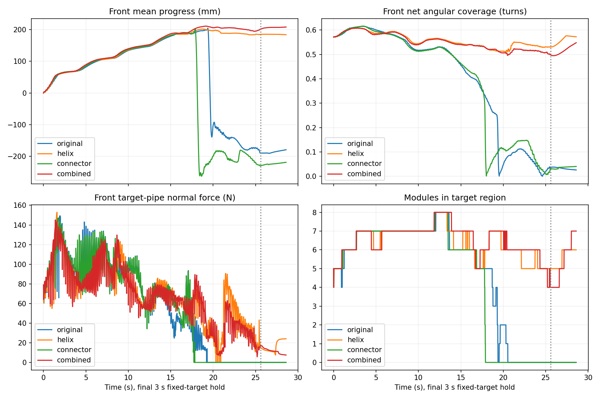

# 搭管段螺旋形状维持：固定边界对照

日期：2026-10-04。

## 结论

**加入局部螺旋形状反馈，明显缓解了前部展开和脱离；但本轮仍未实现持续身体转移，四组均未通过阶段门槛。** 组合组在25.6秒内始终存在前部目标管接触，原前6模块净角度覆盖最低0.496圈、末尾0.498圈，前部净推进202.04 mm。旧控制19.31秒持续失去前部接触，25.6秒时已退至初始位置后方。

这个结果支持用户提出的“前部需要形成并维持包绕形状”，但不能证明连接区牵拉是唯一原因。仅把轴转弯项从rolling中分离的一组反而17.85秒失去前部接触；不能把该分离方法视为已解决连接区控制。

## 改了什么

新增独立`snake_control/supported_helix_field.py`，仍先生成统一弯曲场，再做Yamada积分，不拼接关节角。日常仿真与实机入口未改。

### 搭管段局部螺旋参考

已知目标管轴沿身体头→尾方向记为a，关节点对该轴的径向单位向量为e_r，e_θ=a×e_r，绕向w由捕获姿态确定。反馈半径取前6关节点到管轴距离中位数，以既有前部平均K作小幅收紧：R_d=R_measured/(1+mean(K))。螺距P保持220 mm。

令h=P/(2π)，α=atan(h/R_d)，κ=R_d/(R_d²+h²)，参考切向为：

```text
T_d = w cos(α) e_θ + sin(α) a
D_d = -κ e_r + [T_d - (T_d·T)T] / (2l)
```

其中T为实测局部切向、l为平均连杆长度。第一项对应螺旋向内的曲率，第二项纠正切向/螺距方向；投影到实测材料标架的法平面得到参考弯曲场。不能只固定曲率大小就声称形成了目标螺旋。

形状反馈权重固定0.1，在1.6秒内平滑启用；前6个关节位置使用完整权重，至第9节平滑衰减至零。既有局部Δγ=Kγ修正和捕获预紧场保留，未搜索增益。

**这是软形状反馈，不是两段理想螺旋及连接曲线的精确解。** 管轴和径向距离使用已知仿真几何，没有验证实机轴估计。半径仍随反馈更新，没有强行固定成初始81.5 mm，也没有把整个搭管姿态瞬间替换成标准螺旋。

### 连接区分离

由已知轴场沿弧长的旋转率Ω，计算局部轴转弯贡献D_axis=Ω×T，并投影到同一材料标架。rolling前从观测弯曲场扣除该项，旋转后再加回；这部分不直接乘rolling相位。

**它不等于固定连接区端点，也不保证端点位置、切向及连接弧长满足某条拼接曲线。** 当前只验证这个场分解是否有帮助，尚未实现带完整几何约束的连接段。捕获预紧场仍按原方式随总相位旋转，未独立分解其过弯贡献。

## 四组对照与门槛

同一水平step92完整物理存档，20关节/21模块、重力开启、MuJoCo 3.2.7，K/摩擦/力矩限制不变。分界固定6节、轴过渡宽度6节；同步rolling，每循环两步各0.2秒，两端每循环−0.15 rad。各64循环25.6秒，再固定目标保持3秒。

| 条件 | 螺旋形状反馈 | 分离轴转弯项 |
| --- | --- | --- |
| original | 关 | 关 |
| helix | 开 | 关 |
| connector | 关 | 开 |
| combined | 开 | 开 |

运行前[plan.json](../../experiments/segmented_pole_20261004/supported_helix_v1/plan.json)固定参数及门槛：前部净推进≥64.5 mm，运动中原前6模块角度覆盖不少于初始80%、目标接触持续存在、末尾至少两个新模块连续三个控制终点处于目标区域，且无触地；3秒保持头部回退≤10 mm、基座最大位移≤20 mm、前部接触持续存在。组合组通过后才考虑恢复边界迁移。

## 结果

| 条件 | 25.6秒前部净推进/mm | 末尾前部角度覆盖/圈 | 前部目标接触采样占比 | 首次连续0.2秒失接触 | 保持头部回退/mm |
| --- | ---: | ---: | ---: | --- | ---: |
| original | −189.62 | 0.036 | 75.32% | 19.31 s | 3.31 |
| helix | 185.07 | 0.530 | 99.77% | 未出现 | 28.60 |
| connector | −229.40 | 0.030 | 69.54% | 17.85 s | 0.00 |
| combined | 202.04 | 0.498 | 100% | 未出现 | 24.97 |

角度覆盖是固定原前6模块对目标轴的有符号角度累积后取绝对值，初始0.572圈；不是全身圈数，不等于理想螺旋或充分承载。helix组存在短暂失接触，不能将“未连续失接触0.2秒”写成全程接触。

四组均无触地，但阶段门槛均失败。original/connector的低保持回退值发生在前部已经脱离之后，不能记为稳定保持。helix/combined保持基座移动分别47.35/50.52 mm，仍超过20 mm。

组合组第48循环前部已推进211.12 mm，第64循环降至202.04 mm，后段运动开始停滞/回退。末尾没有满足持续新模块转移条件；目标管接触为模块0和17，前部接触仅剩模块0，不能写成稳定的多点螺旋支撑。部分更靠后模块的接触不代表沿头到尾完成转移。

连接区模块3与9中心距离，组合组从228.01 mm增至峰值335.56 mm，末尾298.92 mm；只有螺旋反馈组峰值330.14 mm。它是端点间距而不是连杆伸长。分离轴转弯项尚未表现出明确的连接区约束收益。

组合组末次参考比较中，前6处切向偏差约4.2°–31.9°，仍有偏差，不能宣称已形成精确标准螺旋。各组最大跟踪误差约40.2°–41.7°；有螺旋反馈两组执行器饱和采样占比约60%，没有证明低负载或实机适用性。



## 必要检查和数据完整性

四组完整初态相同，各128条控制目标实际经隔离可视化EXE转发，共512条。original组25.6秒运动轨迹与上一轮同步固定边界逐帧qpos差0。核对了执行ctrl、采样间隔及代表命令的更高阶弯曲场积分，误差均小于1e-14 rad。首条命令相对捕获ctrl变化约5.68°–5.82°，没有发生直接替换整段理想螺旋的大跳变。

物理运行结束后的首次分析有JSON列表转数组遗漏，已在`SupportedHelixCommand`补`np.asarray`后重做离线分析；物理运行原本传入numpy数组，因此不改变保存轨迹，无需重跑。各组运行源码保留原样，当前分析脚本补充连接区和切向指标。没有SHA校验或无关全面测试。

数据：[supported_helix_v1](../../experiments/segmented_pole_20261004/supported_helix_v1)。包含计划、原始状态/控制/反馈、接触与自转、运行源码、结果和视频。

- [原控制视频](../../experiments/segmented_pole_20261004/supported_helix_v1/original/replay.mp4)
- [仅螺旋形状反馈视频](../../experiments/segmented_pole_20261004/supported_helix_v1/helix/replay.mp4)
- [仅分离连接项视频](../../experiments/segmented_pole_20261004/supported_helix_v1/connector/replay.mp4)
- [组合控制视频](../../experiments/segmented_pole_20261004/supported_helix_v1/combined/replay.mp4)

## 下一步

保留局部螺旋形状反馈作为候选，因为本轮实际改善了前部包绕保持。但要进一步解决**连接区如何送入后续身体并建立新的目标管支撑**，不能满足于头部仍挂在管上。

下一项应以有螺旋反馈组为基线，研究连接区端点/切向及弧长约束下的过弯目标曲线，区分保持形状与推进后续身体；无需再重复无约束延长rolling。当前轴转弯项分离没有证明有效，不应默认保留为正确方法。本轮按门槛未恢复迁移，也未做竖直、实机或完整跨越验证。

复现（仓库根目录，既有MuJoCo 3.2.7环境）：

```powershell
python validation/supported_helix_experiment.py --prepare --output-root validation/results/supported-repeat
foreach ($mode in @('original','helix','connector','combined')) {
    python validation/supported_helix_experiment.py --mode $mode --output-root validation/results/supported-repeat
    if ($LASTEXITCODE -ne 0) { throw 'Inspect experiment output.' }
}
python validation/supported_helix_review.py --output-root validation/results/supported-repeat --render
```
