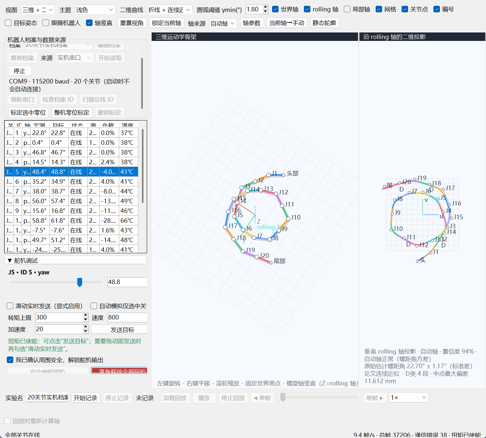
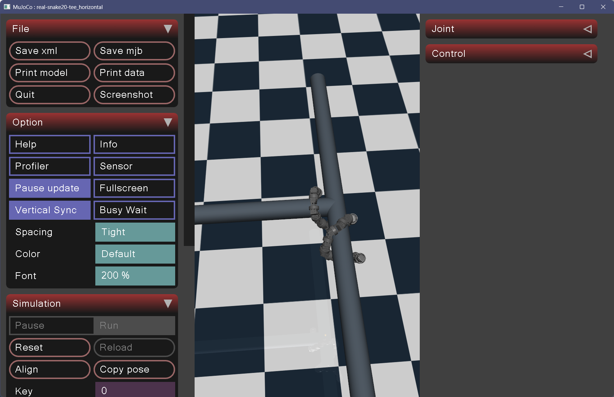
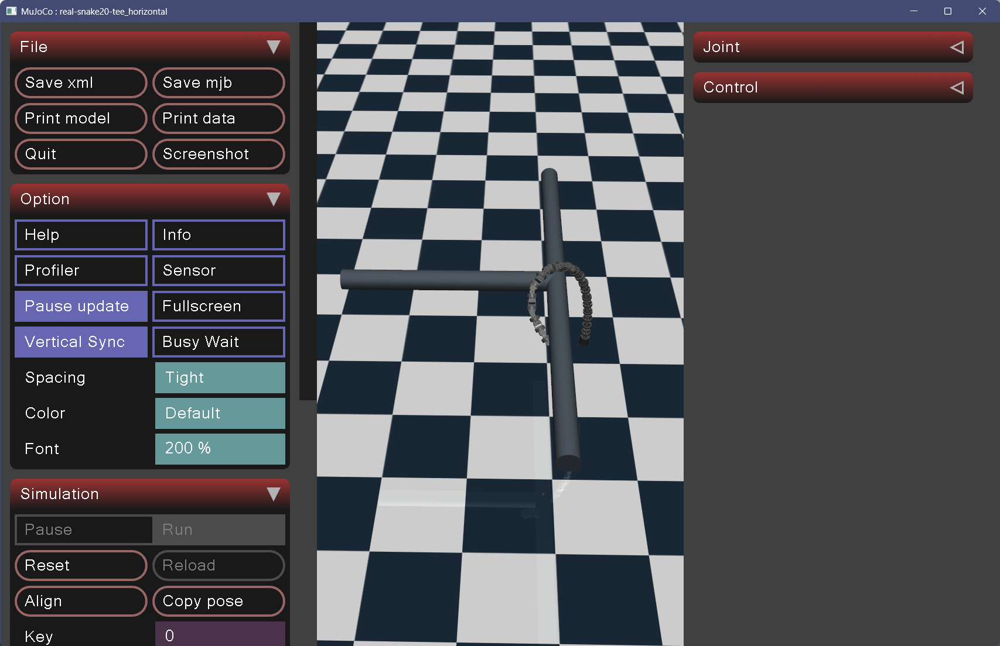
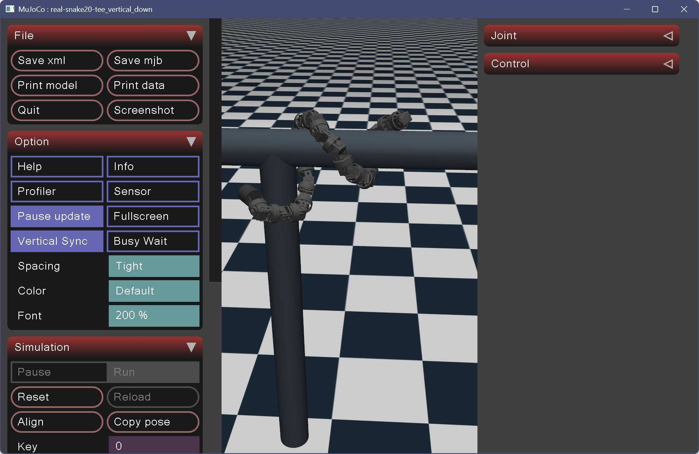
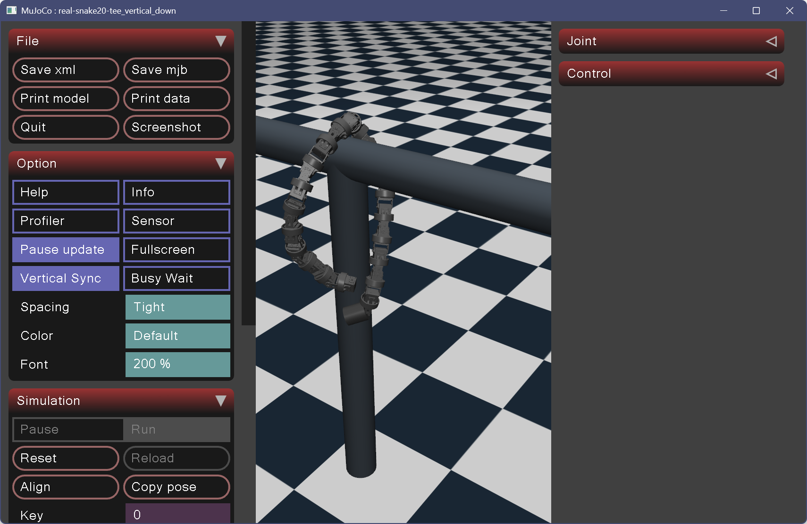

# 实机调试实验日志

## 2026-10-02

10.2（上）实验总结

1. 标准螺旋与顺应性控制在d=110mm小管，以半径r=85mm左右攀爬能够正常移动。并且有额外发现，顺应性运动好像可以尝试解旋T型螺旋管，但是无法往T型下面的管道继续以螺旋缠绕有些困难。不知道竖直从上到下爬管道(T型）是否有人实现？
2. 标准螺旋与顺应性控制在d=110mm小管，以半径r=85mm左右攀爬，如果是过不连续90度弯管，从上到下貌似无法沿着管道行进（水平管在上，竖直管在下），因为怕出水平管后蛇如果头部不能缠绕上竖直管，会自然解旋从而掉下来。不知道从上往下（水平->竖直）爬管是否有人实现？
以及我们要实现从下到上过不连续90度弯，目前没验证这一现象是否也会在我们的从下往上爬顺应性步态出现，如果确有出现，可能得想个解决方法。
3. 标准螺旋与顺应性控制在d=110mm小管，以半径r=86左右能够抱紧竖直管道。初始蛇身抱紧之后，向上rolling会打滑，无论是螺旋还是顺应性控制都上不去。给蛇部分关节缠上电工胶带之后，r还是86，蛇身抱紧之后标准步态能向上爬大概5-10cm，然后电流过载（达到5.5A）舵机通信断开，无法再向上爬；改成顺应性控制之后，电流瞬间从5.5A降到2.2A左右，并且实际缠绕半径r来到90mm左右（由于顺应性控制的因素目标r与实际r会不一样），只需要给蛇提供一丢丢支持力，蛇就能实现沿着管道螺旋上爬。
目前还存在一些问题，从直观感受来说r=86mm确实报的比较紧，但是顺应性控制最后顺应到了90mm左右，是否在90mm左右管道就已经能抱紧？此时使用标准螺旋应该能不过载稳定上爬？待测试。
4. 需要给蛇贴点防滑胶带，防止打滑导致实机实验失败。

### AI总结今日实验与下一步规划建议

今日实验表明，接触防滑和夹紧程度是后续调试的重点。贴电工胶带后标准步态能短距离上爬，切换顺应性后观察到电流下降，并能在少量辅助下继续上爬；是否能无辅助稳定上爬仍需验证。

建议先贴好防滑胶带，在其他条件相同的情况下，对比标准螺旋 r≈86 mm、r≈90 mm 与顺应性控制，记录电流、滑移和上爬距离。顺应性下实际半径约90 mm，不代表标准螺旋目标设为90 mm就一定有相同效果，需要实测。直管稳定后，再验证从下向上过不连续90度弯管，并检索水平转向下方竖直管及T型管通过的已有研究。

## 2026-10-02

10.2（下）
1. 给管子（d=110mm）贴上胶橡胶之后，标准螺旋步态与顺应性控制都能在r=90mm稳定上爬（由于贴上了橡胶，故管子实际直径会变长，故稳定上爬的缠绕半径比先前的r=85mm要大）。但是标准螺旋电流会持续在4-5.5A左右，并且经常过载（step=120步左右过载）；然而顺应性控制能够保证稳定上爬的同时保证电流稳定在1-2A附近（每一个调试步之后，电流都会先冲到2.5A左右再向下回落）。此为顺应性控制过程中的具体参数：
Step n:
RADIUS 实测截面=94.8mm 当前目标截面=97.5mm
STATUS 阶段=滚动 已缠绕=20/20节 R=90 P=220 phase=-9.0000 delta=0.15 wind=0.25 顺应性=开（管外） 反馈=有效 在线=20/20 最大跟踪误差=2.7deg。
Step n+1:
RADIUS 实测截面=95.8mm 当前目标截面=98.4mm
可见我们设置了初始缠绕半径为r=90mm，但是实际上顺应性控制帮我们调整到了向着缠绕半径为97.5mm变大；并且每一步之后顺应性控制都会改变目标截面缠绕半径，以此实现顺应管道的顺应性运动。
2. 竖直管子顺应性控制一直向上爬也有解旋的倾向，但是由于头部无法缠绕到水平管，因此无法实现不连续弯管跨越（d=110mm）。
3. d=110mm到d=160mm顺应性变径（由于竖直管道有点难以摆放稳定，采用将两管道横向摆放的形式进行实验）。实验整体比较成功，在变径段蛇部分身体会被卡住，电流到4A以上，但是随着顺应性控制使缠绕半径的变化，被卡住的螺旋能够撑过越过变径来到d=160mm管道，电流直接降到2A以下（1.8A左右）。顺应性控制将初始缠绕半径r=90mm变化到最终目标缠绕半径r=124.8mm，最终在d=160mm管道上缠绕的具体数据如下：
RADIUS 实测截面=118.8mm 当前目标截面=124.8mm
STATUS 阶段=滚动 已缠绕=20/20节 R=90 P=220 phase=-20.8500 delta=0.15 wind=0.25 顺应性=开（管外） 反馈=有效 在线=20/20 最大跟踪误差=3.0deg
TELEMETRY 负载 最大=28.0%(J10) 平均=5.6% 温度 最高=59℃(J10) 电压 最低=11.9V（具体缠绕形状与二维投影见图）
4. 使用标准螺旋进行d=110mm到d=160mm变径尝试。设置初始螺旋为90mm时，新进到step=102步左右电流过载（达到5.5A），撑不到变径段。为了让标准螺旋能撑到变径段，调整缠绕半径r=95mm，​​20关节蛇在110mm管上能缠绕两圈，当过变径管时，第一个圈尝试变径跨越时，电流从原本的1A左右涨到4.8A附近，成功跨越后降到3A左右，然而继续向前爬几个step之后，电流直接上升到5.5A过载，第二个圈也来不及跨越变径管道部分，舵机负载率较高：
完成第 179 步 标准螺旋 phase=-13.3500 最大跟踪误差=12.3deg 负载 最大=30.0%(J6) 平均=15.2% 温度 最高=61℃(J10) 电压 最低=9.7V；等待下一步
在横向变径等效测试中，可以验证顺应性控制方法过变径管道的优势。

5. 有些想法，如果将顺应性控制和CMU​​的过T型管道融合起来有没有说法？目前已经发现顺应性控制如果遇到T型管或弯管道（共性为非连续弯管道），蛇形机器人会一直向前拱，并且保证电流始终不过载，最终能实现第一圈解旋并伸出弯管道，但是如果需要再次缠绕到管道上，感觉只依靠纯顺应性控制不太可能实现，但是借助人力会背离顺应性控制的初衷。有个想法，既然顺应性控制第一圈能伸出弯道，那么如果是T型管，蛇缠绕成的螺旋态肯定是与连接T型的两管道有交互，此时对应的区域的关节负载应该会较大，我们能否根据此猜测分析出是否存在这种规律，如果能分析出这种规律，是否能借助CMU方法选择一边管道自动跨越？T型管道与非连续弯管道均能这么干。（T型管道实际上也是非连续管道）

6. 又有些想法。整体的改进思路有三个方向，
① 2023顺应性控制其螺距是固定的（Pitch角固定），如果在管道半径十分大与管道半径十分小的两种管道上都共用一份螺距，在管道半径大的管道可能会导致脱落（不够缠成一圈）。可以根据实时估计的管道螺旋半径改变螺距（估计也得分段，不同段有不同管道直径（对应不同缠绕半径），不同直径有不同螺距），来防止较粗管道缠绕导致脱落。
② 对于非连续弯管道，尝试曲线段拼接 + 顺应性控制的方法。当向上螺旋rolling的时候，如果前进关节局部电流变大，可以大致判断出弯管朝向，则前部分蛇可以采用曲线段拼接的方法搭上管道，再分成两部分实现rolling。此处涉及到螺旋轴可以不恒定为同一竖直（可以考虑看看管内rolling过分支管道是如何实现的，其也是分为两个不同螺旋轴在rolling，应该有参考价值）。（或者实际上顺应性控制过非连续管道一直向上rolling应该是不会过载的，可以试试一直rolling最后会到达一个什么样的状态，我没记错的话那个状态将rolling解开并重新反向缠绕，是否可以实现接上水平管？（需要进一步验证））
③ 基于②进一步拓展，U型管道是一种更具有挑战性的弯管道，其管道是持续弯的，分成两个螺旋轴也无法准确描述整个蛇形机器人过弯管道的实际运动。

### AI总结今日实验与下一步规划建议

**今日观察。** 根据上述现场记录，包胶后两种步态均能在直管上爬，顺应性运行时观察到更低的电流；横向 110→160 mm 变径中，顺应性通过后电流回落，标准螺旋在所试参数下未完成整身跨越。这支持继续研究顺应性的形状适应与电流改善，但尚未形成重复实验统计，也不能把横向通过等同于竖直通过。记录中的低至 9.7 V 电压、通信中断及高电流应联合分析，暂不能把故障统一归因于舵机过载。

**方向①：根据局部半径调整螺距。** 首先需要区分螺距 P（每圈沿轴前进的长度）与螺距角 α。按项目采用的角度定义，对理想圆柱螺旋有 P=2πR·tanα，因此固定 α 不等于固定 P；当前原顺应性实现保持设计螺距角，不能将它简单描述为所有半径共用同一螺距长度。半径应区分机器人中心线半径与管道半径，身体重建得到的半径不能直接当作管径测量。

从理想几何看，长为 L 的身体段在半径 R、螺距 P 下的圈数为 N=L/√[(2πR)²+P²]。降低 |P| 可以增加圈数，但即使 P 趋近于零，也有 N≤L/(2πR) 的长度上限；圈数本身也不足以判定是否可靠支撑。因此，这一方向应验证“分段调节螺距角是否在有限身体长度下改善包绕与支撑”，不能预先保证它防止脱落。建议先在直轴、不同管径下比较固定螺距角与局部自适应策略，记录各段包绕角、滑移、电流及关节限位，再进入跨管径场景。已有弯曲轴方法也在调制螺距角，后续需要区分用于增加包绕和用于轴转向的两种作用，不能直接叠加后归因。

**方向②：曲线段拼接与顺应性过急弯。** 保留两条待验证路线：一是前部通过过渡曲线接近目标管，旧管与目标管上的身体分别绕各自轴 rolling；二是观察原顺应性继续滚动后的姿态，再检验解旋及反向缠绕是否能建立新接触。“滚动相位反向”与“改变螺旋旋向”应分别定义，前者不能直接当作后者。两段曲线拼接还需检查位置、切向及曲率/挠率过渡、关节目标连续性和滚动相位协调，不能仅凭两段各自能 rolling 就认定整体可跨越。

局部电流增大能否提示弯管方向，目前是识别假设。关节负载还受夹紧、摩擦和重力影响；整机供电电流也不能定位到具体关节。建议先在目标方向已知的场景验证跨越运动，再采集不同方向接头与直管受阻等对照中的逐关节遥测，检验方向识别是否有可重复规律。现有实机入口仍使用原直轴控制器，尚不能据其失败判定完整弯曲轴方法无效。可比较未接触目标管与已形成初步包绕的起始状态，区分接触建立和接触后适应；人为设置包绕只作为诊断对照。CMU 及管内分支 rolling 的具体机制列为后续文献核对事项，本次未核验相关论文是否采用所设想的双轴方式。

**方向③：持续弯曲的 U 型管。** 将其作为从分段轴向连续轴方向场扩展的验证场景，与现有弯曲轴方法衔接。两根固定直轴难以精确表达持续弯曲，但是否足以近似控制，需要实验比较；U 型也不必然比急弯更难，难度还取决于弯曲半径、身体长度和管道朝向。建议明确这些几何条件，对比双轴分段方法与连续局部轴方法，关注整身通过、支撑丢失和关节执行约束。

**下一步顺序与记录。** 先补直管/横向变径的重复对照和方向①的几何可行性，再用单个已知方向的 90° 急弯区分局部顺应、曲线拼接及反向缠绕的作用，最后扩展到 U 型；三条方向目前均为研究设想。每次同步记录视频、实测/目标角、局部几何、整机电流与逐关节遥测，明确辅助接触、参数变化和停止原因。沿用用户给定的 12.6 V 上电条件与超过 5.5 A 考虑终止的约束；“6 A＋0.5 A”的容忍含义与持续时间尚未明确。“持续 rolling 不会过载”没有得到保证，继续滚动观察也应受上述实验约束限制。

## 2026-10-03（MuJoCo仿真）

10.3

1. 在Mujoco中搭建水平面T（T型顺时针转90°）型管道，发现顺应性控制天然能够实现90度拐弯，但是由于当前估计方法只有一个螺旋轴，跨上之后由于横截面估计错误，会不断放大横截面半径，导致缠绕在原管道的关节半径不断放大，最后导致脱落。
（顺应性控制当蛇头在管道右侧，一直向前蠕动能够自然放大前面的截面环，并最后让蛇头搭上左侧90度管道）
（但是运动几步之后就会掉落，顺应性控制失效）
2. 另一种形状T管道也具有该特性。但是一样前部缠住管道之后，再顺应性向前走，整体形状会直接散架。
3. 是否可以推出共性？实则顺应性控制是能够一定程度上实现管道转弯的，但是如果还是采用单个螺旋轴估计，必然会导致由于横截面估计错误导致顺应性失效。因此可以自然引入将直线轴分段，通过试探，检测电流/扭矩变化找到障碍管道所在，实现自跨越（纯顺应性自跨越，or拼接曲线段实现自跨越）。

### 实验截图

截图1（tee_horizontal）：

截图2（tee_horizontal）：

截图3（tee_vertical_down）：

截图4（tee_vertical_down）：

### AI总结今日实验与下一步规划建议

**今日观察。** 根据本次仿真记录，两种T型布置都出现了前部自然转向、搭上或局部包绕另一管段，随后继续运动时整身松散、脱落的现象。这说明在所试条件下，原顺应性已经能够形成部分过弯动作，后续应重点检查接触建立之后的形状更新和支撑保持；目前还不能记为完成90°整身跨越。四张静态截图记录了形态，无法单独确定失稳的时间顺序和原因。

**原因判断。** 单根直轴难以同时准确描述两段不同朝向的螺旋，因而“跨管后投影失真，目标半径异常增大，原管支撑被逐步松开”是值得优先验证的解释。但“单轴必然导致脱落”尚未被这些观察证明；还需排除轴方向跳变、目标关节角突变、力矩饱和和有效支撑长度不足等因素。应区分显示/重建出的截面半径、下发目标所对应的半径，以及实际身体松开的程度，不能仅由投影半径增大认定真实身体同比变大。

**下一步建议。** 优先重放从前部搭管到脱落的短过程，同步保存滚动相位、实测/目标关节角、轴方向、分段实测/目标半径、关节力矩及原管/目标管接触分布，检查目标半径异常是否先于支撑丢失。在相同初态和参数下，对比原单轴方法与使用已知两根管轴、已知身体分段的诊断版本；管轴真值仅用于定位原因，不能计作自主识别。分段后还要保持连接段和关节目标连续，不能让两段独立输出互相覆盖。若该对照能保住原管支撑，再研究自动分段、局部轴估计及力矩试探，区分“改进形状表达已足够”与“仍需要主动转弯/曲线拼接”。重复不同初始滚动相位，以尾部通过、整身在目标管稳定保持为评价，不能只看头部是否搭上。

**研究方向。** 当前更具体的假设是：利用已有顺应性产生的初步转向，通过分段形状估计和协调更新维持新旧管段上的支撑，尝试完成后续转移。局部负载探测可作为进一步寻找目标管的办法，但负载变化能否辨别方向仍需单独验证，不能从本次形态直接推出。后续可沿用[局部负载主动探测与急弯跨越执行方案](局部负载主动探测与急弯跨越_执行方案.md)，先验证已知方向与分段时的运动可行性。
