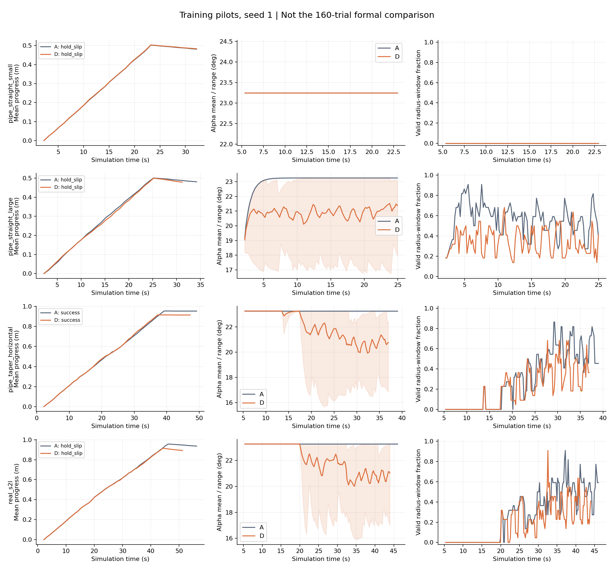
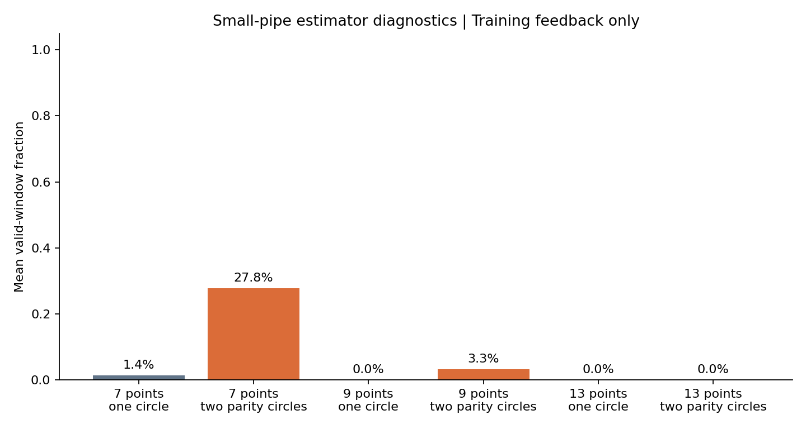
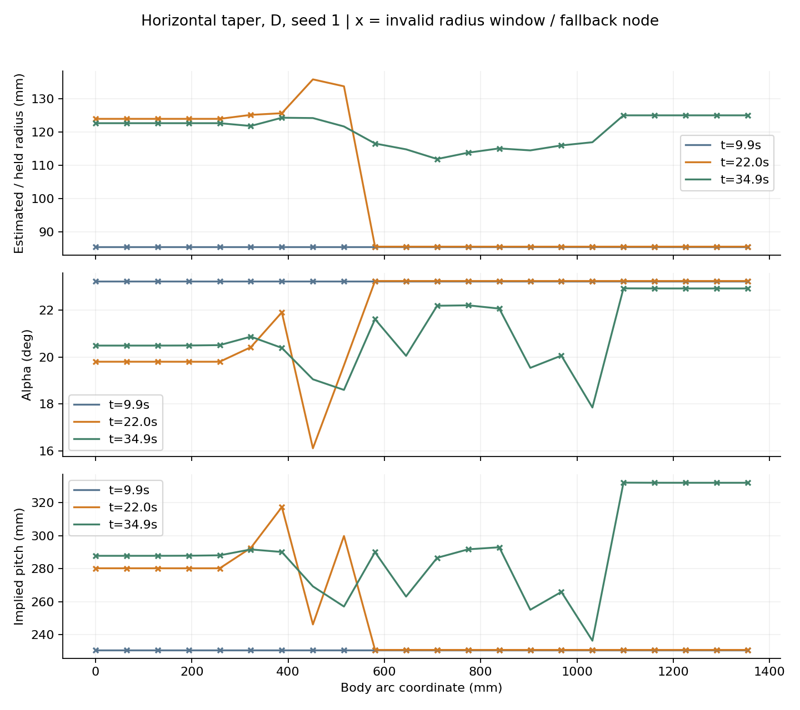

# 局部螺距自适应：阶段验证报告

日期：2026-10-03。执行依据：`docs/局部螺距自适应/局部螺距自适应_实验执行方案.md`。

**结论：阶段0的连续几何检查通过；阶段1的局部半径估计未通过。按方案的停止条件，未冻结正式参数、未执行160次主对照，也未执行阶段3或操作实机。** 这是否定当前估计器的可用性，不能据此否定所有局部螺距自适应方法。

## 已完成的工作与数据范围

- 新增独立几何模块 `snake_control/local_pitch_geometry.py`、实验控制器 `snake_control/local_pitch_controller.py`，保留原控制器和运行入口。
- 新增20关节专用阶段0、隔离EXE仿真试跑和分析入口；模型关节数、1 ms步长、kp=127、±2.355 N·m、K=0.01/0.02均核对。未修改摩擦、模型、实机参数或原初始化关键帧。
- 阶段0扫描5个半径、7种角度/策略、73个滚动相位，共35组、2555个姿态；另检查恒角退化、正反包绕/轴方向、连续弧长、独立三维标架积分及编码器量化级别扰动。
- 28次仿真试跑全部保留：`training/`为实现期间8次探索；`matched_pilots_v1/`为8次链路复核，其中包含取消后未重试的通信失败；`matched_pilots_v2/`为同版代码四场景A/D共8次；`estimator_repeats_v2/`为小直管种子2、3的A/D共4次。
- 本报告采用最后两批**12次训练试跑**。前16次是工程探索记录，控制器或调度版本不同，不混入性能对比。训练种子1–3不是正式测试种子101–110。

全部数据位于 `experiments/pitch_adaptation_20261003/`。同版试跑逐次保存代码、模型、EXE的SHA-256；分析程序会检查代码哈希与记录相同，并验证必需的12个试跑齐全。最早探索批次没有完整的逐次代码哈希，不保证用最终版本逐字复现其轨迹。

## 阶段0：几何检查

半径为85.5、95、110.5、125、140 mm。候选固定角12°、18°、23.2493615°、28°及k=0、0.5、1的半径规则；P限制100–300 mm，α限制8°–30°。

| 检查 | 结果 |
| --- | --- |
| 35组目标在完整滚动相位的限位/非相邻外壳穿透检查 | 均通过 |
| 恒角时，与原解析Yamada积分的最大角差 | 5.15×10⁻¹⁴ rad |
| 可变角连续曲线相对弧长误差 | 2.56×10⁻⁸（约0.00000256%） |
| 独立Bishop积分与目标曲线的点误差 | 9.15×10⁻⁹ mm |
| 独立Bishop积分与控制积分的最大角差 | 3.40×10⁻⁸ rad |
| 忽略α沿弧长变化项造成的最大目标角差 | 0.0522 rad，约2.99° |
| 标准理想螺旋到离散机器人FK的最大RMS误差 | 13.77 mm |
| 分段固定角/可变角示例FK最大RMS误差 | 8.89 / 9.19 mm |

这些是指定扫描域和合成曲线的结果，不是接触稳定性或防脱落验证。R=125/140 mm仅作离线压力参数，没有据此宣称已建接触场景或验证攀爬。非相邻几何距离使用MuJoCo 3.3.0的默认native CCD；距离搜索上界100 mm，超出上界的结果只是距离下界。接口语义核对自[MuJoCo官方API文档](https://mujoco.readthedocs.io/en/3.3.0/APIreference/APIfunctions.html#mj-geomdistance)。

原型采用明确的三维切向场，而不是逐段替换κ/τ：

```text
T(s) = cos(α)t_xy + a sin(α)e_z
b1 = w cos(α) θ′
b2 = w a α′
ω  = a sin(α) θ′
```

a为头到尾沿反馈轴的符号，w为包绕方向。将局部标架按−∫ωds运输，直接积分两个Bishop弯曲分量，得到交替关节目标。b2保留螺距角变化的过渡项；控制与采样来自同一ODE。恒角路径使用原解析积分，另以数值路径独立核对退化，避免仅靠分支调用“自证一致”。

目标延续原方法的分段结构：位置、切向连续，曲率允许有界跳变。`curvature_torsion()`给出段内诊断值，不能将接缝处的Frenet挠率当作普通连续函数；控制采用无此奇异性的Bishop标架。FK误差仍约为毫米至厘米量级，不能忽略，也未以显示曲线代替机器人实际形状。

## 阶段1：同版配对试跑

链路为Python→隔离EXE→无界面MuJoCo。每次复制EXE与测试状态到独立目录、使用独立端口；未连接真实舵机。共同初始化采用场景原生抱管目标，apply后hold 10次，共2.2 s物理时间。四场景种子1的A/D初始qpos逐项差为0。

A平滑接入23.2493615°全身固定角。D使用9点单圆窗口、k=0；α采用空间σ=1点、时间增益0.2及每更新≤1°。所有方法使用同一30°整组目标跳变拒绝和模型限位规则。窗口失效时先保持该节点半径，500 ms后该节点回到固定角。大直管的原生初始化角不同，所以A、D都存在接入过程；正式实验还需固定反馈就绪及接管时刻，不能把本批训练直接当作正式对照。

| 场景，种子1 | A | D | D有效半径窗口比例 |
| --- | --- | --- | --- |
| 小直管 | 保持回退超20 mm | 保持回退超20 mm | 0% |
| 大直管 | 保持回退超20 mm | 保持回退超20 mm | 34.95% |
| 横向小→大变径 | 整身通过、再推进0.20 m、保持10 s通过 | 同一判据通过 | 20.15% |
| 竖直小→大变径 | 保持回退超20 mm | 保持回退超20 mm | 18.76% |

小直管种子2、3的A/D均未通过保持判据；D有效半径窗口仍为0%，全部更新退回固定角。小直管三次D的α全程为23.2493615°，因此不是有效的自适应对照。

保持判据另用未舍入的10 ms物理记录复核：12次同版训练试跑中，10次回退约20.02–22.35 mm，均确实超出20 mm；横向变径A/D最大回退分别约0.873/0.208 mm，保持时间均达到10 s。所有同版试跑无触地，未出现目标跳变拒绝；竖直D重试2次、大直管D重试1次，次数保存在数据中。重试只针对未推进物理时间/相位的取消，不把通信等待计作运动时间，也不将其当作算法失败。

这只是训练诊断。单个配对种子中D略快、略少回退，不足以建立稳健优势。B尚未训练，C尚未进入动态对照；不能声称D优于调优固定角或全身调整。当前反馈有效期及退化超时使用墙钟，因此调度也会影响接管/退化时刻；正式实验须明确时钟与反馈就绪条件后再冻结。虽然共同初始qpos相同，实际顺应性接管时刻仍可能不同。图中的implied P由滤后α和保留的R计算，过渡/退化时可能超过未滤波候选P范围；本轮未证明全流程的P约束，正式冻结前也须处理。



## 阶段1停止原因：局部半径模型与真实反馈不匹配

**已确认的事实：** 理想圆柱点加0.1 mm坐标扰动时，单圆估计最大RMSE约0.096 mm；换成真实交替关节FK点，并加入±半个4096-count位置计数的角扰动后，有的测试窗口全部被拒绝。通过的窗口中，量化扰动导致的估计变化最大RMSE约0.074 mm；这项数值不包含被拒绝窗口，不能当作整体估计精度。4096来自当前协议角度转换代码，扰动不是实测编码器误差标定。

在真实反馈上，9点窗口的小直管D三种子全程无有效结果。对相同的失效反馈分别取k=0、0.5、1，输出目标最大差为0：调k不能恢复未获得的半径反馈。

额外检查7/9/13点以及“共同圆心、奇偶点不同半径”的诊断拟合，保留所有结果。小直管三个种子的平均有效窗口比例：

| 窗口 | 普通单圆 | 两组奇偶半径 |
| --- | --- | --- |
| 7点 | 约1.4% | 约27.8% |
| 9点 | 0% | 约3.3% |
| 13点 | 0% | 0% |

奇偶结构处理有所改善，但未形成已验证的稳定局部反馈，未直接替换主方法或放宽残差阈值来制造通过。空间窗口混合不同管径时还存在偏差/拒绝，不能借用真实边界消除它。

**合理推测：** 离散交替关节的径向偏差、共同轴偏差及受接触约束的形变共同导致圆模型失配。小直管反馈轴相对仿真轴的中位夹角约2.3°–2.6°；尚未通过逐项消融确定各因素贡献。不能把全部失效归因于编码器噪声，也不能把局部圆弧曲率当作管径。





## H1–H4的证据边界

- **H1：未确认。** 本批失败发生于静态保持回退，未观察到触地。回退并不等同于已证实的接触打滑，目前未拆分其具体运动机制。大直管及竖直变径的全身总几何圈数在记录中仍大于1，不能归因为“全身不足一圈”。几何圈数也不等于有效支撑。另保存各管径区域的身体长度分配、有向包绕量和接触模块；接触模块长度仅是代理，不称为已验证的可靠支撑长度。
- **H2：未检验。** 没有调优并冻结B，不能宣称动态调整优于固定角调参。
- **H3：未检验。** 没有完成冻结参数后的C/D对照，横向一组A/D都通过不能证明局部化贡献。
- **H4：当前实现未通过。** 必需小管场景中的半径反馈全程不可用，D退化为A。该反例限制的是当前窗口、置信判据和估计模型，不是所有可能的反馈方法。

因此停在阶段1，不启动160次、D-truth/D0泛化或实机。尚不能确认仿真摩擦与包胶实机一致；保持回退也提示正式实验前应校准静态保持行为和判据。模型力矩积分是负担代理，未换算为整机电流或真实能耗。

下一步应在固定反馈回放上修正局部半径估计，分别处理离散模型与轴误差，并验证窗口退化/跨径延迟；同时规定共同反馈就绪条件。通过后再用种子1–3选B与C/D共用参数，冻结后运行101–110配对主对照。不要仅放宽置信门槛或增加k搜索。

## 复现与交付

在仓库根目录使用MuJoCo 3.3.0环境。本机已存在的隔离环境为：

```powershell
$pitchPython = "$env:TEMP\snake-mujoco330\Scripts\python.exe"
& $pitchPython -X utf8 validation/pitch_adaptation_stage0.py
& $pitchPython -X utf8 validation/pitch_adaptation_experiment.py --workers 2 --out experiments/pitch_adaptation_20261003/matched_pilots_v2
& $pitchPython -X utf8 validation/pitch_adaptation_experiment.py --scenes pipe_straight_small --seeds 2 3 --workers 2 --out experiments/pitch_adaptation_20261003/estimator_repeats_v2
& $pitchPython -X utf8 validation/pitch_adaptation_analyze.py
```

试跑入口会跳过已存在的result；要重新执行请指定新的独立输出目录，保留原始结果。EXE使用仓库已有构建，未重新构建或改变发布包。`--main`明确拒绝启动正式实验，本轮没有参数冻结文件。

关键交付：`stage0/summary.json`、`release_gate.json`、`controller_checks.json`、`training_summary.csv`、估计诊断及三张图。每次试跑保存trace、10 ms力矩/触地/进度记录、控制更新、局部α/P/R、窗口诊断、目标曲线及反馈快照，可回放。机制JSON记录有向包绕和身体分区，长度分区相加应为1354.5 mm，避免重复分配整机长度。所有探索和失败保留；EXE工作副本及UI本地状态不入库。
