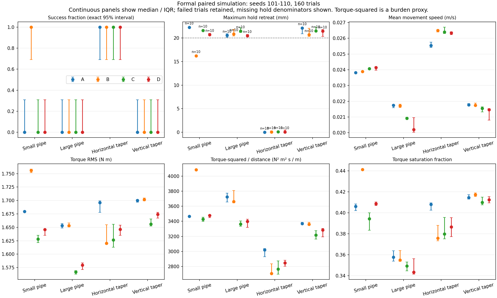
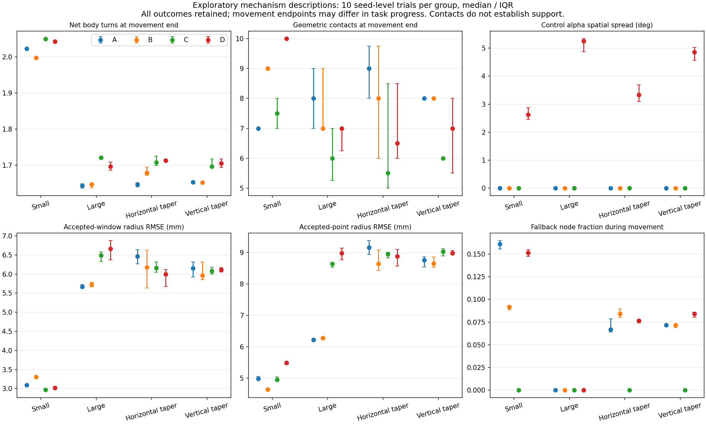

# 局部螺距自适应：正式仿真验证报告

2026-10-04。依据《局部螺距自适应_实验执行方案》，完成阶段0检查、阶段1有限训练和阶段2的160项正式对照。结论是：**在本批模型、扰动和任务判据下，局部螺距D没有显示优于调优固定角B及全身调整C的效果。** 功能已经实际运行，不能据此宣称防脱落创新得到验证，也不能据此否定所有可能的螺距反馈控制律。

正式工作目录：`D:/Desktop/SNAKE/Paper Code/Mujoco/Snake_Robot_Gait_pitch_v5_formal`；分支：`experiment/pitch-v5-formal-20261004`。共享主目录其他任务的force/实机代码没有被覆盖。正式执行代码与训练冻结证据提交为 `3f4464caa49484e4298e43c3e2d3fc614f91e469`，本报告和正式原始数据随后在同一分支交付。

## 1. 本次验证的控制行为

所有A/B/C/D都以 `codes/Adaptive_Pole_Climbing_Mujoco.py` 的原截面顺应性为基础，使用同一截面规则及K（两端0.01、中间0.02）。本次不是关闭顺应性后只测试螺距。原控制代码已有半径相关估计；原截面曲率半径、新增窗口包绕半径、实际身体到管轴距离和管道表面半径并非同一个量。

| 方法 | 正式参数与作用 |
| --- | --- |
| A | 跨场景固定α=23.2493615° |
| B | 独立训练选择固定α：小管28°、大管23.2493615°、横向18°、竖直23.2493615° |
| C | 根据全身半径反馈统一调整α |
| D | 根据局部窗口半径反馈分段调整α |

C/D共用k=1、空间窗口/滤波/限速与回退规则。P=220×(85.5/R)^k，P约束100–300 mm、α约束8–30°、每0.2 s最多变化1°。主控制使用机器人反馈，仿真真轴/管径只用于离线评分。首次运动前用原生目标稳定2.2 s，随后共同的2 s运动接管，未清零滚动相位。

**运动阶段每步更新截面顺应性及相应螺距策略；保持阶段沿用原入口的`hold`，固定最后的关节目标并冻结滚动相位，不重新调用顺应性或螺距反馈。** 这是A/B/C/D共同的执行协议，非“保持阶段持续自适应夹紧”的试验。未来若要验证持续反馈保持，需另建统一协议的新批次，不能改写本批结果。

模型为20关节、21×64.5 mm连杆，kp=127、力矩±2.355 N·m、物理步长1 ms；共同初始化、模型、K和摩擦扰动保持配对。训练使用种子1–3，共7种参数配置、120条记录（116新增及4条同源复用）；正式只使用未训练的101–110。种子扰动为摩擦U(0.8,1.2)及绕管轴初始转角，不代表十种独立环境。

参数冻结SHA-256：`430a98aadff3497a376dd3bdfb4705e3ec6abc6ec7beae9e83d7f95c44171aa0`。正式计划SHA-256：`c4bca7dc9e8925c628bde54fc7d1d153722973f341dbb534186b1b7a95ad6824`。Python 3.9.21 / NumPy 1.23.5 / SciPy 1.13.1 / MuJoCo 3.3.0 / EXE v1.4.3。

## 2. 原始数据及实现审计

`repair_v5/formal_analysis/formal_audit.json` 核验160/160条、40/40组配对，完整统计及160条机制回放已生成。全部首次运动步使用顺应性目标，控制调用捕获共24,194次，拒绝0、工程错误0、触地0。184次反馈/中继取消后重试均保留，不推进物理时间或滚动相位；没有把取消算作成功控制步。横向A/种子103有4次关节目标限幅记录，未删除该记录，其最终任务通过。

最大原始采样间隔0.010000000000012221 s；最大α单步差1.000000000001223°，差异属于浮点量级。D的最大局部α空间差11.1893°，A/B/C目标α空间差为0，说明D确实分段调整，并非固定角退化。保存每10 ms qpos、目标、执行力矩、时间和触地状态，以及每次控制输入、R/α/P、置信度、曲线和限幅前后重放。

157/160条初态与各自配对参照逐位相同，另3条在正式前冻结的数值容差内：最大关节差1.17638e-5 rad、根位置差6.24505e-7 m、根旋转差7.70809e-6 rad、初始目标历史差2.22045e-16 rad。该容差是在发现训练中微小可重复差异后、正式启动前确定；不能称为训练前预注册，也不影响20 mm物理成功阈值。

评分从保存qpos重新执行正运动学，不依赖舍入日志或滞后位置缓存；最大缓存进度差0.5913 mm。机制回放按区域分配21条实际连杆，各帧总长1.3545 m，最大分配误差3.33e-15 m；净包绕先累加有符号角增量，再取净圈数，反向弯折会抵消。反馈与轨迹匹配缺失0。离线几何接触数与原始接触数最大差2个，保留差值；接触数不是接触力或稳定支撑。

阶段0的旧估计器门槛失败、v3/v4探索失败、v5试跑、训练、复跑诊断和原生默认角参考均保留，未用正式结果重新选参。阶段0连续曲线及恒角退化检查通过，但离散FK最大误差13.77 mm，不能据此声称实体几何精确。邻接凸包最小距离-22.343 mm，零姿态即有重叠，模型启用父子碰撞过滤；结果只适用于现有理想关节仿真，不证明实物铰链/外壳间隙。

## 3. 正式主结果

直管任务为均值推进≥0.50 m；变径为全部关节越过终点后再均值推进≥0.20 m；均须保持10 s、最大均值回退≤20 mm且不依靠地面。运动预算120 s，保持另计。本批160条都进入目标后的保持阶段，50条通过、110条因保持回退超标停止；没有支撑完全丢失、触地或工程故障记录。

| 场景 | A | B | C | D |
| --- | --- | --- | --- | --- |
| 小直管 | 0/10 | **10/10** | 0/10 | 0/10 |
| 大直管 | 0/10 | 0/10 | 0/10 | 0/10 |
| 横向小→大变径 | 10/10 | 10/10 | 10/10 | 10/10 |
| 竖直小→大变径 | 0/10 | 0/10 | 0/10 | 0/10 |

精确二项95%区间：0/10为[0, 0.3085]，10/10为[0.6915, 1]。不能将0/10或10/10推断为所有条件下概率0或1。主比较族预声明为四场景D/B及两变径D/C共六项；小直管D/B配对0胜10负、Holm校正p=0.01171875，方向为D较差。其余五项10对均为成功状态相同、p=1；没有正向主成功证据，这也不是证明方法完全等效。

下表为每组10个种子“记录停止前最大保持回退”的中位数，单位mm：

| 场景 | A | B | C | D |
| --- | --- | --- | --- | --- |
| 小直管 | 22.271 | 16.230 | 21.631 | 20.719 |
| 大直管 | 20.574 | 20.869 | 21.479 | 20.506 |
| 横向变径 | 0.00009 | 0.065 | 0.109 | 0.053 |
| 竖直变径 | 22.144 | 20.704 | 21.534 | 21.456 |

失败条目越过20 mm即停，实际保持5–10 s，成功条目完整保持10 s。因此失败组的数值受阈值与停止时间截断，不能用“更接近20 mm”直接判断更稳，也不能把这些回退都解释成实际脱落。



## 4. 连续指标及天花板场景审查

连续比较以种子为单位，20,000次配对中位差bootstrap仅作描述，未按帧扩增样本量。完整差值、有效配对数、缺失及双方成功子集见 `formal_statistics.json`。不能由主检验没有正结果就跳过连续量审查。

横向变径全部通过，D减去B的平均运动速度配对中位差为-0.000116 m/s，描述95%区间[-0.000234, +0.0000635]；最大保持回退差-0.00285 mm，区间[-0.127, +0.321]。D减去C的对应差为-0.000131 m/s、区间[-0.000290, +0.0000839]，及-0.0275 mm、区间[-0.113, +0.290]。没有一致的速度/保持优势。

横向D相对B运动时间短2 s（配对中位差，区间[-2,-1]），但推进距离也短0.0506 m，速度并未提高；任务终点由各自整身越界后的0.20 m推进决定，不能将用时差单独称为更快攀爬。D相对C用时差中位数0 s。

横向D相对C单位路程∫Στ²dt配对中位差+40.57 N²·m²·s/m，描述区间[+1.40,+110.14]，方向为负担更高；相对B为+77.11，区间[-1.63,+131.43]。本批积分、力矩RMS/饱和含初始化、运动和实际保持时段，失败提前停会影响跨结果比较。它们是模型负担代理，不能称为实机电能、电流或温升。

竖直变径D/B速度差-0.000357 m/s，区间[-0.000880,-0.000250]；保持回退差区间跨0。虽然D对B有较低负担的描述性记录，两者均未通过保持，且D未体现相对C的稳健推进/保持增益。大直管D也较B慢；不能只挑负担下降作为支撑改善证据。

## 5. 机制证据与半径估计边界

机制汇总开发于查看部分正式记录之后，明确为探索性补充，未改变冻结主统计。每条轨迹先形成一个种子级描述量，再报告10条的中位数/IQR。终态取保持开始；跨径过程另外保存两个管径区域同时被身体占据时的每轨迹时间中位数。名义P由记录的R/α换算，有限值不保证反馈新鲜，也不是实体测量螺距。

| 场景 | D运动终点净包绕中位数（圈） | B / C | D局部α空间差中位数 | D窗口/单点半径RMSE中位数（mm） |
| --- | --- | --- | --- | --- |
| 小直管 | 2.0425 | 1.9973 / 2.0490 | 2.626° | 3.021 / 5.488 |
| 大直管 | 1.6969 | 1.6479 / 1.7215 | 5.250° | 6.661 / 8.979 |
| 横向变径 | 1.7134 | 1.6795 / 1.7082 | 3.327° | 6.001 / 8.885 |
| 竖直变径 | 1.7060 | 1.6528 / 1.6965 | 4.853° | 6.110 / 8.982 |

D确实形成局部α差异及不同包绕分布，但圈数增加不充分决定保持成功。小管B的净圈数较D少而全部通过，D几何接触中位数10、B为9却保持失败，说明“更多圈/更多几何接触就一定更稳”的解释与本批结果不符；这些是描述性反例，不是接触力因果实验。

横向跨径时，D/C的上游净圈数中位数分别1.199/1.239，下游0.661/0.601；竖直分别上游1.103/1.126、下游0.682/0.675。局部策略的分配发生变化，但没有相应的主成功或一致连续性能增益。跨径持续时间、身体位置和区域长度不同，不能视作等状态的受控因果比较。

半径误差参照为同一窗口/中点到真实轴的身体距离，并非管径误差；RMSE在每轨迹内按接受的模块拟合调用计算，含重复物理时间，再将轨迹作为统计单位。新增窗口误差不能归咎于原截面估计器，也不能从此推断“只修估计器就会有效”。本批没有D-truth实验，估计误差与控制律各自的贡献尚未隔离。



## 6. H1–H4及阶段3决定

| 假设 | 本批结论 | 证据边界 |
| --- | --- | --- |
| H1：原方法存在包绕不足导致支撑丢失 | **未确认** | 无完全支撑丢失/触地记录；保持回退与圈数不能建立“包绕不足→脱落”因果链 |
| H2：反馈螺距优于更好的固定角 | **未获支持** | D不优于B，小管显著较差；其他场景没有一致主结果和连续优势 |
| H3：跨不同管径时局部优于全身调整 | **未获支持** | 横向D/C均10/10且速度/回退无一致优势，D负担更高；竖直均失败 |
| H4：只用机器人反馈仍保留上述收益 | **本候选未展示收益；原因未隔离** | 主D仅用机器人反馈，但没有收益；没有D-truth结果，不能断言真值策略会有效或估计器是唯一原因 |

**阶段3门槛不成立，因此本次不执行收益之后才要求的40项D0/D-truth、30项反向变径及26关节/厚度/过渡长度泛化。** 决定不是只看Holm成功检验：已审查全部通过的横向场景、连续速度/回退/负担、空间包绕/接触及新增估计误差，均不足以形成D同时优于B和C的收益证据。决定及输入SHA保存于 `formal_analysis/stage3_review.json`。

阶段0的R=125/140 mm只是预先离线扫描，未建接触压力场景。本批并非所有场景所有方法均10/10，已有固定角成功和保持失败对照；横向天花板的连续指标也未显露局部增益。因此没有为寻找正结果临时扩大管径/摩擦搜索。压力场景可以成为下一项明确假设的新研究，但不补写为本批已验证场景。

本计划的条件仿真验证到此结束，结论为限定条件下的负面结果。下一步若继续研发，应先明确是否研究持续反馈静态保持、估计器/实体约束，或另一个螺距控制目标，并建立新的训练与冻结批次。本次不自动操作实机。

## 7. 交付及复现

数据路径均相对于 `experiments/pitch_adaptation_20261003/`：

- 阶段0几何：`stage0/`；旧探索和失败仍在各原始目录。
- 修复、有限训练、冻结、原生角参考及诊断：`repair_v3/` 至 `repair_v5/`。
- 正式160项原始记录：`repair_v5/formal/`（私有EXE工作副本app不入库）。
- 完整审计及主统计：`repair_v5/formal_analysis/formal_audit.json`、`audited_formal.csv`、`formal_statistics.json`、`formal_summary.png`。
- 160项机制：`formal_analysis/mechanisms/*/mechanism.json`、`.npz`、`.png`；种子级表为 `mechanism_by_seed.csv`，探索汇总为 `mechanism_comparison.json`。
- 条件阶段3审查及交付清单：`stage3_review.json`、`delivery_manifest.json`；全部新增正式原始文件和分析有SHA-256。

代表轨迹按同一配对种子105选取，非挑选最有利样本：

| 片段 | 可回放原始qpos | 对应机制图 |
| --- | --- | --- |
| 小管B通过 | `formal/pipe_straight_small__B__s105__k0__a28.0000/trace.npz` | [图](../experiments/pitch_adaptation_20261003/repair_v5/formal_analysis/mechanisms/pipe_straight_small__B__s105__k0__a28.0000/mechanism.png) |
| 小管D保持失败 | `formal/pipe_straight_small__D__s105__k1__a23.2494/trace.npz` | [图](../experiments/pitch_adaptation_20261003/repair_v5/formal_analysis/mechanisms/pipe_straight_small__D__s105__k1__a23.2494/mechanism.png) |
| 横向B通过 | `formal/pipe_taper_horizontal__B__s105__k0__a18.0000/trace.npz` | [图](../experiments/pitch_adaptation_20261003/repair_v5/formal_analysis/mechanisms/pipe_taper_horizontal__B__s105__k0__a18.0000/mechanism.png) |
| 横向D通过 | `formal/pipe_taper_horizontal__D__s105__k1__a23.2494/trace.npz` | [图](../experiments/pitch_adaptation_20261003/repair_v5/formal_analysis/mechanisms/pipe_taper_horizontal__D__s105__k1__a23.2494/mechanism.png) |

在独立工作目录已有MuJoCo 3.3.0环境下：

```powershell
$pitchPython = "$env:TEMP\snake-mujoco330\Scripts\python.exe"
# 冻结校验/计划预览，不启动新仿真。
& $pitchPython -X utf8 validation/pitch_adaptation_formal_v5.py
# 对已保存数据重新审计并生成统计/机制；会重写派生分析文件。
& $pitchPython -X utf8 validation/pitch_adaptation_formal_audit_v5.py
& $pitchPython -X utf8 validation/pitch_adaptation_mechanism_summary.py
# 对交付时的文件做SHA核验，不启动仿真。
& $pitchPython -X utf8 validation/pitch_adaptation_delivery_v5.py --verify
```

派生压缩文件重新生成可能改变字节SHA。若重新分析，需另存新审查/清单版本，保留交付清单，不将新的派生文件字节冒充原始交付版本。重新物理实验应使用新的输出批次，保留本批失败；当前原始EXE不在Git中，执行新的物理试验前须按冻结SHA准备同版程序。
