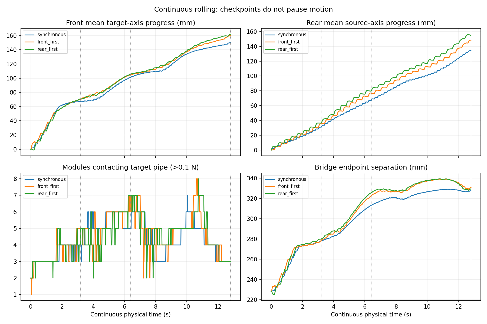
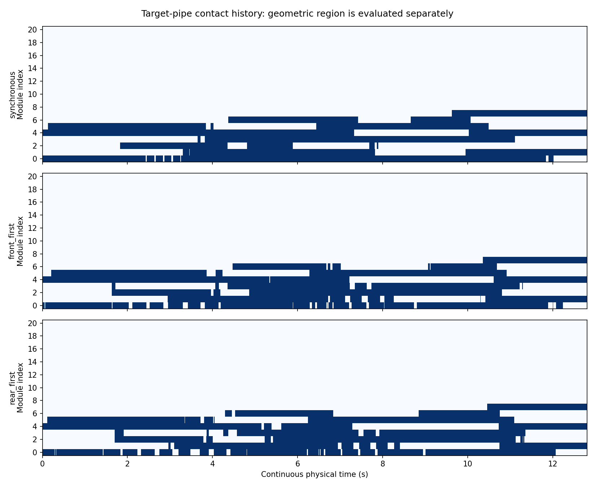

# 搭管后持续 rolling 对照验证

日期：2026-10-04。

## 本轮回答的问题

**先前停下保持失败，并不意味着持续 rolling 必然失败。** 用户提出继续前进可能缓解带转问题，本轮从同一水平 T 管搭管存档继续运行，比较同步、前部先行、后部先行三组。三组均完成32循环，前后段继续推进、未触地，且目标管接触位置开始向更靠后的模块转移。但尚未完成完整跨越，也没有证明带转已经消失。

此前[交替 rolling 对照](搭管后交替rolling_对照验证.md)的3秒停止保持失败结论保留。本轮改变的是研究问题，不是把原门槛改成通过；连接段力矩的详细归因留作后续诊断。

## 条件与实现

- 输入：`experiments/segmented_pole_20261004/inputs/horizontal/`，用户捕获的水平 step92，20关节，R=81.5 mm、P=220 mm、重力开启；MuJoCo 3.2.7。
- 沿用保形接管的三维 Bishop 弯曲场与 Yamada 积分、局部增量顺应，K、模型、摩擦、力矩限制不变。该顺应原型**不是2023论文完整 A–D 曲线重构**，分段轴使用已知管道方向，未验证在线轴识别。
- 分界固定为6节，过渡宽度6节。本轮没有边界迁移；同步/交替只改变两端相位的推进顺序。
- 每循环两子步，每子步0.2秒。同步两端每子步各−0.075 rad；交替活动端−0.15 rad，另一端相位暂停、顺应仍更新；循环末两端相位重新一致。
- 三组各32循环、64条经隔离可视化 EXE 实际转发的控制命令，累计12.8秒、两端各−4.8 rad。第8/16/32循环记录状态，中途和末尾均不插入保持。
- 预设停止条件：触地，或全身所有管道接触力均不超过0.1 N持续0.2秒；每子步检查。三组均未触发。

`validation/alternating_pole_experiment.py`增加`--continuous`分支；旧停止保持模式及其16循环门槛保留。新增`validation/continuous_pole_review.py`计算过程指标、接触时空图和对照图。日常仿真及实机入口未改。

## 结果

前部为模块0–5的中心平均位置，沿目标管轴计位移；后部为模块10–20，沿原管轴计位移。编号是21个质量模块的零起始索引，不是舵机ID。位移均相对同一初态。

| 条件 | 8循环前部推进/mm | 16循环前部推进/mm | 32循环前部推进/mm | 32循环后部推进/mm | 32循环头部推进/mm |
| --- | ---: | ---: | ---: | ---: | ---: |
| 同步 | 66.98 | 101.02 | 149.90 | 134.16 | 145.28 |
| 前部先行 | 69.86 | 104.39 | 159.96 | 148.50 | 144.02 |
| 后部先行 | 70.43 | 105.57 | 161.77 | 154.82 | 152.39 |

三组在8→16和16→32循环的前后部净推进均为正。全部100 Hz记录中，前6模块始终至少一个与目标管接触，原管也始终有接触，均未触地。这里的“接触存在”不等于静态承载能力充分。

### 接触是否向后转移

将连续三个控制终点均位于目标管区域、且过去0.6秒内该模块至少有一次目标管接触力大于0.1 N，作为“进入目标区域并发生接触”的记录条件。它不是连续承载或稳定包绕的验收条件。区域判定采用仿真真值几何，仅用于评分。

三组均得到：

- 第8循环：模块6已进入目标管区域，但最近窗口尚未满足上述接触条件。
- 第16循环：模块6满足进入区域及接触条件。
- 第32循环：模块7满足该条件；模块6仍在目标区域，但最近窗口没有目标管接触。
- 第32循环瞬时目标管接触均为模块1、4、7；几何上模块0–7处于目标管区域。仍有大量身体留在原管。

所以可以说**更靠后的身体开始参与目标管接触**，不能说“新增两个模块同时形成稳定支撑”，也不能用区域模块数代替接触模块数。

### 仍然存在的限制

1. 同步也能持续推进。交替两组末尾前部平均多推进约10–12 mm，但前先组头部位移略小于同步；单个初态不足以证明交替普遍优于同步。
2. 三个区间的前部接触滑速中位数：同步约5.27/7.62/6.27 mm/s，前先9.27/10.48/7.79，后先9.68/11.15/7.80。推进伴有滑动，不能宣称纯滚动或带转消失。
3. 执行器饱和占关节×采样约60%–64%（按绝对力矩达到上限99%计）；最大跟踪误差约40.18°/44.47°/44.46°，三组分别累计11/18/22次关节目标限幅。不能据此推断实机低负载稳定运行。
4. 模块3与9中心间距由228.0 mm增至约327.6/331.0/329.5 mm，连接区构型明显展开。这是端点间距，不是连杆被拉长，也不能单凭它判定即将失稳。
5. 尚未做竖直场景复核、完整身体转移或持续运动后的稳定停止。原停止保持问题仍存在。

## 必要核对与原始记录

三组各1281帧、64条实际应用命令；核对控制目标与执行ctrl、0.01秒记录间隔、累计相位、固定分界及无保持阶段。三组前8循环qpos与旧对应实验逐帧差值均为0，说明本轮确实延续同一运动过程。没有进行SHA校验或重复全面测试。

数据目录：[continuous_v1](../experiments/segmented_pole_20261004/continuous_v1/)，包含运行前计划、各组轨迹/控制/源码快照、三个循环节点状态、接触与自转记录、分析JSON及回放。





- [同步回放](../experiments/segmented_pole_20261004/continuous_v1/synchronous_c32/replay.mp4)
- [前部先行回放](../experiments/segmented_pole_20261004/continuous_v1/front_first_c32/replay.mp4)
- [后部先行回放](../experiments/segmented_pole_20261004/continuous_v1/rear_first_c32/replay.mp4)

复现时在仓库根目录运行，输出到新目录以保留本次结果：

```powershell
python validation/alternating_pole_experiment.py --continuous --cycles 32 --prepare --output-root validation/results/continuous-repeat
python validation/alternating_pole_experiment.py --continuous --cycles 32 --mode synchronous --output-root validation/results/continuous-repeat
python validation/alternating_pole_experiment.py --continuous --cycles 32 --mode front_first --output-root validation/results/continuous-repeat
python validation/alternating_pole_experiment.py --continuous --cycles 32 --mode rear_first --output-root validation/results/continuous-repeat
python validation/continuous_pole_review.py --output-root validation/results/continuous-repeat
```

分析入口使用归档的旧8循环轨迹作前缀对照，并依赖本机既有的可视化执行端和MuJoCo环境。

## 下一步建议

建议进入**随身体转移的边界迁移验证**，同时保留完全相同条件的固定边界对照。依据已经进入目标管的身体位置平滑移动分界，保证目标形状和相位连续，继续检查剩余身体转移、原管支撑退出及最终停止保持。不要先把交替设为必需，也不要预设固定边界必然失败。

当前证据足以支持开展该验证，但不保证迁移后就能完整跨越。若再次出现前部停滞、连接区持续展开或接触丢失，再对该时间段做力矩与支撑诊断，比先给所有运动状态做详尽归因更有针对性。本轮尚未实现迁移改动。
