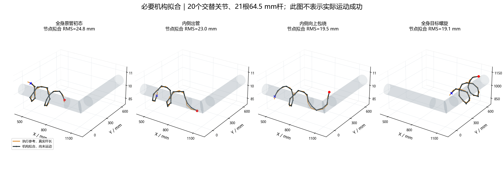
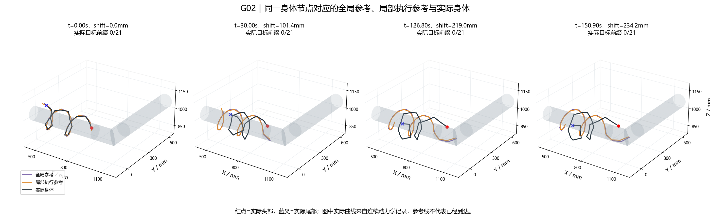
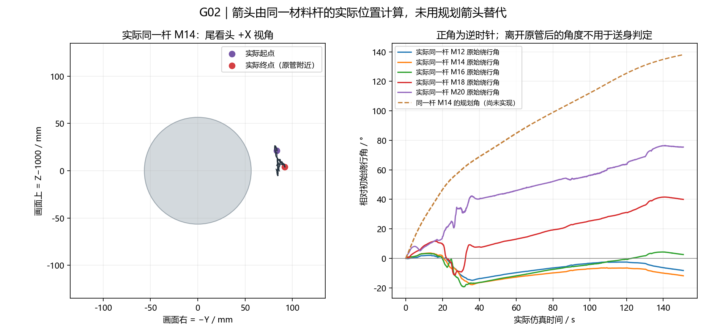
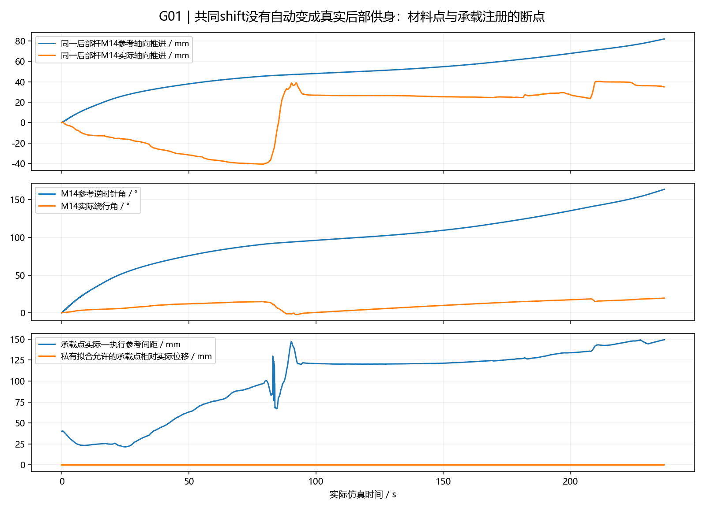
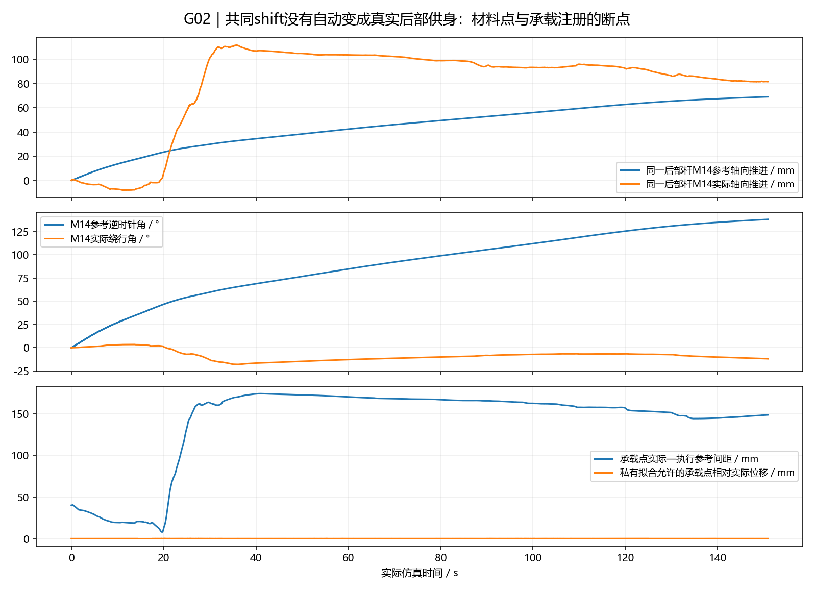

# 已确认全局曲线的实际验证：两候选均未完成搭管跨越

**未实现完整跨越。** 本轮按暂时认可的完整路线接入真实机构并连续运行了 G01、G02；两次均未接触目标管，没有内侧下部入管、向上包绕或整身接续。两个候选额度已用完；没有成功，因此没有运行 C01 反馈关闭对照。反勾备选未启动。

## 已完成的实现与必要拟合

全局曲线直接加载 `KNOWN90_ROUTE_CONFIRM_20261011/draw_global_route.py` 中已确认的 Route：原管螺旋、298.126 mm 内侧下部过渡弧、延伸目标螺旋。每次只有共同头部曲线坐标 shift；从头向尾逐段求解 64.5 mm 的前序弦，始终是 21 杆、总长 1354.5 mm。没有前十杆整圈退绕、压短前部再插值或提前收成目标小螺旋。

为使人工选好的初态实际贴管，只在执行曲线中将原管节点半径固定减小 1.5 mm；在线不改变原管承载区半径。通过连续位置与切线的小量入口修正接回原目标入口，未修改已确认全局曲线。初态实际 14 个杆身与原管接触，目标管接触为 0，后部接触满足初始化条件。

| 必要机构拟合姿态 | 节点 RMS / mm | 最大关节角 / ° | 最大管道穿透 / mm |
|---|---:|---:|---:|
| 全身原管初态 | 24.78 | 71.07 | 0.707 |
| 逐段出管 | 23.05 | 71.20 | 0.687 |
| 内侧上绕 | 19.52 | 71.07 | 0.603 |
| 全身目标螺旋 | 19.05 | 71.50 | 0.615 |

拟合的终态满足本轮单一目标螺旋几何判据，说明存在可近似该终态的关节配置；**不证明从初态可由接触与关节驱动连续到达它**。必要拟合没有执行物理步数，没有另开静止保持或自动找位试验。

实际初始头部为 (858.637, 84.995, 973.231) mm，全局出管点 Q 为 (860.000, 80.540, 953.500) mm，已有 20.27 mm 的头部偏差。这个偏差是机构近似拟合的结果，不应把初始参考点等同于真实头部位置。

## 实际连续结果

| 指标 | G01 | G02 |
|---|---:|---:|
| 实际仿真时间 / s | 236.9 | 150.9 |
| 停止原因 | 30 s 无新合格实际进展 | 30 s 无新合格实际进展 |
| 全过程真实目标管接触 | 0 | 0 |
| 最大实际目标前缀 / 杆 | 0 | 0 |
| 实际包绕角 / rad | 0 | 0 |
| 内侧下部入口 / 向上包绕 | 均未观察到 | 均未观察到 |
| 全过程头部到固定入口的最小距离 / mm | 95.00 | 122.88 |
| 末态实际—全局节点 RMS / mm | 178.61 | 179.44 |
| 末态实际—局部节点 RMS / mm | 168.03 | 170.78 |
| 最大关节跟随误差 / ° | 6.19 | 5.96 |
| 最大实际关节角 / ° | 88.17 | 88.18 |
| 最大实际驱动力矩 / N·m | 2.355 | 2.355 |
| 最大管道穿透 / mm | 1.360 | 1.274 |
| 最大非相邻身体穿透 / mm | 0 | 0.198 |
| 触地 | 否 | 否 |
| 最后仍接触原管的杆数 | 10 | 10 |

停止判定按登记的实际几何进展阈值执行：固定曲线上的头部进展或固定入口接近达到 3 mm、新实际包绕增加 0.10 rad、持续新目标承载前缀。参考 shift 增长、局部系数改变、关节抖动和接触数量本身均不重置计时；参考误差本身也不判停。

G01 最后一次合格实际接近发生在 206.9 s，G02 在 120.9 s，均继续完整运行 30 s 后结束。这不表示身体完全静止：G01 后续最小入口距离比计时器保留的最优值仅改善约 2.21 mm，G02 改善约 1.23 mm，均未达到下一次 3 mm 更新阈值，也没有新的出管、包绕或身体接续。

两次都保留原有重力、摩擦、质量、1 ms 仿真步长、关节与力矩限制。没有运行时根位姿搬动。执行参考和实际身体的杆长误差均小于 10⁻⁶ mm。法向接触力只作为诊断记录，不用其合计值宣称竖直支撑或搭管成功。

[G01实际连续1倍速视频](G01/actual_continuous_1x.mp4)（236.9 s） · [G02实际连续1倍速视频](G02/actual_continuous_1x.mp4)（150.9 s）。视频分别为 20 fps、4739/3019 帧，包含同次运行保存的实际 qpos；首、中、末帧均读回成功。红色为头部，绿色为尾部；紫色入口箭头和“CCW requested”仅说明计划方向。

## 第一个卡点与 G02 改进

第一个实际卡点是**前端没有沿下部过渡弧从原管释放**。G01 前端沿原管侧面向接头缓慢靠近，身体仍大部分保持原管缠绕；执行参考已向下、向目标入口推进，但实际前端没有跟上。关节跟随误差仅数度，整体空间拟合误差却持续增大，所以不能归因为简单的伺服关节跟不上。

确认了 G01 的反馈分区错误：参考过渡区同时要求实际已经不属于原管，导致“参考应出管、实际仍贴原管”的前部不参加调整。在约 225 s 之前局部系数为 0，230 s 才出现明显调整。其末段已达到 12 mm 系数边界，仍未搭管。

G02 保留相同初态、全局路线、名义速度和物理条件，针对这一出管卡点做一次改进：按参考身体对应选取过渡区，允许尚贴原管的前部参与有界局部调形；后部承载区不一起变径。同时把私有 FK 承载框架按共同曲线增量作位置与方向输运，尝试减轻 G01“固定承载位置/方向却推进全身参考”的协调冲突。详细改法与首步必要拟合记录见 [G02_CHANGE.md](G02_CHANGE.md)。

这些修改没有带来实际搭管。G02 约 14.45 s 开始出现超过 0.1 mm 的局部系数，远早于 G01；但头部仍留在原管一侧，后部也没有一致实现计划逆时针送身。

## 反馈作用与实际方向：已确认事实和解释的边界

局部调形使用同一身体段的实际位姿与执行参考偏差，结合关节跟随和实际驱动负载；仅在过渡区施加两端位置与斜率均为零的有界曲线形变，再重新按真实杆长走曲线。目标半径须有实际几何包绕后才允许调整，两次均未触发。原管半径在线保持固定。推进速度随跟随与头部偏差降低，滚动相位只随同一个推进增量变化，没有停止 shift 后独自 rolling。

这里明确用了**MuJoCo 的实际位姿观测**，不是声称实机可只靠编码器得到这些世界坐标；实际接触身份与法向力留给结果评估。私有 IK 中的预测碰撞用于拟合惩罚，实际动力学只接收关节目标。

G01 有 190/4738 个控制步出现超过 0.1 mm 的局部系数；G02 为 2729/3018。二者最大系数都是 12 mm。曲线变形在图和数据中确实发生，但不能据此宣称反馈改善了跨越。

末态局部参考与实际身体的 RMS 比全局参考小约 10.58 mm（G01）/8.66 mm（G02）。局部参考本身向实际偏差作了有界让步，因此这个数值减少不等于实际身体更接近全局目标。G02 的入口最小距离反而更远，且两次均未接触目标。没有成功后关闭局部形变的对照，**无法分离或量化反馈的独立因果贡献**，也不能把 G01/G02 当成单变量反馈对照。

方向追踪固定同一个材料对象。本轮杆 M14 是第 15 根杆（P14→P15）的中心；P0 是头部节点，P21 是尾部节点。尾看头的 +X 视角中，右为 −Y、上为 +Z，正角为逆时针。

| 同一后部杆 M14 中心的绕行变化 | G01 | G02 |
|---|---:|---:|
| 共同参考要求的角度 / ° | +163.65 | +138.08 |
| 同一杆实际原管附近角度 / ° | +19.47 | −11.83 |

G01 有少量实际逆时针绕行，但远未执行参考要求的材料推进。G02 的该杆实际为顺时针，后部接触采样逆时针角中位数为 −3.22°、正向杆比例仅 44.4%；不满足实际逆时针送身要求。部分尾杆有正角，不能用它们代替整个后部的协调运动。对同一杆的实际位置、原始角及规划角分别绘图，未用规划箭头冒充实测方向。

## 当前结论与下一处需要解决的问题

已确认的事实是：关键配置可做约 19–25 mm 的机构近似拟合，关节目标也能以小跟随误差执行；但当前共同参考到真实材料滚动/送身的转换失败，前部没有沿下部弧出管，未到达检验目标包绕的阶段。全局曲线在数据中保持原样，没有用实际下垂替代目标。

合理解释是：自由根的关键帧拟合和增量承载框架拟合不足以保证有摩擦接触时的真实材料运动；G02 的框架输运加局部让步甚至改变了实际后部绕行方向。尚未证明这条已确认路线的动作意图本身不可行，也没有验证反勾备选。

下一处应先解决承载约束下的出管与材料相位对应，要求同一后部材料点实际按 +X、逆时针供身，同时前部实际到达 Q→E 下部弧；不能只以自由根关键帧 RMS 或关节跟随为可行性依据。按最新任务保留现有曲线与起点，不进行起点重画。记录初始拟合偏差不等于将失败归因于起点；后部材料相位与承载注册的断点见下文。以上是后续方向，本轮没有额外开启第三候选或改换反勾动作。

## 为什么后部没有随 shift 依次供到前面

**后部不是完全没动，也不是没有收到关节目标；它没有按完整参考要求的轴向与绕行相位组合，逐段变成前方过渡段。** 共同 shift 在当前代码中只是曲线取样参数，不能自行产生真实供身。

| 同一后部杆 M14 中心 | G01 | G02 |
|---|---:|---:|
| 末态共同 shift / mm | 278.17 | 234.20 |
| 参考所需轴向 +X 推进 / mm | 81.83 | 69.04 |
| 实际轴向 +X 推进 / mm | 35.02 | 81.59 |
| 参考所需逆时针绕行 / ° | +163.65 | +138.08 |
| 实际绕行 / ° | +19.47 | −11.83 |
| 执行参考中进入过渡的杆数 | 4 | 3 |
| 实际头端连续脱离原管邻近带的杆数 | 1 | 0 |
| 实际头端连续没有原管接触的杆数 | 2 | 0 |

G01 的轴向推进和绕行都不足；G02 虽然有明显轴向移动，绕行相位却方向相反。轴向移动一些整身/线圈，不等同于材料沿这条螺旋依次绕行、解缠和进入前方弧段。原管接触仍有 10 杆，实际目标前缀仍为 0。

原管邻近带用杆中心距原管轴 74–118 mm 且 X<1035 mm 作诊断；接触前缀另按实际原管接触记录。两者不等价，也不单独证明已解缠形成下部过渡，更不表示搭管成功。这里用它们说明：参考中已经释放到过渡的 3–4 杆，没有对应地变成实际伸出的连续前部。

明确的代码断点位于承载注册。G01 在 4723/4738 个控制步选择杆 M18 为承载框架，私有拟合把它的身体原点 P19 固定在**当前实际 P19**；只额外给极小滚动相位增量。全局/执行参考 P19 随 shift 在螺旋上前行，末态距离实际 P19 已达 **149.13 mm**。但私有拟合预测 P19 与实际 P19 的最大距离只有浮点误差约 10⁻¹² mm。

这是由 `ActualBearingMapper.solve` 的注册方式直接决定的：对每个候选关节角重新构造 `translation = origin - rotation @ raw_origin`，使预测承载原点恒等于固定的 origin。该点相对参考的位置误差对全部关节变量的导数为 **0**；因此把累计送身偏差加进节点误差，并不会由这个误差生成推动承载点前进的关节目标。优化器只能调整该点以外的形状，不能在这个注册模型里修正它的累计供身偏差。

G02 仍然以当前实际承载框架逐步重新注册，只允许它在单步内作共同曲线增量与有界修正。在 3018 个控制步中均采用 M18；允许的私有承载点相对实际单步位移最大 **0.303 mm**，末步 **0.163 mm**，而末态参考距离仍为 **148.50 mm**。它没有把累计材料推进状态落实为实际供身。注册后的承载点对关节变量仍不变化，只是固定 origin 被小量移动。

滚动位相也有同类断点：`ApprovedRouteTransfer` 累计 `self.phase`，但拟合只收到当步 `phase_inc`；旋转目标每步以当前实际承载姿态为基准乘这个小增量，累计的 `self.phase` 仅进入记录，未作为必须补偿的材料滚转位相误差。未实现的增量没有在该目标中累计追回。局部绕杆滚转相位与绕管轨道角是不同的量，不能直接相减；这里指出的是代码中累计滚转状态与拟合目标脱节，而实际绕管角另外用固定材料杆位置核对。

后部关节实际收到了大幅变化的命令：关节 13–20 各自的目标角全程跨度，G01 约 56–176°、G02 约 89–176°；末态这些关节相对目标的误差，G01 最大约 2.33°、G02 约 1.48°。因此“后部没有下发动作”不符合记录。问题是这些目标在当前承载注册下调整了后部形状，未生成一致的材料相位前进；末态 G01 关节 18/19/20、G02 关节 17/18 的目标还达到 ±88°边界，进一步限制可用形状，但不能仅凭限幅将它认定为唯一原因。

上述承载原点冻结/小量输运、零位置雅可比、材料点的轴向与绕行失配是可核对的实现与轨迹事实。它们解释了“参考 shift 增大，但伸出段没有按预期增加”的直接断点。尚未从两次数据单独隔离出各接触摩擦与负载的贡献，也不据此宣称起点或仿真模型是根因。后续应修正真实机构的材料相位推进与前后供身关系；仅让桥段参考更靠近实际身体，无法替代后部的这一运动机制。

详细数值来自各候选 `feed_breakpoint_audit.json`，仅分析已保存轨迹，新增物理步数为 0。当前报告响应的是后部供身问题；已撤销的起点重画任务没有执行。

## 交付与保留材料

步态入口：[snake_control/approved_route_transfer.py](../../../snake_control/approved_route_transfer.py)，运行入口：[validation/approved_route_experiment.py](../../../validation/approved_route_experiment.py)，只读复核：[validation/approved_route_audit.py](../../../validation/approved_route_audit.py)。代码执行流程见 [README.md](README.md)。

每个候选保留 `plan.json`、`result.json`、`observed_audit.json`、`sources/` 原版代码、`curve_snapshots.csv`、全局/局部/实际曲线图、反馈图、实际方向图，以及本地原始 `trace.npz`、`commands.json`、初末状态和完整视频。`ledger.json` 登记 2 个实际候选、0 个对照。≥2 MB 文件只保留本地。
