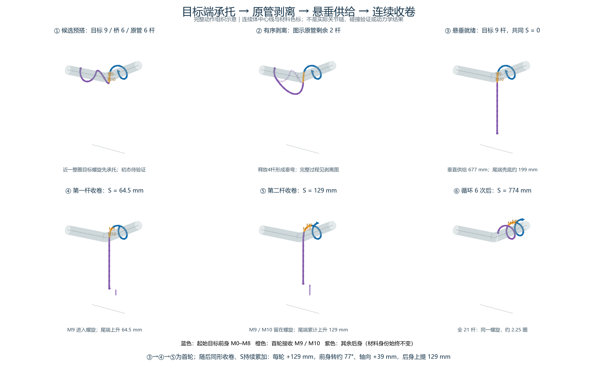
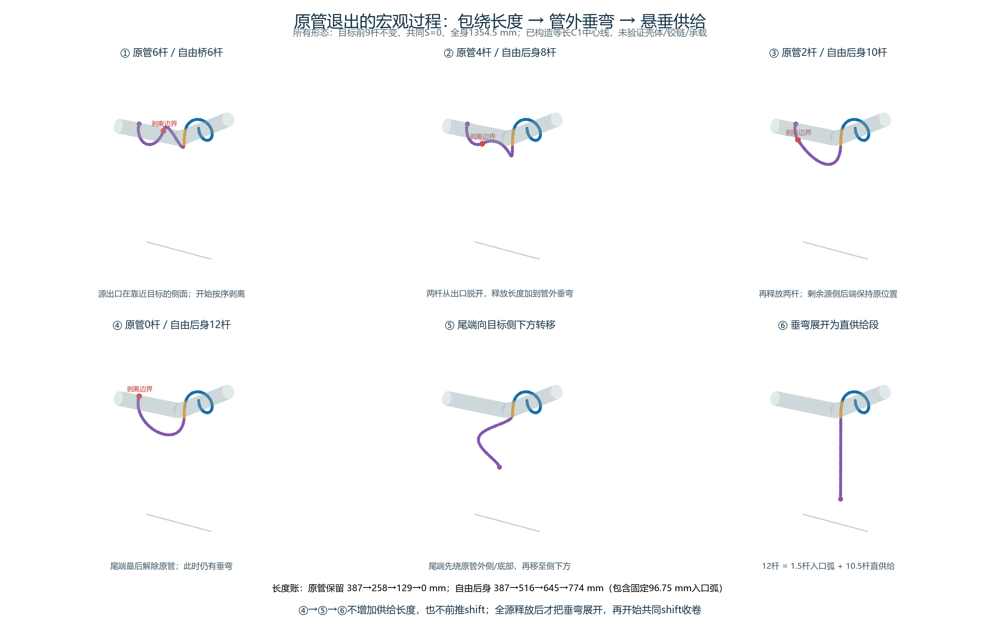
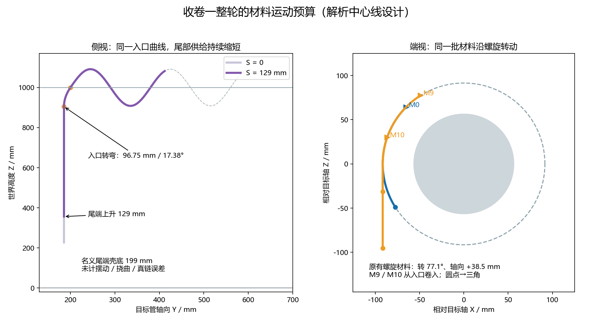

# 目标承托、原管剥离、悬垂供给与连续收卷：宏观步态设计

2026-10-09。**本次交付是设计，不是已完成的搭管动作。没有修改动作源码，没有新开动力学，没有施加根位姿。** CLOSE1B保留为已知对照，候选初态按最新授权重新安排。

选这条路线：先以目标管上近一整圈前身承担支撑，按序解除原管包绕，后身受控转为目标管侧下方的悬垂供给，再用一个共同shift连续收卷。与此前构思的“双口张开、定长桥送两杆”相比，它直接撤掉双管桥接约束；代价是目标端必须实际承担和提升后身。**这是值得优先验证的判断，不是可行性结论。**

## 初态和整段动作

候选初态分配：目标9杆、过渡桥6杆、原管6杆，总长1354.5 mm。两侧名义中心线半径91.5 mm、螺距180 mm；目标9杆的连续体包绕约347°，杆中心之间约308°。目标入口放在世界坐标 `(1008.5, 200, 1000) mm`，避开拐角最拥挤位置。源侧出口选在朝向目标的侧面 `(880, 91.5, 1000) mm`；源与目标采用相反手性。桥接包含290.25 mm自由弯段和96.75 mm固定入口弧，总长387 mm。**尚未求出真实20铰链的可摆放初态和完整壳体间隙**，不能把这张图当成已搭好；预搭M0–M8也不计为运行中新卷入成果。

| 段落 | 身体具体动作 | 曲线与共同窗口 | 实际通过条件 |
|---|---|---|---|
| 预搭承托 | 前9杆绕目标，后6杆绕原管，中间6杆跨接 | 捕获这一个初态与材料标架；S=0 | 目标端具备分布承载，前身包绕稳定；不以单次接触代替 |
| 一次性剥离 | 从原管出口向尾端逐段脱开；未释放的后段继续绕原管。释放长度逐渐加入管外垂弯 | 相位q由0→1，改变整条过渡/源侧曲线；S保持0，目标螺旋段保持原位。S不动但身体在主动变形 | 目标前身持续承载、尾部不坠地；尾端最后解除源侧包绕 |
| 垂弯展开 | 尾端先径向离开原管、绕到底部，再转到目标侧下方；自由垂弯逐渐展开 | 另一形态相位r由0→1；自由后身固定774 mm，S仍为0 | 实际尾端与原管脱开、全后身无原管承托；不以参考保留长度0冒充实际脱开 |
| 悬垂就绪 | 原管包绕归零；12杆后身成为短入口转弯和近垂直供给段 | 同一曲线接成“竖直段→入口弧→目标螺旋” | 实际脱开原管、供给段离地、入口外壳无干涉 |
| 首半轮 | 前身沿目标螺旋前转；后身向上送一杆，M9卷入 | 同一个S：0→64.5 mm | M9实际进入固定入口后的目标区域，有持续包绕与承载 |
| 后半轮 | 接着卷入M10，先前M9留在目标螺旋；后身再上提一杆 | S：64.5→129 mm | M9/M10留住，原前身没有退回拐角或解卷 |
| 同形续卷 | 每次再收两杆，供给段持续缩短 | S持续累加，不重置材料标架；约6轮至S=774 mm | 最终21杆全部在同一目标螺旋，原管接触清零 |

## 已补构造的剥离与展开中间形态

以目标入口为材料弧长v=0，前身范围0至580.5 mm，后身范围−774至0。剥离q从0到1时，源侧脱开边界是 `b(q)=−387(1+q) mm`：边界之后的原管后段保持原来的空间位置，边界之前的自由段与固定入口弧连接。目标前9杆和入口弧的空间位置始终不变。

| 剥离q | 原管保留 | 新释放原管长度 | 自由后身（包含入口弧） | 自由连接弯段 |
|---:|---:|---:|---:|---:|
| 0 | 6杆，387 mm | 0 | 6杆，387 mm | 290.25 mm |
| 1/3 | 4杆，258 mm | 2杆，129 mm | 8杆，516 mm | 419.25 mm |
| 2/3 | 2杆，129 mm | 4杆，258 mm | 10杆，645 mm | 548.25 mm |
| 1 | 0杆 | 6杆，387 mm | 12杆，774 mm | 677.25 mm |

这些中间中心线已经构造：从边界的源螺旋位置及切向出发，用Hermite弯段接到入口弧起点，端切向匹配竖直上行；只求一个几何长度参数，让弯段弧长等于表中数值，再按弧长取样。没有计算或调整关节角。原管失去多少包绕长度，自由垂弯就得到多少长度；目标端还未收进新材料，S也未前进。

q=1时只表示参考中源螺旋保留长度归零，自由垂弯仍在，尾端尚靠近原管，不能直接替换成悬垂。随后r从0到1：尾端从原位置先径向外移至距源轴130 mm，再沿管外绕到底部 `(800,0,870) mm`，然后移向侧下方 `(910,150,480) mm`，最后到名义悬垂尾端 `(1008.5,185.4,227.5) mm`。后期用宽侧弯吸收剩余弧长，再逐渐把侧弯幅度减至0；始终保持自由连接段677.25 mm和入口弧96.75 mm。**不能把旧尾端直接斜线拉到侧下方，那会穿过源管。** r=0的形态与q=1相接，r=1才与收卷入口曲线相接，没有换初态或挪根位姿。

已经完成的是连续体等弧长曲线族、6个中间形态、阶段位置连续性，以及两根直管轴的粗略采样包络检查。42个形态各取1801点，中心线到源/目标直轴的最小距离均约91.5 mm；两个阶段连接位置误差为浮点量级。**这些检查未包含弯头网格、实际杆弦、完整外壳、自碰、材料标架到20铰链的重构和载荷。C1曲线还须平滑曲率；因此已有具体几何构造，尚无已验证可执行的物理剥离轨迹。** 承托条件、局部反馈和驱动执行仍是设计要求，尚未实现为新动作控制器。

悬垂形成后不再重新包绕原管，也不再形成弯桥储长。所有杆的名义位置取自 `C(h0+S−(j+0.5)L)`；实施时全部20个关节须由同一曲线、同一连续材料标架产生，剥离时材料规范从不变的目标前段向后连续运输。滚动来自材料沿螺旋移动，不另给前后两套shift，不拼接固定关节角补丁。q/r都是整条曲线的形态相位，不是另两套送身量。保留原关节限幅、10°/s限速和2.355 Nm驱动限制；时间安排须服从全曲线目标变化量，不能用加速实现示意图。

## 解析长度与受力预算

取 `R=91.5 mm，p=180 mm`，轴向弧长比例 `α=p/√((2πR)²+p²)=0.29879`，周向比例 `β=√(1−α²)=0.95432`。目标螺旋从入口向前为：

`C(u)=(1100+R cos(π−βu/R), 200+αu, 1000+R sin(π−βu/R))`，单位mm，u≥0。

入口先沿竖直方向上行，经96.75 mm、17.38°的YZ平面弧，转到螺旋切向。弧起点约 `(1008.5, 185.5, 904.7) mm`。剩余12杆共774 mm，扣去入口弧，初始直供给段677.25 mm；名义尾端壳底约198.5 mm。**这只排除了名义曲线“必然触地”的长度矛盾，未计摆动、真实关节链偏差和曲率平滑改动。** 直线—圆弧—螺旋目前为C1连接，实际实施前还需平滑曲率并重新核算长度和间隙。

每轮材料移送129 mm：原有螺旋材料转77.09°、沿目标轴前进38.54 mm；悬垂尾端上提129 mm。新进入的M9/M10先经过入口，不能套用原有螺旋材料的全轮转角。末态21杆的名义螺旋约2.248圈、轴向跨度404.7 mm，覆盖Y≈200–604.7 mm。积分曲率上界约73.57°小于88°，**但这不是交替铰链FK、壳体碰撞或实际关节角已合格的证据**。

已从原模型只读确认：21杆各0.136 kg，总重约28.02 N，12杆供给约1.632 kg、16.01 N；重力9.81 m/s²、管半径56.5 mm、电机上限2.355 Nm。悬垂重力提供拉紧，同时阻碍向上收卷，不能说“重力会自动送身”。`16.01 N×0.0915 m≈1.465 Nm`仅为载荷尺度，不等于任何关节力矩，也不能用它小于2.355 Nm证明可提升。需要分布接触法向力、摩擦和每个关节的实际力矩共同承担；近一圈也可能打滑、滚脱或局部饱和。

## 与现有方法的实质区别

| 已有分支 | 已有动作机制 | 本设计真正改变的部分 |
|---|---|---|
| N01–03 | 双管曲线前卷、后送共同推进 | 先撤掉原管包绕与双管桥接，再从侧下方收卷 |
| N04–06 | 目标局部相位与入口收拢，源侧继续供给 | 全后身承托方式改变；不是把局部卷入幅度做大 |
| N07–08 | 源侧前部螺旋舒展/直化，保留后端包绕 | 必须把原管包绕全部解除并建立明确悬垂供给；只展开不算完成 |
| N09–10 | 接收廊道与柔顺成员变化 | 主变化是路线和支撑拓扑，柔顺反馈只是修正 |
| N11–15 | 固定空间曲线+共窗；目标轴/半径/姿态反馈 | 保留这套表达，但增加一次性剥离和后身向上收卷的完整动作组织 |
| N16–19 | 180 mm目标延伸、原壳反馈或真实铰链拟合 | 180 mm螺距不是新意；不再把同一CLOSE双管桥接交给拟合器修补 |
| U88–91 | 接收形态→后送撑拱储长→前拉释放；U88/U89确实进入过前拉段 | 不存拱长、不用 `dS+dL桥=0` 分配供给；取消源管约束后，同一个S直接缩短悬垂段 |

更早的 `traveling_compliant_winding.py` 已有按条件解除后部控制与交接。因此不能声称首次提出“前承托、后释放”。本候选具体区别是固定侧下方供给路线、可计算的提升/卷入关系和整身最终单螺旋；新动作仍组合了已有的曲线变形与shift原语。

`Square_Crossing.py` 值得保留的是“源螺旋—圆弧—直线—圆弧—目标螺旋”的整条拼接、连续ψ与交替关节积分。共同shift确实把弯曲图案传遍身体；另外 `s5` 从0增加会打开第二弧和目标螺旋的曲率，rolling也能在shift不变时改变弯曲面。**并非只要shift增长就自动完成目标卷绕。** 已读材料没有与原Square代码绑定的完整跨越轨迹；其配套XML为零重力、±13 Nm，也不能直接当成当前重力和±2.355 Nm的成功证据。本设计借鉴它把宏观形态和材料移动明确分开，再组合成整段动作。

## 反馈边界与下一次验证判据

全局路线和入口不追随实际退回拐角；局部接触/跟随反馈只在同一曲线上修正半径、入口形态和推进速率，界限在实施时预设。剥离过程中若目标承托下降，应恢复最近一个仍有源管支撑的曲线相位，不能继续释放到自由坠落；这仍属于同一全局曲线阶段，不改最终目标。收卷段若持续丢失承托或新杆进不来，停在已有供给阶段记录失败，不靠长时间冻结后的包绕保持续报进展。

第一项要证实的是“原管逐段脱开后，目标9杆能承住12杆后身，悬垂段不触地”；第二项才是一个完整129 mm收卷循环。“通过”必须看到M9/M10实际卷入并留住、已有前身沿目标螺旋推进、后身实际上提，且源管不再供给支撑。参考位移、整身滑动和短促接触均不算。只有同一版本连续完成全21杆单螺旋，才报整身跨管成功。若第一项失败，承托/剥离机制本身应重设计；若第二项失败，应依据打滑、饱和或入口几何证据改收卷机制，不能退回连续调权重。

## 本地依据与交付

- [当前模型几何与质量](<D:/Desktop/SNAKE/Paper Code/Mujoco/Snake_Robot_Gait/mujoco_model/Snake_Robot_o20_Pipe_elbow90_horizontal.xml:16>)、[当前驱动上限](<D:/Desktop/SNAKE/Paper Code/Mujoco/Snake_Robot_Gait/mujoco_model/Snake_Robot_o20_Pipe_elbow90_horizontal.xml:111>)。重力与质量另经MjModel编译只读核对，没有创建MjData或推进动力学。
- [Square拼接与shift](<D:/Desktop/SNAKE/Paper Code/Mujoco/Snake_Robot_Gait/codes/Square_Crossing.py:663>)、[目标曲率开关](<D:/Desktop/SNAKE/Paper Code/Mujoco/Snake_Robot_Gait/codes/Square_Crossing.py:411>)、[ψ](<D:/Desktop/SNAKE/Paper Code/Mujoco/Snake_Robot_Gait/codes/Square_Crossing.py:376>)、[零重力](<D:/Desktop/SNAKE/Paper Code/Mujoco/Snake_Robot_Gait/mujoco_model/Snake_Robot_o40_Square_Crossing.xml:8>)、[13 Nm](<D:/Desktop/SNAKE/Paper Code/Mujoco/Snake_Robot_Gait/mujoco_model/Snake_Robot_o40_Square_Crossing.xml:313>)。未import这些会启动线程/查看器的旧脚本。
- [U88储长与前拉](<D:/Desktop/SNAKE/Paper Code/Mujoco/Snake_Robot_Gait/snake_control/coordinated_curve_transfer.py:251>)、[更早的后部释放](<D:/Desktop/SNAKE/Paper Code/Mujoco/Snake_Robot_Gait/snake_control/traveling_compliant_winding.py:70>)、[夜间最终证据](<D:/Desktop/SNAKE/Paper Code/Mujoco/Snake_Robot_Gait/experiments/unified_curve_transfer_20261007/EXECUTABLE_CHAIN_20261009.md:1>)。
- 同目录交付：`cycle_overview.png/.svg`、`stroke_geometry.png`、`release_sequence.png/.svg`、`design_budget.json`、`release_budget.json`、`release_geometry_checks.json`、`draw_design.py`、`release_geometry.py`。图已目视核对；绘图程序只有解析几何、必要图形检查和原模型事实读取，不包含任何动作控制或动力学测试。
