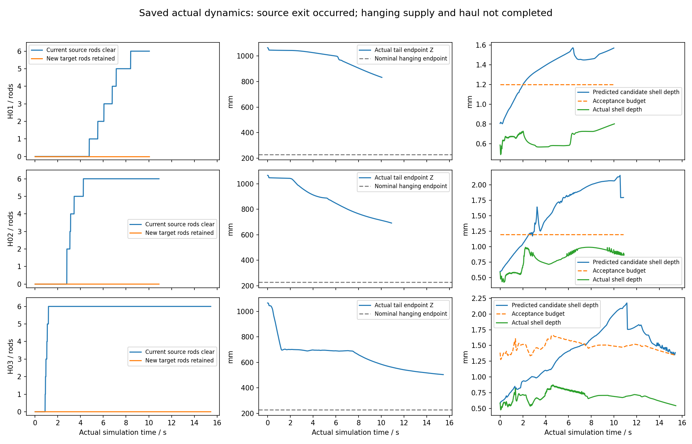

# 悬垂供给宏观动作：3次实际尝试，源侧退出，未进入收卷

2026-10-09，北京时间08:28:46开始本轮实施，3次动力学尝试已用完。**没有完成整身跨管；共同shift三次均为0，没有新杆持续卷入目标螺旋。** 本分支已停止。三次都是从同一个人工摆放的新双管真实20关节初态独立开始，保留原重力、摩擦、kp和±2.355 Nm驱动；运行中只写20个关节ctrl，没有根位姿重置，没有静止保持任务。

## 已经落实的动作和实际结果

动作代码包括：目标前段承托、源侧按支撑情况释放、自由垂弯接管、展开到悬垂、共同shift整身收卷。所有关节来自同一曲线的真实FK重构。首次准备采用26变量人工初态拟合；运行中的20变量候选直接限制在上一ctrl±0.5°并检查这一组角，预测固定到实际承载杆及其接触滚动，不自由累积虚拟根位移。这个完整程序只实际执行到了退出/部分展开，**不能说后面的收卷已经试过**。

人工初态名义分配为目标9杆、桥6杆、源6杆。实际FK初态前部包绕5.153 rad，最大关节88°，原壳预测侵入0.586 mm，无非相邻自穿透，参考节点拟合RMS29.03 mm。PREPARE_1/2未通过，不进入动力学；PREPARE_3通过后用于三次起跑。初态只是本轮允许的预搭，M0–M8预搭不计新卷入成果。

| 实际版本 | 实际时长 | 当前6杆全部离源时刻¹ | 展开相位末值 | 新持续卷入 | 结果 |
|---|---:|---:|---:|---:|---|
| H01 | 10.05 s | 8.41 s | 未进入 | 0杆 | 预测原壳门槛连续拒收8 s |
| H02 | 10.90 s | 4.25 s | 0 | 0杆 | 全离源后原起算曲线不接住实际垂弯，仍拒收 |
| H03 | 15.45 s | 1.18 s | 0.11045 | 0杆 | 接住垂弯后推进过展开，7.45 s起再次连续拒收 |

¹当前离源审核条件：M15–M20各自实际中心距源轴>130 mm，且与原管任何几何体无接触，持续0.5 s；每帧重新判断，不累计过去脱开代替当前状态。末态三次都没有任何身体与原管接触。已直接用保存qpos和原模型前向几何复核，没有补跑动力学。**这证明退出发生，不能证明严格按设计的6→4→2→0节奏受控释放**；源侧实际脱开明显快于原50 s计划，早期真实下垂贡献很大。

三次每次启动前均保存plan.json：名义完整轨迹414.6 s（剥离50、展开55、收卷309.6 s），最多600 s实际时间、900 s执行墙钟，并登记8 s连续候选失效、75 s源退出/展开无进展、30 s收卷无进展和阶段目标完成但无对应实际动作的终止条件。短时间结束是所登记拒收终止触发，不是完整轨迹机会已经执行完。

H03的修改实质：已离源前缀纳入当前连续自由垂弯，只保留仍承载源尾段；全离源后捕获自由段单位切向，以12杆固定长度逐步变形到固定悬垂路线。当前离源状态决定阶段交接，目标前部和最终目标管螺旋不跟随实际退回。接触预测参考实际侵入加0.8 mm，范围1.2–2.5 mm。H03确实比前两次更快完成离源并执行了部分展开，但没有完成悬垂准备和收卷。

## 拒收原因与不能推出的结论

H03第一次拒收发生在7.45 s：预测管壳侵入1.5222265 mm，预算1.5207218 mm，只超出约**0.00150 mm**。随后整组ctrl保留，展开相位停在0.11045，15.45 s按8 s连续拒收停止。149/309条候选实发； accepted候选与实发角完全一致，拒绝候选不是实际关节或实际侵入。

**软接触预算仍被实现成了整体硬拒收线，这个缺陷没有解决。** 即使预算按实际接触调整，微小跨线仍冻结全部动作。因此不能把三次停止说成“退管机制物理不可行”或“电机无法收卷”；收卷阶段尚未进入。H03还有一次性捕获的自由垂弯与后续真实滚动/下垂失配的问题：候选曲线拟合RMS在首次拒收时已达82.77 mm，末约198 mm。它与拒收相关，但未证明是唯一原因。

H03实际前部包绕5.153→4.994 rad，末目标侧承载模块M0/M3/M4，正常向力合计约35 N；尾端高度1065→504 mm，仍在下垂，**不是已向上提升供给**。最大实际角88.220°，实发ctrl≤88°、每50 ms≤0.5°，最大力矩2.355 Nm，实际最大管壳侵入0.873 mm，无触地、无非相邻自穿透。承托在这段实际运动中没有崩溃；不能据15.45 s推断整段提升/收卷可完成。

## 下一种宏观改法：边卷入、边消去自由垂弯

取消“先把12杆全部归成直悬垂，才允许shift”的前置。目标前段已经实际承担脱开后身时，保留当时的自由垂弯作为供给曲线，先用短入口曲线把接头外侧1–2杆引向目标螺旋，随后在同一个shift推进中逐杆收卷，同时缩短自由段。每收两杆，目标占用增加129 mm，自由段长度减少129 mm；先卷入杆留在螺旋，再重复下一轮，最终所有身体进入同一目标螺旋。

具体循环：当前垂弯连接→入口曲率逐渐合卷（S不动、垂弯等长）→共同S推进第一杆→第二杆接续并保留第一杆→垂弯余长随两杆收进而减少。全局目标轴和最终180 mm螺旋保持；自由段可按实际承托连续调形，不能整段重新贴回旧源螺旋，也不能冻结早期垂弯的世界姿态后强制12杆同时归直。

这个改变让目标入卷动作本身承担供给，避免先完成一个大幅展开才能产生第一杆收卷。它组合已有的曲率开合和共同shift，不声称新发明。与U88储长循环的区别是源管已经解除，没有再撑拱的后送储长阶段；使用当前实际自由垂弯，余长随着接收消去。真正实施前还必须把小接触残差作为连续柔顺/推进修正，不再用微小预算跨线冻结整组，明确实体干涉与原关节/驱动限制继续保留。**本次仅交下一改法，没有第四次动力学。**

## 完整交付与可追溯版本

- 动作：[suspended_transfer_route.py](<D:/Desktop/SNAKE/Paper Code/Mujoco/Snake_Robot_Gait/snake_control/suspended_transfer_route.py>)、[suspended_supply_transfer.py](<D:/Desktop/SNAKE/Paper Code/Mujoco/Snake_Robot_Gait/snake_control/suspended_supply_transfer.py>)；运行：[suspended_supply_experiment.py](<D:/Desktop/SNAKE/Paper Code/Mujoco/Snake_Robot_Gait/validation/suspended_supply_experiment.py>)；保存后审核：[review_suspended_supply.py](<D:/Desktop/SNAKE/Paper Code/Mujoco/Snake_Robot_Gait/validation/review_suspended_supply.py>)。
- 每轮H01/H02/H03都有plan.json、initial_geometry.json、initial_pose.npz、trace.npz、commands.json、final_state.npz、controller_state.json、result.json、replay_1x.mp4、video.json、首/中/末帧及sources冻结版本。来源依赖含Bishop辅助和原XML；公共进度文档不在本次修改范围。
- [H01实际1×](H01/replay_1x.mp4)、[H02实际1×](H02/replay_1x.mp4)、[H03实际1×](H03/replay_1x.mp4)。视频分别202/219/310帧、20fps，首中末帧可读；只用保存实际qpos绘制，参考图没有混入实际视频。
- 原H01距离查询打分在远离管体时返回明显矛盾的大负值，原结果/视频面板的“退出4杆”不采用；原文件保留。统一独立复核为末6杆当前离源，见各轮saved_record_review.json及audited_exit_series.npz。H02/H03也采用同一审核口径。不存在借重新运行补足历史。
- comparison.json汇总三轮；原参考图与解析预算留在相邻MACRO_GAIT_DESIGN_20261009目录，不能当实际结果。
